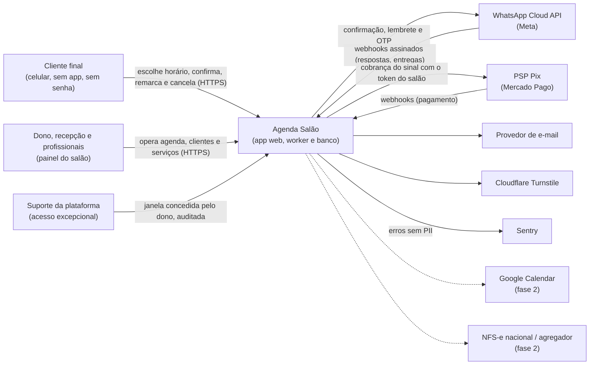
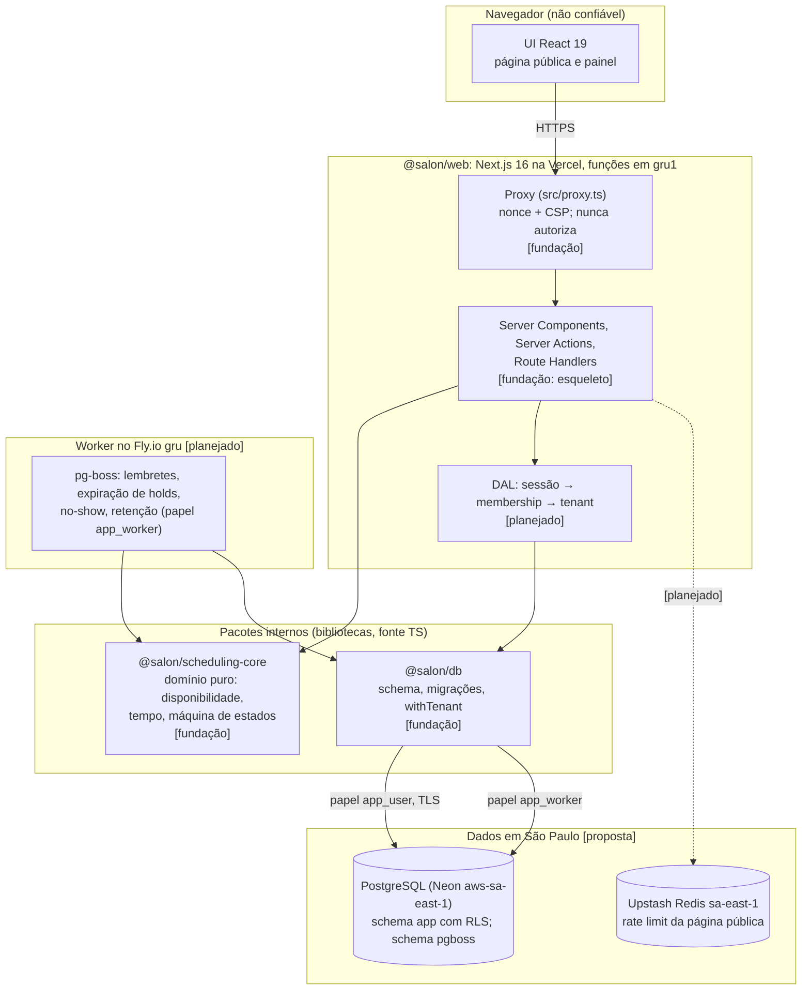
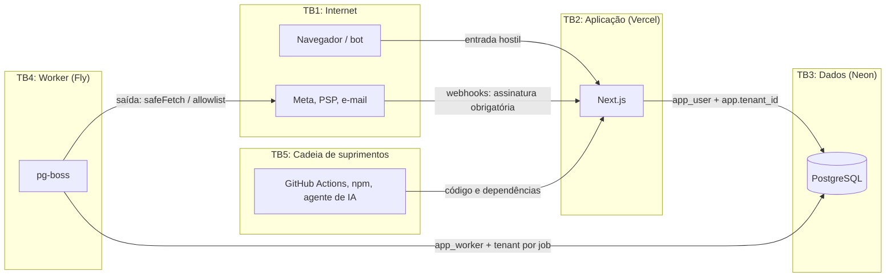
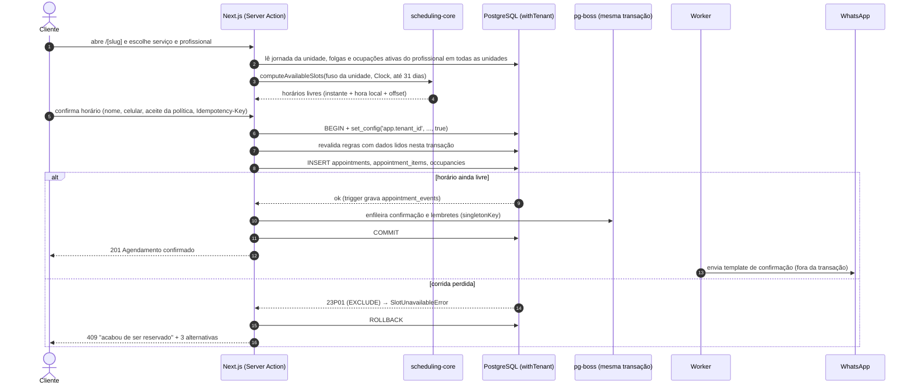
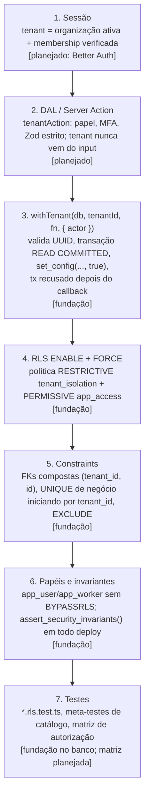

# Arquitetura

Visão de arquitetura do Agenda Salão: o que existe na fundação, o que está planejado e por
quê. As decisões detalhadas estão nos [ADRs](adr/README.md). O que está implementado é
descrito com precisão nos READMEs dos pacotes ([web](../apps/web/README.md),
[scheduling-core](../packages/scheduling-core/README.md), [db](../packages/db/README.md)).

Legenda usada neste documento: **[fundação]** = implementado e testado nesta iteração;
**[planejado]** = decidido, ainda sem código; **[proposta]** = recomendação que depende de
validação (custo, contrato, plano de fornecedor).

## 1. Contexto (C4 nível 1)

- **Tenant = salão.** Um salão tem uma ou mais **unidades**, cada uma com fuso IANA próprio.
- **B2B2C.** O salão é o controlador dos dados dos clientes dele e a plataforma é a operadora
  (ver [LGPD: papéis](lgpd/papeis-e-bases-legais.md)).
- **O dinheiro do sinal vai direto para a conta do salão**, via OAuth do PSP. A plataforma
  não faz custódia (ver [integrações](dominio/integracoes.md#2-pix-sinal-e-pagamento-online)).

## 2. Contêineres (C4 nível 2)

| Contêiner | Tecnologia | Responsabilidade | Status |
|---|---|---|---|
| `@salon/web` | Next.js 16.4 App Router, React 19.3, Tailwind 4 | UI, Server Actions, Route Handlers, Proxy (CSP) | [fundação]: landing, 404, `/api/health`, CSP e cabeçalhos |
| `@salon/scheduling-core` | TypeScript puro + `temporal-polyfill` | `computeAvailableSlots`, intervalos, hora de parede, máquina de estados | [fundação] |
| `@salon/db` | Drizzle ORM 0.45 + `pg` | schema `app`, migrações imutáveis, `withTenant`, tradução de erros do banco | [fundação] |
| Worker | Node 24 + pg-boss 12 | jobs agendados e assíncronos | [planejado] ([ADR-0005](adr/0005-fila-pg-boss.md)) |
| PostgreSQL | 18 em CI, 16 local; Neon em produção | fonte de verdade; RLS; EXCLUDE; fila | [fundação] schema / [proposta] hospedagem |
| Redis | Upstash | rate limit da página pública e do OTP | [planejado] |

**Regras de dependência entre pacotes** (o lint as impõe):

- `@salon/scheduling-core` não importa nada do monorepo, nem `pg`, `drizzle-orm`, `next`,
  `react` ou builtins do Node (`createPureDomainConfig` em [`eslint.base.mjs`](../eslint.base.mjs)).
- `@salon/db` depende do core: o trigger de status do banco espelha a máquina de estados do
  core, e um teste de paridade compara os dois.
- `@salon/web` depende dos dois. Nenhuma regra de negócio mora no app.

## 3. Fronteiras de confiança

| Fronteira | O que atravessa | Controles | Status |
|---|---|---|---|
| TB1 → TB2 (usuário) | requisições de anônimos, clientes e equipe | CSP com nonce, cabeçalhos, Zod estrito, autorização dentro de cada Server Action e Route Handler, rate limit, Turnstile, 404 para recurso de outro tenant | cabeçalhos e CSP [fundação]; o resto [planejado] |
| TB1 → TB2 (webhooks) | notificações de Meta e PSP | assinatura sobre o corpo cru (HMAC ou mTLS), deduplicação por ID do evento, reconsulta ao PSP antes de mudar estado | [planejado] |
| TB2 → TB3 | SQL | papel `app_user` (sem BYPASSRLS, sem ownership), contexto de tenant por transação, RLS `FORCE`, SQL parametrizado, TLS `verify-full` | [fundação] no banco; TLS [planejado] |
| TB4 → TB3 | jobs | papel `app_worker` (SELECT e só UPDATE das colunas `appointments.status` e `occupancies.active`, por GRANT de coluna), `withTenant` por job, payload com `tenantId` validado | [fundação] papel; worker [planejado] |
| TB4 → TB1 (saída) | chamadas a APIs externas | `safeFetch` (só https, sem redirect, bloqueio de IPs não públicos, timeout), segredos por provedor | [planejado] |
| TB5 → TB2 | dependências, actions, código gerado por IA | quarentena de 3 dias, `trustPolicy`, scripts bloqueados, pins por SHA, revisão humana, hooks do agente | [fundação] ([supply chain](seguranca/supply-chain.md)) |

O **Proxy do Next.js não é fronteira de autorização**. Houve vários bypasses de middleware e
proxy em 2025–2026 (por exemplo,
[GHSA-f82v-jwr5-mffw](https://github.com/advisories/GHSA-f82v-jwr5-mffw) e os lotes
corrigidos nas versões 16.2.5 e 16.2.11), e um matcher alterado tira a cobertura de rotas sem
aviso. A autorização acontece dentro de cada Server Action, Route Handler e DAL. O Proxy só
aplica a CSP, com o matcher `/((?!_next/static/).*)` (tudo, exceto os assets com hash dentro
de `/_next/static/`), compilado no teste unitário com as regras do próprio Next
([cabeçalhos e CSP](seguranca/headers-e-csp.md)).

## 4. Fluxo de agendamento

Fluxo-alvo da página pública. A garantia contra dupla reserva é do banco, e o motor só sugere
horários.

O que já existe: o motor (`computeAvailableSlots`), as linhas de ocupação da reserva
(`staffOccupancySegments`: uma por buffer, `kind = 'buffer'`, e uma por fase de trabalho,
`kind = 'service'`), as tabelas, os triggers (inclusive a checagem no COMMIT de que as
ocupações cobrem as fases de trabalho do item), o `EXCLUDE`, o `withTenant` e a tradução de
`23P01` para `SlotUnavailableError`, tudo testado contra PostgreSQL real. O que falta: a Server
Action (que limita a consulta a `[hoje no fuso da unidade, hoje + max_advance_days]` e a no
máximo 31 dias, com rate limit por IP e slug), a resolução pública de `slug → tenant` (função
`SECURITY DEFINER` dedicada, porque `tenants` só é visível ao próprio tenant), a fila e o
envio.

Com sinal via Pix, o agendamento nasce `pending` com `hold_expires_at`, e o horário fica
bloqueado até a expiração. Os detalhes de pagamento tardio e devolução estão em
[dominio/modelo.md](dominio/modelo.md#6-holds-e-sinal-via-pix).

## 5. Multi-tenancy em profundidade

Tabelas compartilhadas com `tenant_id` em todas as linhas, protegidas em camadas.
Nenhuma camada sozinha é suficiente. Decisão em [ADR-0002](adr/0002-isolamento-multi-tenant-rls.md).

1. **Sessão → tenant.** O `tenantId` sai só da sessão autenticada, depois de confirmar que o
   usuário é membro da organização. Nunca sai de body, query, header ou subdomínio.
   [planejado]
2. **DAL e Server Actions.** Um cliente do `next-safe-action` (`tenantAction`, `ownerAction`)
   resolve sessão, papel e MFA antes de qualquer acesso. A regra Semgrep
   [`server-action-auth`](../.semgrep/rules/server-action-auth.yml) aponta action exportada
   sem guarda. Recurso de outro tenant responde **404**, não 403. [planejado]
3. **`withTenant`.** É a única porta para dado de tenant. Abre a transação em READ COMMITTED
   (fixo) e define `app.tenant_id` com escopo local (`set_config(..., true)`), o que é seguro
   com pool e com PgBouncer em modo transação. Também fixa `TimeZone=UTC` e registra o ator da
   auditoria. O `tx` só vale durante o callback: depois dele, só COMMIT e ROLLBACK passam e
   qualquer outra consulta é recusada com `TransactionClosedError`, para que uma consulta
   atrasada (`after()`, `setTimeout`, builder devolvido, `Promise.all` com ramo que falha)
   nunca rode na transação de outra requisição, com o tenant dela. Conexão com transação sem
   desfecho limpo, com consulta ainda em voo ou que emitiu erro é destruída em vez de voltar
   ao pool. Enquanto emprestada, ela tem um ouvinte de `error` (o `pg-pool` tira o dele no
   empréstimo), então uma queda no meio do callback (failover, `pg_terminate_backend`) não
   derruba o processo Node: o erro chega pela consulta seguinte ou pelo COMMIT, e o
   `withTenant` rejeita. [fundação]
4. **RLS.** `ENABLE` + `FORCE` em toda tabela de tenant, inclusive `tenants`. A política
   RESTRICTIVE compara com `NULLIF(current_setting('app.tenant_id', true), '')::uuid`. Sem
   contexto, o resultado são 0 linhas e o INSERT falha (fail-closed). O `NULLIF` evita o erro
   `22P02`: na mesma conexão, depois do fim da transação, o GUC volta como string vazia
   (verificado no PostgreSQL 16.15). [fundação]
5. **Constraints.** Checagens de FK e de unicidade **ignoram a RLS** (documentação do
   PostgreSQL, "Row Security Policies"). Por isso toda FK é composta `(tenant_id, x_id)` e toda
   UNIQUE de negócio (telefone, slug da unidade, `idempotency_key`) começa por `tenant_id`.
   Assim não dá para referenciar linha de outro salão nem descobrir que um telefone existe em
   outro salão. **Exceção:** a PK `id` é global. Um INSERT com o `id` de uma linha de outro
   tenant recebe 23505 mesmo com a RLS escondendo a linha. Isso não vaza nada porque o id nasce
   no servidor e nunca muda (o cliente nunca manda `id` nem `tenant_id`), e o `@salon/db`
   traduz o erro para `IdentifierConflictError`, respondido como 404/409 genérico. [fundação]
6. **Papéis e invariantes.** `app_migrator` (NOLOGIN, NOINHERIT, membro de nenhum papel) é
   dono de tudo. `app_user` e `app_worker` são `NOSUPERUSER NOBYPASSRLS NOINHERIT`, não são
   donos e não têm `TRUNCATE`/`REFERENCES`/`TRIGGER`. Ao fim de toda execução de migração, o
   runner confere o hash de `app_private.assert_security_invariants()` e a chama. Se algo
   regredir em qualquer schema de usuário (tabela sem RLS ou sem a política canônica, papel
   com BYPASSRLS ou com LOGIN no dono, posse, privilégio extra, `SECURITY DEFINER` executável
   ou sem `search_path`, view sem `security_invoker`, trigger crítico ou `EXCLUDE` removido,
   ou trigger crítico recriado com definição diferente da esperada, lida de `pg_trigger`:
   constraint trigger ou não, momento, eventos e colunas do `UPDATE OF`, adiamento até o
   COMMIT, nível, presença de `WHEN`, número de argumentos e função), nada é commitado.
   Recriar a completude do item como `AFTER UPDATE`, por exemplo, reprova o deploy. O portão
   pega erro honesto e drift, não migração maliciosa
   ([ADR-0002](adr/0002-isolamento-multi-tenant-rls.md), decisão 5). [fundação]
7. **Testes.** `pnpm test:db` cobre leitura, escrita, UPDATE que troca `tenant_id`, ausência
   de contexto, FK cruzada, `app_worker`, a regressão do `22P02` e meta-testes de catálogo
   (ver [packages/db/README.md](../packages/db/README.md#testes)). [fundação]

Pontos de atenção:

- **`set_config` é chamável por qualquer sessão.** A RLS confia que só o servidor define o
  contexto. Uma injeção de SQL permitiria trocar de tenant. Mitigações: SQL sempre
  parametrizado (Drizzle) e a regra
  [`sql-raw-interpolation`](../.semgrep/rules/sql-raw-interpolation.yml). A RLS é a segunda
  camada, nunca a única.
- **Caches e jobs.** Nada de `"use cache"` ou cache de dados de tenant sem o tenant na chave
  (houve advisories de cache poisoning entre usuários no Next.js em 2026). Todo job carrega
  `tenantId` e abre `withTenant` próprio.
- **Página pública.** A leitura anônima de disponibilidade passa por uma função dedicada que
  resolve `slug → tenant` e devolve só o necessário (horários, nunca dados de clientes).
  [planejado]

## 6. Tempo e fuso horário

Decisão em [ADR-0003](adr/0003-tempo-e-fusos-temporal.md). Regras completas em
[packages/scheduling-core/README.md](../packages/scheduling-core/README.md#regras-de-tempo-decisões).

- **Banco:** instantes em `timestamptz` (UTC), com precisão de milissegundo nos horários de
  agenda. As sessões usam `TimeZone=UTC`. O agendamento guarda também a hora de parede
  (`local_starts_at`), o offset UTC daquela ocorrência (`local_utc_offset_seconds`, que
  distingue a hora repetida no fim do horário de verão) e o fuso (`timezone`), com coerência
  conferida por CHECK e fuso igual ao da unidade. Unidade, fuso e horário da visita são
  imutáveis. [fundação] Se o tzdata mudar (por exemplo, com a volta do horário de verão), um
  job recalcula os agendamentos futuros a partir da hora de parede, usando o core e não o
  `AT TIME ZONE` do banco, e marca colisões para a recepção. Como visita, item e ocupação são
  imutáveis para a aplicação, ele precisa de caminho privilegiado próprio. [planejado]
- **Fuso da unidade**, validado contra o tzdata (`app_private.is_valid_iana_timezone`). O
  Brasil tem 16 zonas IANA. O default é `America/Sao_Paulo`, nunca o fuso do servidor ou do
  navegador e nunca offset fixo. O banco só aceita nome `Area/Local` sem dígito: recusa
  `Etc/GMT+3` (offset fixo), nomes POSIX inventados (`Abc/Def3`) e `UTC` (use `Etc/UTC`). O
  `assertIanaTimeZone` do core usa a mesma regra de formato. Links legados (`US/Eastern`)
  dependem do tzdata de cada lado, e o CHECK do banco dá a palavra final
  ([ADR-0003](adr/0003-tempo-e-fusos-temporal.md), item 2). [fundação]
- **Domínio:** `Temporal.Instant` e intervalos semiabertos `[início, fim)`. O "agora" vem só
  de `Clock` injetado, e o lint proíbe `Date.now()`, `new Date()` sem argumento,
  `Temporal.Now` e `Math.random` no core.
- **Fora do domínio** (web, db, scripts e testes): o bloco `salon/fuso-da-maquina` do
  `eslint.base.mjs` proíbe `new Date` com data-hora em texto sem offset (`'2026-10-17T10:00'`,
  inclusive com `t` minúsculo, ano expandido e template como `` `${dia}T10:00` ``) e qualquer
  `Date.parse`, porque o V8 lê esses textos no fuso da máquina. A regra Semgrep
  `server-timezone-date` usa a mesma expressão, fora de testes. [fundação]
- **Hora inexistente ou ambígua:** o core usa uma regra monotônica própria. O
  `AT TIME ZONE` do PostgreSQL usa outra regra, por isso não se reconverte hora de parede no
  SQL: grava-se o instante calculado pelo core, com hora local, offset e fuso.
- **UI:** formatação sempre no fuso da unidade, com o offset visível quando o rótulo local se
  repetir.
- **Testes:** propriedades com fusos com horário de verão (Nova York, Santiago, Lord Howe e
  outros) e CI em `TZ=UTC` e `TZ=America/Sao_Paulo`. O job noturno
  ([`nightly.yml`](../.github/workflows/nightly.yml), consultivo) roda as propriedades do core
  com 2000 casos em `TZ=UTC`, `America/Sao_Paulo` e `Pacific/Kiritimati`. [fundação] O cron e o
  disparo manual só valem depois que o arquivo estiver na branch padrão.

## 7. Jobs e assincronia [planejado]

Decisão em [ADR-0005](adr/0005-fila-pg-boss.md).

| Fila | Gatilho | Idempotência |
|---|---|---|
| `appointment.reminder` | 24 h e 2 h antes do início | `singletonKey = reminder:<appointmentId>:<offset>`; ao remarcar, cancela e recria |
| `notification.send` | confirmação, cancelamento, lembrete | `dedupe_key` única por tenant na tabela de notificações |
| `appointment.expire-holds` | a cada minuto | só expira `pending` vencido; ignora linhas travadas (`SKIP LOCKED`) |
| `appointment.no-show-check` | X min após o início (opcional por salão) | transição validada pela máquina de estados |
| `lgpd.retention` | diária | por tenant, com métricas |

- O job é enfileirado **na mesma transação** do agendamento: rollback desfaz o job.
- O worker conecta como `app_worker`, que lê o tenant do job e só altera
  `appointments.status` (e `occupancies.active`, que o trigger recalcula), por GRANT de coluna.
  Abre `withTenant` por job com ator `system`. Job que precise escrever outra coluna exige
  GRANT de coluna explícito numa migração nova e ajuste em `assert_security_invariants()`, que
  recusa INSERT, DELETE e UPDATE de tabela inteira para esse papel.
- O worker roda em processo long-running, separado do serverless. Ele usa conexão direta
  (sem pooler em modo transação), porque o pg-boss usa `LISTEN/NOTIFY`.

## 8. Hospedagem e residência de dados [proposta]

Decisão em [ADR-0006](adr/0006-hospedagem-e-residencia.md).

| Componente | Provedor e região | Observação |
|---|---|---|
| App web | Vercel, funções em `gru1` (São Paulo) | o default de funções é `iad1`, então é preciso configurar a região |
| Worker | Fly.io `gru` | Machines pequenas, imagem Node 24 |
| PostgreSQL | Neon `aws-sa-east-1` | branching por PR, PITR. Conexão *pooled* para o app e *direct* para migrações e worker |
| Rate limit | Upstash Redis `sa-east-1` | |

- A LGPD não exige armazenamento no Brasil, mas transferência internacional precisa de base
  no art. 33. Manter os dados primários em São Paulo reduz o escopo de transferência.
  Sobram transferências para subprocessadores (Meta, Sentry, e-mail), cobertas por cláusulas
  contratuais (ver [checklist contratual](lgpd/checklist-contratual.md)). **A validar com
  jurídico.**
- Papéis criados pelo console da Neon entram num grupo com BYPASSRLS (não verificado na
  documentação oficial). Por isso os papéis `app_*` são criados por SQL, pela migração 0000,
  e a função de invariantes recusa papel de runtime com BYPASSRLS.
- **Métodos na borda:** bloquear `TRACE`, `TRACK` e `CONNECT` com 405 na borda (Vercel
  Firewall, CDN ou reverse proxy) antes de expor o app. O Next 16.4 responde 500 sem
  cabeçalhos de segurança a `TRACE`/`CONNECT` (o adaptador do Proxy falha antes de `proxy()`
  rodar), e o parser do Node devolve 400 sem cabeçalhos a `TRACK`. Primeiro, conferir se a
  Vercel já os recusa (não verificado). [planejado]
- **Um build, vários ambientes:** a origem pública é `APP_URL`, variável de servidor lida em
  runtime, assim como `APP_ENV`. O mesmo build pode ser promovido de preview para produção sem
  rebuild. Variáveis `NEXT_PUBLIC_` são o oposto: o `next build` as embute em todos os
  bundles, inclusive o do servidor, e mudar o valor exige rebuild
  ([README do web](../apps/web/README.md#variáveis-de-ambiente)). [fundação]

## 9. Observabilidade [planejado]

Decisão proposta em [ADR-0010](adr/0010-observabilidade.md) (item T2 do backlog). Resumo:

- **Logs:** pino em JSON com `time` em UTC, `requestId`, `tenantId` e `userId`. A redaction
  cobre cookies, `authorization`, telefone, e-mail, OTP e tokens. O IP fica só nos registros
  de acesso (6 meses, Marco Civil art. 15). Nunca registrar o `DrizzleQueryError` cru nem o
  `cause` dos erros do `@salon/db`: a mensagem traz os parâmetros da consulta.
- **Erros:** Sentry com `sendDefaultPii: false`, `beforeSend` com redaction e túnel na mesma
  origem (a CSP mantém `connect-src 'self'`). Sem dados de anamnese em erro, log ou prompt.
  As páginas de erro já mostram só o `digest` [fundação].
- **Eventos de segurança:** `auth.*`, `authz.denied`, `ratelimit.hit`, `rls.violation`
  (`TenantIsolationError`), `slot.conflict` (`SlotUnavailableError`), `id.conflict`
  (`IdentifierConflictError`) e `tx.closed` (`TransactionClosedError`, bug de programação).
- **Alertas:** queda da razão entre OTPs verificados e enviados (sinal de SMS pumping),
  exportações em massa, `authz.denied` por usuário, falhas de envio de lembrete, taxa de 409
  na reserva, custo diário de mensagens por tenant.
- **Auditoria de negócio:** `appointment_events` (append-only, escrita só por trigger)
  [fundação]. A auditoria de acesso a dado sensível vem com a anamnese.
- **Saúde:** `/api/health` responde `{"status":"ok"}` com `no-store`, sem versão nem estado
  de dependências [fundação].
- **Telemetria de ferramentas:** Next e Turbo com telemetria desligada no CI.

## 10. Decisões relacionadas

| ADR | Tema |
|---|---|
| [0001](adr/0001-monorepo-e-stack.md) | Monorepo e stack, com versões |
| [0002](adr/0002-isolamento-multi-tenant-rls.md) | Isolamento multi-tenant com RLS |
| [0003](adr/0003-tempo-e-fusos-temporal.md) | Tempo e fusos com Temporal |
| [0004](adr/0004-autenticacao-better-auth.md) | Autenticação com Better Auth (proposta) |
| [0005](adr/0005-fila-pg-boss.md) | Fila pg-boss (proposta) |
| [0006](adr/0006-hospedagem-e-residencia.md) | Hospedagem e residência de dados (proposta) |
| [0007](adr/0007-politica-de-supply-chain.md) | Política de supply chain |
| [0008](adr/0008-desenvolvimento-assistido-por-ia.md) | Desenvolvimento assistido por IA |
| [0009](adr/0009-lint-biome-eslint.md) | Lint com Biome + ESLint enxuto |
| [0010](adr/0010-observabilidade.md) | Observabilidade: logs, erros e eventos de segurança (proposta) |
| [0011](adr/0011-plugins-e-mcp-na-nuvem.md) | Plugins e MCP do Playwright nas sessões na nuvem |
