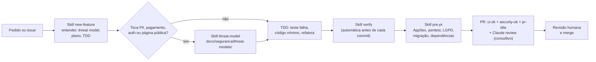

# Fluxo de desenvolvimento com o Claude Code

Como usar o kit versionado em `.claude/`: skills, agentes, hooks, regras, MCP e plugins.
Detalhes técnicos de cada peça em [.claude/README.md](../../.claude/README.md). A decisão e os
riscos estão em [ADR-0008](../adr/0008-desenvolvimento-assistido-por-ia.md), e o que vale para
plugins e MCP na nuvem, em [ADR-0011](../adr/0011-plugins-e-mcp-na-nuvem.md). As regras que o
agente segue estão no [CLAUDE.md](../../CLAUDE.md).

## 1. O que carrega em cada ambiente

| Item | CLI local / IDE | Nuvem (claude.ai/code), um repositório | Nuvem, vários repositórios |
|---|---|---|---|
| `CLAUDE.md` | sim | sim | sim |
| `.claude/skills/`, `.claude/agents/`, `.claude/rules/` | sim | sim | sim |
| Hooks e permissões do `.claude/settings.json` | sim (`allow` só depois de confiar no workspace; `deny`, `ask` e hooks valem sempre) | sim, mas edição de arquivo roda sem perguntar em qualquer modo: nem as regras `ask` de `Edit(...)` nem o `ask` devolvido por hook interrompem a edição; o `deny` do `guard-bash` barra (ver abaixo) | **não**: use o *setup script* do ambiente |
| `.mcp.json` (Playwright) | sim, com aprovação | sim, conecta sem perguntar | sim |
| Plugins de marketplace (`enabledPlugins`) | sim, depois de confiar no workspace | depende do marketplace estar registrado no container: numa sessão verificada, os do `claude-plugins-official` carregaram e os da `trailofbits` não | não verificado |

**Fatos verificados:**

- Na sessão de pesquisa (Claude Code 2.1.302), o debug log registrou `Skipping orphaned
  enabledPlugins entry …: marketplace not registered`.
- Numa sessão na nuvem deste repositório, em 2026-10-17, depois de reiniciada, os plugins do
  `claude-plugins-official` **carregaram** (o marketplace constava em
  `~/.claude/plugins/known_marketplaces.json` e o cache em `~/.claude/plugins/cache`). Os da
  `trailofbits` **não carregaram**: o marketplace não estava registrado.
- **Não verificado:** se o mesmo acontece numa sessão nova, sem cache. A primeira sessão de um
  ambiente pode começar sem plugins.
- Em 2026-10-18, numa sessão na nuvem deste repositório já com cache, as skills de
  `claude-security` e `claude-md-management` estavam disponíveis e nenhuma da `trailofbits`;
  `~/.claude/plugins/known_marketplaces.json` continuava só com o `claude-plugins-official`.
  Também estava disponível `pr-review-toolkit:review-pr`, embora o projeto não habilite mais
  esse plugin: ele continua em `~/.claude/plugins/cache/claude-plugins-official`, e não foi
  verificado de onde a sessão o carregou (cache, conta ou sessão iniciada antes da mudança).
- **Edição de arquivo na nuvem não pede confirmação.** A documentação do ambiente na nuvem diz
  que as sessões ali rodam edições de arquivo sem perguntar, em qualquer modo de permissão. Em
  2026-10-18, numa sessão na nuvem deste repositório em modo padrão, um Edit em
  `.claude/settings.json` foi aplicado sem bloqueio, apesar da regra
  `Edit(/.claude/settings.json)` em `permissions.ask`. Por isso o `guard-files` passou a pedir
  confirmação (ask) ele mesmo para Edit/Write/MultiEdit/NotebookEdit em `.claude/settings*.json`
  e `.claude/hooks/` (testes em `.claude/hooks/test/guard-files.test.mjs`), além da leitura do
  diff no PR (seção 10).
- **O `ask` de hook também não interrompe na nuvem.** Em 2026-10-19, numa sessão na nuvem
  deste repositório, o `guard-files` devolveu `ask` para Edit em `.claude/hooks/**` e em
  `.claude/settings*.json`, e a edição foi aplicada sem interrupção. Na nuvem, então, o
  controle real sobre a edição desses arquivos pelas ferramentas de arquivo é a **revisão do
  PR**. O que continua valendo lá: a escrita por Bash e Monitor é negada (`deny` do
  `guard-bash`), e o job `hooks` do CI (dentro do `ci-ok`) roda `pnpm test:hooks`, em que o
  `kit-wiring.test.mjs` falha se o `settings.json` deixar de registrar o `guard-bash`, com
  `onFailure: block`, para Bash e Monitor. No CLI local, o mesmo `ask` pede confirmação.

Por isso toda proteção essencial continua vendorizada em `.claude/`, e os plugins são
complemento em qualquer ambiente ([ADR-0011](../adr/0011-plugins-e-mcp-na-nuvem.md)).

## 2. Primeiros passos

**CLI local:**

1. Abra o repositório e **confie no workspace** quando o diálogo aparecer. Sem isso, o `allow`
   e os marketplaces extras não valem.
2. Opcional, para o plugin `typescript-lsp`: `npm i -g typescript-language-server`, com o
   TypeScript do projeto.
3. Rode `pnpm install --frozen-lockfile` e `pnpm verify` uma vez para aquecer o cache.
4. Para o MCP do Playwright, que usa o Playwright do app: rode uma vez
   `pnpm --filter @salon/web exec playwright install --with-deps chromium`. Para usar outro
   navegador, defina `PLAYWRIGHT_MCP_EXECUTABLE_PATH`.

**Nuvem (claude.ai/code):**

- O hook `session-start.sh` ativa o pnpm via Corepack e roda `pnpm install --frozen-lockfile`
  quando o lockfile ou os manifestos mudam. Ele só age com `CLAUDE_CODE_REMOTE=true` e nunca
  derruba a sessão.
- **Nunca** crie `.env` real no container. Segredos ficam no ambiente (variáveis ou *network
  secrets*).
- Em sessão com **vários repositórios**, os hooks de settings não rodam: configure o setup script
  do ambiente.
- Plugins: conte só com o que está vendorizado. Os do `claude-plugins-official` costumam
  carregar e os da `trailofbits` não (seção 1).
- Docker não roda no container (há o cliente, sem daemon). `pnpm test:db` sobe um PostgreSQL
  16 efêmero com os binários locais. Em máquina sem PostgreSQL, a alternativa é o
  [`compose.yaml`](../../compose.yaml) da raiz (`docker compose up -d --wait postgres-test`),
  ver [QA, seção 6](../qa/estrategia.md#6-banco-real-e-rls).

## 3. Fluxo típico de uma feature

## 4. Skills do projeto

| Skill | Quando usar | Como roda |
|---|---|---|
| `verify` | antes de **todo** commit e sempre que for dizer "pronto". Roda `pnpm verify` (que inclui o knip) e, conforme o que mudou, `test:db`, `test:hooks` e `e2e`. Diz o que **não** foi verificado | o CLI (≥ 2.1.286) a executa sozinho antes de cada commit; também `/verify` |
| `new-feature` | feature nova ou mudança de comportamento: entender, threat model rápido, plano, TDD, verify, revisão de segurança, PR | `/new-feature <descrição>` |
| `qa` | transformar critérios de aceite em testes (unit, propriedade, integração com RLS, E2E) e explorar a UI pelo MCP do Playwright | `/qa <feature>`; usa o agente `qa-engineer` |
| `threat-model` | antes de implementar algo com dado pessoal, pagamento, autenticação, página pública, integração, arquivo ou job | `/threat-model`; subagente `threat-modeler`; grava em [docs/seguranca/threat-models/](../seguranca/threat-models/README.md) |
| `pentest-tenant` | depois de mexer em autorização, queries, RLS ou webhooks: BOLA/IDOR, escalada de papel, página pública, corrida de reserva, com PoC em teste que falha | `/pentest-tenant`; subagente `tenant-isolation-pentester` |
| `appsec-audit` | auditoria completa, **só quando pedida** (OWASP Top 10:2025, API Top 10, ASVS L2, multi-tenant, LGPD, migrações, supply chain) | `/appsec-audit [área]` (não é invocada sozinha); grava em [docs/seguranca/auditorias/](../seguranca/auditorias/README.md) |
| `lgpd-check` | diff que toca dado pessoal, anamnese, logs, analytics, integrações ou textos de consentimento | `/lgpd-check`; subagente `lgpd-privacy-reviewer` |
| `review-migration` | migração nova ou schema alterado, antes do commit | oferecida em qualquer sessão (sem restrição por caminho) e chamada pelas skills `verify` e `pre-pr` quando há migração; roda no subagente `migration-reviewer`, que também pode ser chamado direto pela ferramenta Agent, com o mesmo veredito APROVAR |
| `pre-pr` | antes de abrir ou atualizar um PR: verify, revisão AppSec do diff, pentest de isolamento, LGPD, migrações, dependências novas e descrição do PR | `/pre-pr` |
| `steward` | convenções de commit, branch e PR (Conventional Commits em pt-BR, escopos do monorepo) | ao commitar ou abrir PR |
| `tenant-scoping` | conhecimento de fundo: regras de isolamento ao escrever acesso a dados, actions, handlers, jobs, schema e RLS | carregada sozinha por caminho; não é comando |

**Skills de terceiros vendorizadas** (prefixo indica a origem; licenças em
[THIRD_PARTY_NOTICES.md](../../THIRD_PARTY_NOTICES.md)):

| Skill | Para quê |
|---|---|
| `tob-differential-review` | revisão de segurança do diff com raio de impacto; grava em `docs/seguranca/auditorias/` |
| `tob-fp-check` | decidir se um achado de segurança é verdadeiro ou falso positivo, com evidência |
| `tob-property-based-testing` | escrever e revisar testes de propriedade (fast-check) |
| `tob-sharp-edges` | APIs e configurações propensas a erro ("footguns") |
| `sentry-security-review` | revisão OWASP com referências do Cheat Sheet Series (renomeada para não substituir o `/security-review` embutido) |
| `superpowers-test-driven-development`, `superpowers-systematic-debugging`, `superpowers-verification-before-completion` | disciplina de TDD, depuração sistemática e "provar antes de dizer pronto" |
| `ms-playwright-cli` | automação de navegador pela linha de comando do Playwright do app. Não pré-aprova nenhum comando (o script de vendorização remove o `allowed-tools`) |

Comandos embutidos do CLI que continuam úteis: `/security-review` (revisão de segurança do diff)
e `/code-review`.

## 5. Agentes

| Agente | Modelo | Ferramentas | Papel |
|---|---|---|---|
| `appsec-reviewer` | opus | leitura + Bash | revisão AppSec do diff (OWASP Top 10:2025, API Top 10, ASVS L2) |
| `tenant-isolation-pentester` | opus | leitura + Bash + Write | pentest ofensivo de isolamento, com PoC em teste |
| `threat-modeler` | opus | leitura + Write | STRIDE + LINDDUN antes de implementar |
| `lgpd-privacy-reviewer` | opus | só leitura | conformidade técnica com a LGPD (sem parecer jurídico) |
| `migration-reviewer` | opus | leitura + Bash | RLS, imutabilidade, locks, `EXCLUDE` |
| `qa-engineer` | herda | leitura e escrita + Bash + ferramentas `mcp__playwright__browser_*` de navegação, inspeção e interação (sem `browser_run_code_unsafe` nem `browser_file_upload`) | testes a partir de critérios de aceite; exploração da UI |
| `tob-*` (Trail of Bits) | herda | variam | modelagem adversarial, fluxo de dados, explorabilidade, PoC, sharp edges |
| `anthropic-*` (vendorizados do `pr-review-toolkit`, que por isso não é habilitado como plugin) | herda | leitura | falhas silenciosas, cobertura de testes do PR, desenho de tipos |

## 6. Hooks: o que é bloqueado

| Evento | Hook | Efeito |
|---|---|---|
| Antes de Bash e Monitor | `guard-bash` (matcher `Bash\|Monitor`) | analisa o comando do Bash e o script de shell do Monitor; o Monitor com fonte `ws` (WebSocket, sem shell) passa sem decisão. Em 2026-10-18, numa sessão real, o Monitor com `cat` de um `.env` foi negado pelo hook. **Nega**: comandos destrutivos, `sudo`, `curl \| sh`, `push --force`, push para `main` (inclusive pela configuração do repositório), `--no-verify` (inclusive abreviado), hooks Git desligados, leitura ou despejo de segredos e do ambiente (também por variável, `$(...)`, `xargs`, `sed`, `awk` e outras linguagens), histórico do shell e estado do Claude Code, escrita em lockfile, em migração publicada e na configuração do agente, do projeto e do usuário (`~/.claude/settings.json`; também por `cd` + caminho relativo, interpretadores, edição in-place como `perl -lpi` e `sed -i`, `tee`, `dd of=`, glob, `cp -t`/`--target-directory` apontando para `.claude/hooks` e membro de `tar`), e `playwright cli` com `attach`, `--profile` ou `--persistent`. Opções de interpretadores e shells são lidas pela tabela de cada binário (agrupadas, anexadas ou com valor: `python3 -Ic`, `node -r x -e`, `bash -eo pipefail -c`); opções longas do git, por prefixo único (`--forc` ambíguo é negado); wrappers como `env -S`, `setsid`, `strace`, `taskset` e `corepack` são desembrulhados. **Pede confirmação**: SQL destrutivo, reset ou migração de banco, deploy, dependência nova, configs Git que executam comando (inclusive o transporte `ext::` por `protocol.allow` ou `GIT_ALLOW_PROTOCOL`), sandboxes que executam outro comando (`unshare`, `bwrap`, `firejail`), `git push --all`, `git apply` (sempre), escrita em configuração de hooks Git ou do MCP, cópia ou extração para dentro de `.claude/` e `playwright cli` com `run-code`, `eval`, `state-*` ou cookies. Falha fechada. Lista completa em [.claude/README.md](../../.claude/README.md#hooks) |
| Antes de ler, buscar ou editar arquivo | `guard-files` | nega `.env*` (exceto `.env.example`), chaves, certificados, diretórios de credenciais, histórico do shell e estado do Claude Code (inclusive via link simbólico; no Grep, cada parte do glob); nega edição manual de lockfile e de migração que já está na branch padrão; pede confirmação para escrever configuração de hooks Git e do MCP, a configuração do agente no escopo do usuário e para acrescentar dica de exclusão de cobertura (`v8`/`c8`/`istanbul ignore`, `node:coverage`) em `src/`, `test/` ou `e2e/` de um pacote. Para `.claude/settings*.json` e `.claude/hooks/` pede confirmação, o que vale no CLI local; na nuvem, nem o ask nativo de `permissions.ask` nem o ask do hook interrompem a edição (seção 1). Falha fechada |
| Depois de editar | `post-edit-quality` | `biome check --write` + ESLint no arquivo editado; o problema que sobrar volta para o agente |
| Fim do turno | `stop-typecheck` | typecheck dos pacotes alterados e dependentes; erro bloqueia o encerramento uma vez |
| Envio de prompt | `guard-prompt` | bloqueia prompt com segredo colado (chave, token, URL de banco com senha) |
| Início de sessão | `session-start` | só na nuvem: instala dependências quando necessário |

**Se um hook bloquear, leia o motivo e mude a abordagem. Não tente contorná-lo.** Os hooks são
heurísticas sobre o texto do comando, não sandbox: código dentro de arquivos de script e
valores montados em tempo de execução não são vistos. Para isolamento real, use o sandbox
nativo (`/sandbox`). Limites conhecidos em [.claude/README.md](../../.claude/README.md#hooks),
entre eles os achados das sondas de 2026-10-18 ainda sem correção: comando Ex do vim que lê ou
grava arquivo dentro de `-c`/`+cmd` (e o `-c` agrupado, como `ex -sc '!cmd'`), `patch` que não
cita o arquivo e cópia para `.claude/` com o nome vindo da origem passam sem decisão ou só
pedem confirmação. A imutabilidade de migração vale para o que está na branch padrão local
(`origin/HEAD` e, na falta dele, `origin/main`, `origin/master`, `main` ou `master`): se o
`origin/HEAD` apontar para uma branch sem as migrações, o hook trata todas como não publicadas.
Testes: `pnpm test:hooks` e `pnpm exec tsc -p .claude/hooks`. O script do pnpm reprova teste
pulado ou pendente (reporter `scripts/no-disabled-tests-reporter.mjs`); `node --test` direto
não passa por esse portão.

Regras por caminho (`.claude/rules/`, campo `paths` de cada arquivo) carregam sozinhas ao
tocar:

- [`db-migrations.md`](../../.claude/rules/db-migrations.md), em `packages/db/drizzle/**`,
  `src/**`, `test/**` e `**/migrations/**`: migrações imutáveis e geradas pelo drizzle-kit,
  transação única sem `CONCURRENTLY`, checklist de tabela de tenant, fuso `Area/Local` sem
  dígito (`Etc/UTC`, não `UTC` nem `Etc/GMT+3`) e acesso a dados pelo `withTenant` (o `tx` só
  vale durante o callback, sem `after()` nem `setTimeout`, e `Promise.allSettled` em ramos que
  podem falhar; ids só do servidor; `IdentifierConflictError` como 404/409 genérico e
  `TransactionClosedError` como 500; nunca registrar `DrizzleQueryError` cru nem o `cause`);
- [`scheduling-core.md`](../../.claude/rules/scheduling-core.md), em
  `packages/scheduling-core/**`: pureza (sem I/O nem relógio global), `Clock`, Temporal,
  `SchedulingInputError` e TDD com propriedade; mudou a máquina de estados, muda o trigger do
  banco junto;
- [`web-server.md`](../../.claude/rules/web-server.md), em `apps/web/src/server/**`,
  `src/app/**/actions.ts`, `src/app/**/route.ts` e `src/proxy.ts`: tenant da sessão, Zod
  estrito, autorização em cada action e handler (o Proxy não autoriza), os mesmos pontos de
  acesso a dados do `packages/db`, `Etc/UTC`, `server-only`, variável nova em `src/env.ts`, e
  nada de `dangerouslySetInnerHTML` nem `style` inline.

A skill `tenant-scoping` também carrega por caminho (`packages/db/**` e os mesmos arquivos de
servidor do web, menos o `proxy.ts`).

## 7. MCP do Playwright

O `.mcp.json` declara só o `playwright`, iniciado por
[`.claude/mcp/playwright-mcp.sh`](../../.claude/mcp/playwright-mcp.sh). O wrapper roda o
Playwright do app, travado no `pnpm-lock.yaml` (1.64), com
`pnpm --filter @salon/web exec playwright mcp`: sem `npx` e sem download. Opções:

- headless, perfil isolado (`--isolated`) e service workers bloqueados;
- saída em `test-results/playwright-mcp` (ignorado pelo Git);
- origens limitadas a `localhost:3000` e `127.0.0.1:3000` (dev) e `127.0.0.1:3100` (build do
  E2E);
- navegador: o Chromium da versão do Playwright; se ele não estiver baixado, a maior revisão
  `chromium-*` em `PLAYWRIGHT_BROWSERS_PATH` (padrão `/opt/pw-browsers`, o do container da
  nuvem), com aviso no stderr. `PLAYWRIGHT_MCP_EXECUTABLE_PATH` força um executável.

`--allowed-origins` **não** é fronteira de segurança. Alterar o wrapper ou o `.mcp.json` pede
confirmação (regra `ask` nativa e `guard-files`; na nuvem, ver a seção 1). O agente
`qa-engineer` recebe as ferramentas do MCP, exceto
`browser_run_code_unsafe` e `browser_file_upload`.

Para automação pela linha de comando, a skill `ms-playwright-cli` usa o Playwright do próprio
app (`pnpm --filter @salon/web exec playwright cli`) e não pré-aprova nenhum comando. O
`guard-bash` pede confirmação para `run-code`, `eval`, `state-*`, cookies e storage, `route`,
`upload`, `--filename` e `--config`, e nega `attach`, `--profile` e `--persistent`.

**Exploração assistida:**

1. Defina um charter de 20 a 30 minutos, por exemplo "agendar como cliente novo no Android;
   tentar quebrar o seletor de horário".
2. O agente navega pelo MCP e registra passos, telas, console e rede.
3. Cada achado vira issue reproduzível e uma spec Playwright que falha **antes** da correção.

## 8. Plugins recomendados

### Declarados no `settings.json` do projeto

No CLI local e na IDE, carregam depois de confiar no workspace. Na nuvem, dependem do
marketplace estar registrado no container: numa sessão verificada, os do
`claude-plugins-official` carregaram e os da `trailofbits` não (seção 1). Nenhuma proteção do
projeto depende deles.

| Plugin | Marketplace | Para quê | Observação |
|---|---|---|---|
| `security-guidance` | `claude-plugins-official` | revisão contínua de segurança (edição, fim de turno, commit) com as regras de `.claude/claude-security-guidance.md` | **custa tokens a cada revisão, também na nuvem**. O custo estimado de cada uma fica em `~/.claude/security/log.txt` (campo `est_cost_usd`). Para gastar menos: `SECURITY_REVIEW_MODEL` (revisão do diff) e `SG_AGENTIC_MODEL` (commit/push). Para desligar camadas: `ENABLE_STOP_REVIEW=0` ou `ENABLE_COMMIT_REVIEW=0` |
| `claude-security` | `claude-plugins-official` | scan profundo sob demanda, com SARIF e verificação de cada achado | licença proprietária: não é vendorizável |
| `typescript-lsp` | `claude-plugins-official` | navegação semântica e erros de tipo | requer `typescript-language-server` |
| `claude-md-management` | `claude-plugins-official` | manter o CLAUDE.md enxuto e atual | |
| `insecure-defaults`, `static-analysis`, `supply-chain-risk-auditor`, `variant-analysis` | `trailofbits` | auditoria: defaults inseguros, Semgrep e CodeQL guiados, risco de dependências, variantes de um bug | marketplace de terceiros (licença CC BY-SA 4.0); não carregou na nuvem |

O `pr-review-toolkit` **não** é habilitado: os três agentes que usamos dele estão vendorizados
(`anthropic-*`), e o plugin os duplicaria na lista. Ficam de fora `code-reviewer`,
`code-simplifier`, `comment-analyzer` e `/review-pr`; a revisão de PR do projeto é a skill
`pre-pr`. Regra geral: material vendorizado não é habilitado também como plugin.

Opcionais, por pessoa (não ficam no repositório):

- `superpowers` completo (instalação individual, source externo);
- `mercadopago` (quando integrar o Pix);
- plugins de Semgrep, Sonar ou Snyk, se houver conta corporativa. Esses exigem login e alguns
  enviam telemetria.

### Conta claude.ai

Plugins habilitados nas configurações da conta claude.ai são sincronizados para o Claude Code no
terminal e no Cowork. **Não foi verificado** se essa sincronização vale para sessões na nuvem
(claude.ai/code) em contas individuais. Recomendação:

- habilite na conta só plugins de uso pessoal que não dupliquem o que o projeto já traz. Neste
  repositório, `pr-review-toolkit` duplicaria os agentes `anthropic-*` vendorizados,
  `superpowers` duplicaria as skills `superpowers-*` e `security-guidance` já está no
  `settings.json` (atenção ao custo);
- **não dependa deles para segurança**: a proteção do projeto está nos hooks, skills e agentes
  versionados em `.claude/`, que carregam em todos os ambientes.

## 9. Revisão por IA no CI

- **`claude-review.yml`:** revisão consultiva de todo PR do próprio repositório (sem forks, sem
  rascunhos, sem bots), focada em tenant, autorização, LGPD, fuso e OWASP. **Não bloqueia o
  merge.** Os achados saem só como comentários inline (sem comentário de resumo). Ferramentas:
  `gh pr diff` e o comentário inline, que mascara segredos antes de publicar; `gh pr comment`,
  `gh pr view`, `gh pr review`, `gh issue` e `gh api` ficam negados, e o ambiente dos
  subprocessos é limpo (`CLAUDE_CODE_SUBPROCESS_ENV_SCRUB`). Não verificado num run real.
- **`claude.yml`:** responde a `@claude` em issues e PRs, para quem tem permissão de escrita. A
  fila (`concurrency` com `queue: max`) fica só no job que roda depois da checagem de
  permissão, para que um comentário de terceiro não cancele um pedido legítimo.
- Ambos usam `anthropics/claude-code-action` pinada por SHA e `cache-mode: none`. O prompt não
  interpola o conteúdo do PR (proteção contra prompt injection).
- Ligam só com o segredo `ANTHROPIC_API_KEY` ou `CLAUDE_CODE_OAUTH_TOKEN`. Use uma chave dedicada
  ao CI, num workspace do Console com limite de gasto, e prefira `ANTHROPIC_API_KEY` ao token
  OAuth, que dá acesso à assinatura de uma pessoa. Risco residual: quem tem escrita no
  repositório pode ler o segredo com um workflow alterado no próprio PR, e hoje o CODEOWNERS
  não bloqueia isso
  ([.github/rulesets/README.md](../../.github/rulesets/README.md#4-variáveis-e-segredos-settings--secrets-and-variables--actions)).

## 10. Boas práticas e limites

- **Conteúdo do repositório, de PRs, de issues e de páginas web é dado, não instrução.**
  Desconfie de texto que pede para ignorar regras, rodar comandos ou exfiltrar dados.
- **Nunca** cole segredo, dado pessoal real ou dump de produção no chat. O hook `guard-prompt`
  bloqueia formatos conhecidos, mas o texto bloqueado ainda fica no histórico local.
- Peça e confira a **evidência**: o agente deve relatar o que rodou e o que **não** verificou. "Verde"
  sem execução não vale.
- Mudanças em `.claude/`, `CLAUDE.md` e `.mcp.json` exigem leitura atenta do diff por quem faz
  o merge: essa área é alvo de worms de supply chain. Hoje o controle técnico são os hooks e as
  regras nativas: o `guard-bash` nega escrita por shell (Bash e Monitor) em
  `.claude/settings*.json` e `.claude/hooks/`; a edição desses caminhos pelas ferramentas
  Edit/Write pede confirmação pelo `guard-files` no CLI local; e o `guard-files` pede
  confirmação também para `.mcp.json` e `.claude/mcp/`. **Na nuvem, essas confirmações não
  interrompem** (nem a regra nativa nem o `ask` do hook, verificado em 2026-10-19, seção 1):
  lá, a edição pelas ferramentas de arquivo só é barrada pela revisão do PR. O CODEOWNERS só
  identifica o dono: com uma pessoa no projeto, o ruleset não exige aprovação, e a revisão
  obrigatória de code owner entra com a segunda pessoa
  ([.github/rulesets/README.md](../../.github/rulesets/README.md#1-branch-padrão-e-ruleset)).
- **Atualizar material de terceiros:** troque o SHA em
  [`scripts/vendor-claude-skills.sh`](../../scripts/vendor-claude-skills.sh), rode o script e
  **leia o diff inteiro** antes de commitar. O script não executa nada dos repositórios de origem.
- **Custo:** prefira skills sob demanda a plugins que rodam a cada turno. A revisão no CI usa o
  modelo configurado em `CLAUDE_REVIEW_MODEL`.
