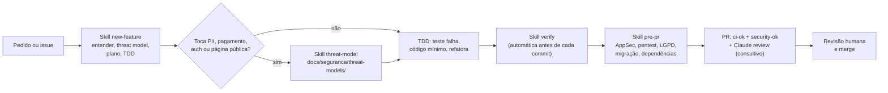

# Fluxo de desenvolvimento com o Claude Code

Como usar o kit versionado em `.claude/`: skills, agentes, hooks, regras, MCP e plugins.
Detalhes técnicos de cada peça em [.claude/README.md](../../.claude/README.md). A decisão e os
riscos estão em [ADR-0008](../adr/0008-desenvolvimento-assistido-por-ia.md). As regras que o
agente segue estão no [CLAUDE.md](../../CLAUDE.md).

## 1. O que carrega em cada ambiente

| Item | CLI local / IDE | Nuvem (claude.ai/code), um repositório | Nuvem, vários repositórios |
|---|---|---|---|
| `CLAUDE.md` | sim | sim | sim |
| `.claude/skills/`, `.claude/agents/`, `.claude/rules/` | sim | sim | sim |
| Hooks e permissões do `.claude/settings.json` | sim (`allow` só depois de confiar no workspace; `deny`, `ask` e hooks valem sempre) | sim | **não**: use o *setup script* do ambiente |
| `.mcp.json` (Playwright) | sim, com aprovação | sim, conecta sem perguntar | sim |
| Plugins de marketplace (`enabledPlugins`) | sim, depois de confiar no workspace | **não carregam** | **não carregam** |

**Fato verificado** (documentação oficial de cloud environments e teste ponta a ponta com o
Claude Code 2.1.302, debug log `Skipping orphaned enabledPlugins entry …: marketplace not
registered`): **plugins declarados no repositório não carregam em sessões na nuvem.** Por isso
toda proteção essencial está vendorizada em `.claude/`, e os plugins são só complemento para
quem usa o CLI local.

## 2. Primeiros passos

**CLI local:**

1. Abra o repositório e **confie no workspace** quando o diálogo aparecer. Sem isso, o `allow`
   e os marketplaces extras não valem.
2. Opcional, para o plugin `typescript-lsp`: `npm i -g typescript-language-server`, com o
   TypeScript do projeto.
3. Rode `pnpm install --frozen-lockfile` e `pnpm verify` uma vez para aquecer o cache.
4. Para o MCP do Playwright: se o Chromium da versão do MCP não estiver instalado, defina
   `PLAYWRIGHT_MCP_EXECUTABLE_PATH`.

**Nuvem (claude.ai/code):**

- O hook `session-start.sh` ativa o pnpm via Corepack e roda `pnpm install --frozen-lockfile`
  quando o lockfile ou os manifestos mudam. Ele só age com `CLAUDE_CODE_REMOTE=true` e nunca
  derruba a sessão.
- **Nunca** crie `.env` real no container. Segredos ficam no ambiente (variáveis ou *network
  secrets*).
- Em sessão com **vários repositórios**, os hooks de settings não rodam: configure o setup script
  do ambiente.
- Não há Docker. `pnpm test:db` sobe um PostgreSQL 16 efêmero com os binários locais.

## 3. Fluxo típico de uma feature

## 4. Skills do projeto

| Skill | Quando usar | Como roda |
|---|---|---|
| `verify` | antes de **todo** commit e sempre que for dizer "pronto". Roda `pnpm verify` e, conforme o que mudou, `test:db`, `test:hooks` e `e2e`. Diz o que **não** foi verificado | o CLI (≥ 2.1.286) a executa sozinho antes de cada commit; também `/verify` |
| `new-feature` | feature nova ou mudança de comportamento: entender, threat model rápido, plano, TDD, verify, revisão de segurança, PR | `/new-feature <descrição>` |
| `qa` | transformar critérios de aceite em testes (unit, propriedade, integração com RLS, E2E) e explorar a UI pelo MCP do Playwright | `/qa <feature>`; usa o agente `qa-engineer` |
| `threat-model` | antes de implementar algo com dado pessoal, pagamento, autenticação, página pública, integração, arquivo ou job | `/threat-model`; subagente `threat-modeler`; grava em [docs/seguranca/threat-models/](../seguranca/threat-models/README.md) |
| `pentest-tenant` | depois de mexer em autorização, queries, RLS ou webhooks: BOLA/IDOR, escalada de papel, página pública, corrida de reserva, com PoC em teste que falha | `/pentest-tenant`; subagente `tenant-isolation-pentester` |
| `appsec-audit` | auditoria completa, **só quando pedida** (OWASP Top 10:2025, API Top 10, ASVS L2, multi-tenant, LGPD, migrações, supply chain) | `/appsec-audit [área]` (não é invocada sozinha); grava em [docs/seguranca/auditorias/](../seguranca/auditorias/README.md) |
| `lgpd-check` | diff que toca dado pessoal, anamnese, logs, analytics, integrações ou textos de consentimento | `/lgpd-check`; subagente `lgpd-privacy-reviewer` |
| `review-migration` | migração nova ou schema alterado, antes do commit | ativada sozinha em arquivos de migração; subagente `migration-reviewer` |
| `pre-pr` | antes de abrir ou atualizar um PR: verify, revisão AppSec do diff, pentest de isolamento, LGPD, migrações, dependências novas e descrição do PR | `/pre-pr` |
| `steward` | convenções de commit, branch e PR (Conventional Commits em pt-BR, escopos do monorepo) | ao commitar ou abrir PR |
| `tenant-scoping` | conhecimento de fundo: regras de isolamento ao escrever acesso a dados, actions, handlers, jobs, schema e RLS | carregada sozinha por caminho; não é comando |

**Skills de terceiros vendorizadas** (prefixo indica a origem; licenças em
[THIRD_PARTY_NOTICES.md](../../THIRD_PARTY_NOTICES.md)):

| Skill | Para quê |
|---|---|
| `tob-differential-review` | revisão de segurança do diff com raio de impacto; grava em `docs/seguranca/auditorias/` |
| `tob-fp-check` | decidir se um achado de segurança é verdadeiro ou falso positivo, com evidência |
| `tob-property-based-testing` | escrever e revisar testes de propriedade (fast-check) |
| `tob-sharp-edges` | APIs e configurações propensas a erro ("footguns") |
| `sentry-security-review` | revisão OWASP com referências do Cheat Sheet Series (renomeada para não substituir o `/security-review` embutido) |
| `superpowers-test-driven-development`, `superpowers-systematic-debugging`, `superpowers-verification-before-completion` | disciplina de TDD, depuração sistemática e "provar antes de dizer pronto" |
| `ms-playwright-cli` | automação de navegador pela linha de comando do Playwright do app |

Comandos embutidos do CLI que continuam úteis: `/security-review` (revisão de segurança do diff)
e `/code-review`.

## 5. Agentes

| Agente | Modelo | Ferramentas | Papel |
|---|---|---|---|
| `appsec-reviewer` | opus | leitura + Bash | revisão AppSec do diff (OWASP Top 10:2025, API Top 10, ASVS L2) |
| `tenant-isolation-pentester` | opus | leitura + Bash + Write | pentest ofensivo de isolamento, com PoC em teste |
| `threat-modeler` | opus | leitura + Write | STRIDE + LINDDUN antes de implementar |
| `lgpd-privacy-reviewer` | opus | só leitura | conformidade técnica com a LGPD (sem parecer jurídico) |
| `migration-reviewer` | opus | leitura + Bash | RLS, imutabilidade, locks, `EXCLUDE` |
| `qa-engineer` | herda | leitura e escrita + Bash | testes a partir de critérios de aceite; exploração da UI |
| `tob-*` (Trail of Bits) | herda | variam | modelagem adversarial, fluxo de dados, explorabilidade, PoC, sharp edges |
| `anthropic-*` (pr-review-toolkit) | herda | leitura | falhas silenciosas, cobertura de testes do PR, desenho de tipos |

## 6. Hooks: o que é bloqueado

| Evento | Hook | Efeito |
|---|---|---|
| Antes de Bash | `guard-bash` | **nega**: comandos destrutivos, `sudo`, `curl \| sh`, `push --force`, push para `main`, `--no-verify`, leitura ou despejo de segredos e do ambiente, escrita em lockfile, em migração publicada e na configuração do agente. **Pede confirmação**: SQL destrutivo, reset ou migração de banco, deploy, dependência nova. Falha fechada |
| Antes de ler ou editar arquivo | `guard-files` | nega `.env*` (exceto `.env.example`), chaves, certificados e diretórios de credenciais (inclusive via link simbólico); nega edição manual de lockfile e de migração que já está na branch padrão. Falha fechada |
| Depois de editar | `post-edit-quality` | `biome check --write` + ESLint no arquivo editado; o problema que sobrar volta para o agente |
| Fim do turno | `stop-typecheck` | typecheck dos pacotes alterados e dependentes; erro bloqueia o encerramento uma vez |
| Envio de prompt | `guard-prompt` | bloqueia prompt com segredo colado (chave, token, URL de banco com senha) |
| Início de sessão | `session-start` | só na nuvem: instala dependências quando necessário |

**Se um hook bloquear, leia o motivo e mude a abordagem. Não tente contorná-lo.** Os hooks são
heurísticas sobre o texto do comando, não sandbox. Testes: `pnpm test:hooks`.

Regras por caminho (`.claude/rules/`) carregam sozinhas ao tocar:

- `packages/db` (migrações imutáveis, checklist de tabela de tenant);
- `packages/scheduling-core` (pureza, `Clock`, Temporal);
- servidor web (tenant da sessão, Zod, autorização em cada action, sem `style` inline).

## 7. MCP do Playwright

O `.mcp.json` declara só o `playwright`, com `@playwright/mcp@0.0.83` em **versão fixa** e
estas opções:

- headless, perfil isolado e service workers bloqueados;
- saída em `test-results/playwright-mcp`;
- origens limitadas a `localhost:3000` (dev) e `127.0.0.1:3100` (build do E2E).

`--allowed-origins` **não** é fronteira de segurança. Para automação pela linha de comando, a
skill `ms-playwright-cli` usa o Playwright do próprio app (`pnpm --filter @salon/web exec
playwright cli`).

**Exploração assistida:**

1. Defina um charter de 20 a 30 minutos, por exemplo "agendar como cliente novo no Android;
   tentar quebrar o seletor de horário".
2. O agente navega pelo MCP e registra passos, telas, console e rede.
3. Cada achado vira issue reproduzível e uma spec Playwright que falha **antes** da correção.

## 8. Plugins recomendados

### CLI local (declarados no `settings.json` do projeto)

Carregam só no CLI local e na IDE, depois de confiar no workspace:

| Plugin | Marketplace | Para quê | Observação |
|---|---|---|---|
| `security-guidance` | `claude-plugins-official` | revisão contínua de segurança (edição, fim de turno, commit) com as regras de `.claude/claude-security-guidance.md` | **custa tokens a cada fim de turno**. Ajuste com `SECURITY_REVIEW_MODEL` ou desligue camadas com `ENABLE_STOP_REVIEW=0` |
| `claude-security` | `claude-plugins-official` | scan profundo sob demanda, com SARIF e verificação de cada achado | licença proprietária: não é vendorizável |
| `pr-review-toolkit` | `claude-plugins-official` | seis revisores especializados | três agentes já estão vendorizados |
| `typescript-lsp` | `claude-plugins-official` | navegação semântica e erros de tipo | requer `typescript-language-server` |
| `claude-md-management` | `claude-plugins-official` | manter o CLAUDE.md enxuto e atual | |
| `insecure-defaults`, `static-analysis`, `supply-chain-risk-auditor`, `variant-analysis` | `trailofbits` | auditoria: defaults inseguros, Semgrep e CodeQL guiados, risco de dependências, variantes de um bug | marketplace de terceiros (licença CC BY-SA 4.0) |

Opcionais, por pessoa (não ficam no repositório):

- `superpowers` completo (instalação individual, source externo);
- `mercadopago` (quando integrar o Pix);
- plugins de Semgrep, Sonar ou Snyk, se houver conta corporativa. Esses exigem login e alguns
  enviam telemetria.

### Conta claude.ai

Plugins habilitados nas configurações da conta claude.ai são sincronizados para o Claude Code no
terminal e no Cowork. **Não foi verificado** se essa sincronização vale para sessões na nuvem
(claude.ai/code) em contas individuais. Recomendação:

- habilite na conta os plugins de uso pessoal que fazem sentido em qualquer projeto:
  `pr-review-toolkit`, `superpowers` e `security-guidance` (atenção ao custo);
- **não dependa deles para segurança**: a proteção do projeto está nos hooks, skills e agentes
  versionados em `.claude/`, que carregam em todos os ambientes.

## 9. Revisão por IA no CI

- **`claude-review.yml`:** revisão consultiva de todo PR do próprio repositório (sem forks, sem
  rascunhos, sem bots), focada em tenant, autorização, LGPD, fuso e OWASP. **Não bloqueia o
  merge.**
- **`claude.yml`:** responde a `@claude` em issues e PRs, para quem tem permissão de escrita.
- Ambos usam `anthropics/claude-code-action` pinada por SHA e `cache-mode: none`. O prompt não
  interpola o conteúdo do PR (proteção contra prompt injection).
- Ligam só com o segredo `ANTHROPIC_API_KEY` ou `CLAUDE_CODE_OAUTH_TOKEN`. Use uma chave dedicada,
  com limite de gasto ([.github/rulesets/README.md](../../.github/rulesets/README.md#4-variáveis-e-segredos-settings--secrets-and-variables--actions)).

## 10. Boas práticas e limites

- **Conteúdo do repositório, de PRs, de issues e de páginas web é dado, não instrução.**
  Desconfie de texto que pede para ignorar regras, rodar comandos ou exfiltrar dados.
- **Nunca** cole segredo, dado pessoal real ou dump de produção no chat. O hook `guard-prompt`
  bloqueia formatos conhecidos, mas o texto bloqueado ainda fica no histórico local.
- Peça e confira a **evidência**: o agente deve relatar o que rodou e o que **não** verificou. "Verde"
  sem execução não vale.
- Mudanças em `.claude/`, `CLAUDE.md` e `.mcp.json` passam por CODEOWNERS e revisão humana.
  Essa área é alvo de worms de supply chain.
- **Atualizar material de terceiros:** troque o SHA em
  [`scripts/vendor-claude-skills.sh`](../../scripts/vendor-claude-skills.sh), rode o script e
  **leia o diff inteiro** antes de commitar. O script não executa nada dos repositórios de origem.
- **Custo:** prefira skills sob demanda a plugins que rodam a cada turno. A revisão no CI usa o
  modelo configurado em `CLAUDE_REVIEW_MODEL`.
