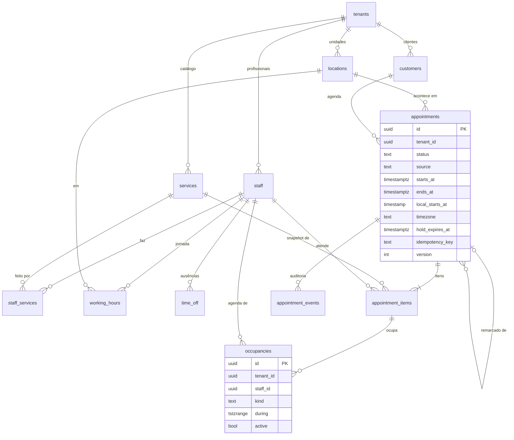
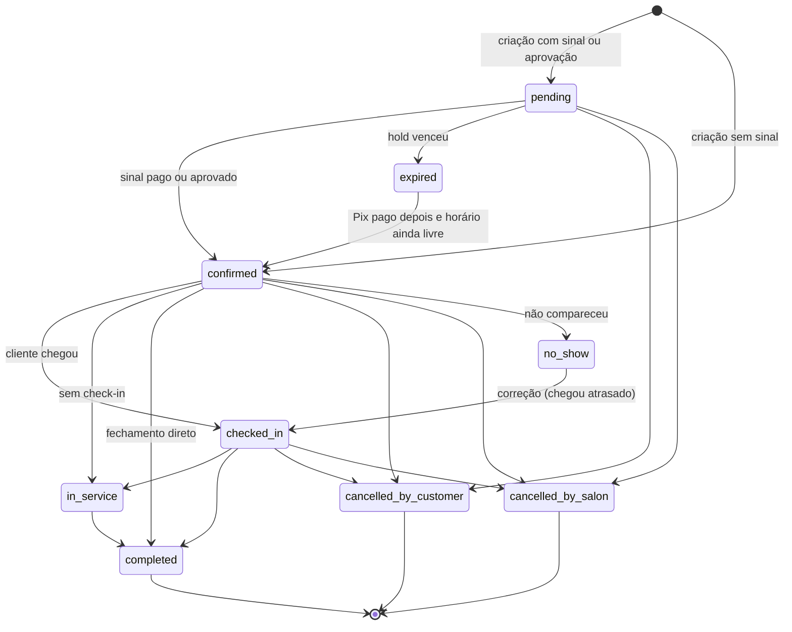
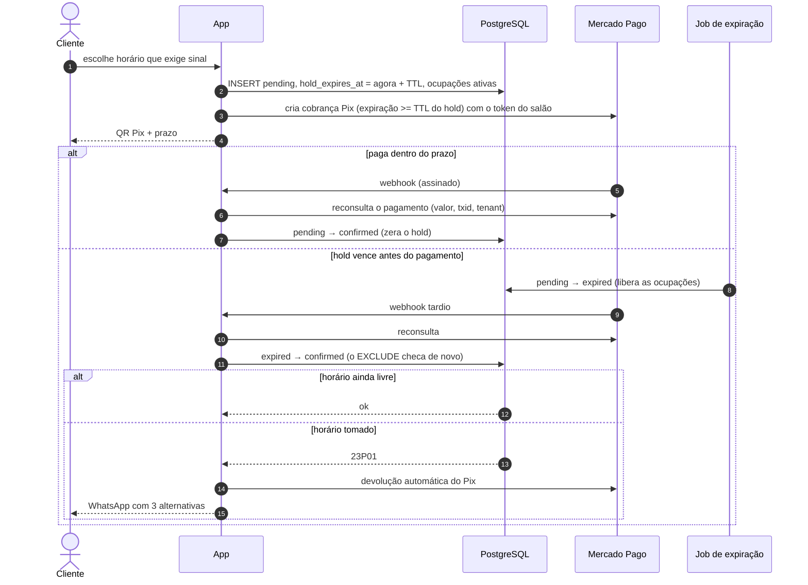

# Modelo de domínio

Entidades, invariantes, ciclo de vida do agendamento, regras de disponibilidade e concorrência.
Termos em [glossario.md](glossario.md). A implementação está em
[`@salon/scheduling-core`](../../packages/scheduling-core/README.md) (regras puras) e
[`@salon/db`](../../packages/db/README.md) (schema e garantias no banco). Marcamos **[fundação]**
para o que existe e **[planejado]** para o resto.

## 1. Entidades

### Implementadas no schema `app` [fundação]



Toda tabela de tenant tem `tenant_id`, PK `uuid` (UUIDv7 gerado na aplicação por `newId()`;
o default do banco é `gen_random_uuid()`, porque o PostgreSQL 16 e 17 não tem `uuidv7()`), FKs
compostas `(tenant_id, id)` e UNIQUEs começando por `tenant_id`. UUIDv7 é ordenável e
parcialmente previsível: é identificador, nunca segredo.

### Planejadas

| Entidade | Para quê | Fase |
|---|---|---|
| Consentimentos (append-only) | opt-in e revogação por finalidade, com versão do texto | MVP |
| `client_records` (ficha técnica e anamnese) | dado sensível com criptografia de campo ([dados sensíveis](../lgpd/dados-sensiveis.md)) | 2 |
| Pagamentos | sinal Pix, caixa, taxa de cancelamento, devolução | MVP |
| Notificações | WhatsApp e e-mail com `dedupe_key` | MVP |
| Eventos de webhook recebidos | idempotência por `(provider, provider_event_id)`, sem tenant na chegada | MVP |
| Lançamentos de comissão | um por item concluído, regime `comissao` ou `cota_parte` | MVP |
| Lista de espera | entradas e ofertas | MVP (simples) / 2 (automática) |
| Feriados, horas extras e recursos da unidade | regras adicionais de disponibilidade | 2 |
| Clube de assinatura, pacotes, avaliações, NFS-e | ver o [roadmap](../produto/mvp-e-roadmap.md) | 2–3 |

## 2. Invariantes

| # | Invariante | Onde é garantida | Teste |
|---|---|---|---|
| I1 | Um profissional nunca tem duas ocupações ativas sobrepostas | banco: `EXCLUDE USING gist (tenant_id =, staff_id =, during &&) WHERE (active)` | integração com corrida real; propriedade P5 do core |
| I2 | A ocupação está ativa se, e só se, o status do agendamento ocupa a agenda | banco: triggers `occupancies_derive_active` e `appointments_sync_occupancies` (o valor enviado pela aplicação é ignorado); core: `occupiesSchedule` | integração |
| I3 | Status só muda pelas transições permitidas | core: `transitionAppointmentStatus`; banco: trigger espelho; teste de paridade sem banco | 81 pares no banco; unit e propriedade no core |
| I4 | O agendamento nasce só `pending` ou `confirmed` | banco (trigger) e core (`INITIAL_APPOINTMENT_STATUSES`) | integração |
| I5 | `pending` exige `hold_expires_at`; `confirmed` zera o hold | banco (CHECK + trigger) | integração |
| I6 | `ends_at > starts_at` e duração ≤ 24 h | banco (CHECK) | integração |
| I7 | Fuso é IANA válido no tzdata | banco (`is_valid_iana_timezone`) e core (`assertIanaTimeZone`) | unit |
| I8 | Nada referencia linha de outro tenant | banco (FKs compostas) | RLS |
| I9 | Telefone único por salão, nunca global | banco (UNIQUE parcial `(tenant_id, phone_e164)`) | integração |
| I10 | Uma criação por `idempotency_key` no tenant | banco (UNIQUE) → `IdempotencyKeyConflictError` | integração |
| I11 | Preço, duração e comissão do item são snapshot e não mudam quando o catálogo muda | aplicação (cópia na criação do item) | [planejado] |
| I12 | A auditoria é append-only | banco (triggers bloqueiam `UPDATE`, `DELETE` e `TRUNCATE` até para o dono) | integração |
| I13 | Cliente anonimizado não tem contato nem consentimento | banco (CHECK) | integração |
| I14 | As fases somam a duração e têm ao menos uma fase de trabalho | banco (CHECK) e core (`serviceFootprint`) | unit |
| I15 | A jornada não tem faixas sobrepostas do mesmo profissional no mesmo dia e vigência | banco (`EXCLUDE` em `working_hours`) | integração |
| I16 | Dinheiro em centavos inteiros; percentuais em bps de 0 a 10.000 | banco (CHECK) | integração |
| I17 | Todo UPDATE de agendamento incrementa `version` (lock otimista) | banco (trigger) | integração |
| I18 | Horário ofertado cabe na jornada, respeita antecedência e horizonte e não colide com ocupação ou folga | core (`computeAvailableSlots`) | propriedades P1 a P15 |

## 3. Máquina de estados do agendamento



| Transição | Quem dispara [planejado: autorização] | Efeitos |
|---|---|---|
| (novo) → `pending` | cliente online, quando há sinal ou aprovação manual; equipe | ocupações ativas (hold) com `hold_expires_at`; QR do Pix |
| (novo) → `confirmed` | equipe, ou cliente online sem sinal nem aprovação | ocupações ativas; enfileira confirmação e lembretes |
| `pending` → `confirmed` | webhook de pagamento (depois da reconsulta ao PSP) ou aprovação do salão | zera o hold; `confirmed_at`; mensagem de confirmação |
| `pending` → `expired` | sistema (job de expiração) | libera as ocupações; métrica de abandono do sinal |
| `expired` → `confirmed` | sistema (Pix pago depois do hold) | reativa as ocupações e o `EXCLUDE` checa de novo. Se der `23P01`: **devolução automática do Pix** + 3 alternativas ao cliente |
| → `cancelled_by_customer` | cliente (link ou botão do WhatsApp) ou equipe | libera a agenda; marca o cancelamento tardio se estiver dentro da janela; o sinal segue a política; aciona a lista de espera |
| → `cancelled_by_salon` | equipe | libera a agenda; **devolve o sinal integralmente** |
| `confirmed` → `no_show` | equipe, ou sistema X min após o início (opcional) | libera o resto do horário; incrementa o contador do cliente; política de sinal |
| `no_show` → `checked_in` | equipe | correção |
| → `completed` | equipe (fechamento no caixa) | gera os lançamentos de comissão; habilita NFS-e e avaliação (fase 2) |

- Toda transição grava `appointment_events` com o ator, via trigger [fundação].
- **Remarcar** cria outro agendamento com `rescheduled_from_id`, na mesma transação que cancela o
  anterior. Se o novo horário colidir, nada muda.
- Mover o horário dentro do mesmo status é um UPDATE das ocupações, também protegido pelo
  `EXCLUDE` e pelo lock otimista (`version`).
- "**Confirmou presença**" (o cliente tocou "Confirmo" no lembrete) é **atributo**, não status.
  "Confirmado" pelo salão e "confirmou presença" são coisas diferentes, e misturar as duas
  confunde os relatórios.

## 4. Regras de disponibilidade

Implementadas em `computeAvailableSlots` [fundação]. As regras completas, inclusive os casos de
horário de verão, estão no [README do core](../../packages/scheduling-core/README.md#regras-de-tempo-decisões).

**Entrada:**

| Entrada | Origem |
|---|---|
| fuso da unidade | `locations.timezone` |
| intervalo de datas locais | até 366 dias por consulta |
| jornada semanal (`weeklySchedule`) | `working_hours` |
| serviço com fases e buffers | `services.phases`, `buffer_before_min`, `buffer_after_min` e o override de `staff_services` |
| ocupações ativas (`busy`) | `occupancies` com `active = true` |
| folgas e bloqueios (`timeOff`) | `time_off` |
| granularidade | `slot_interval_min` |
| antecedência mínima | `min_notice_min` |
| horizonte | `max_advance_days` × 1440 min |
| `Clock` | injetado |

**Saída:** horários com instante de início e fim, data e hora locais e offset UTC.

**Regras principais:**

1. O atendimento visível (todas as fases, inclusive pausas) cabe inteiro num turno da jornada.
2. **Buffers** ocupam o profissional e nunca colidem com ocupação ou folga, mas podem passar do
   limite do turno (preparo antes de abrir, limpeza depois de fechar).
3. Na **pausa**, o profissional fica livre: outro cliente cabe nela. Uma coloração gera duas
   ocupações do profissional, aplicação e finalização, com a pausa livre entre elas.
4. Inícios na **grade local** (`00:00 + k × granularidade` no relógio da unidade).
5. `agora + antecedência ≤ início ≤ agora + horizonte`, com "agora" lido **uma vez** do `Clock`.
6. Intervalos semiabertos: atendimentos encostados não colidem.
7. Rótulo local repetido (fim do horário de verão) gera dois horários distinguidos pelo offset.
   Rótulo inexistente não gera horário.
8. A equipe pode ignorar a antecedência mínima (canal `staff`) [planejado].

**Fora do escopo do motor hoje:**

- "qualquer profissional" (união por horário) e sequência de serviços com profissionais
  diferentes, que o chamador combina;
- recursos físicos;
- feriados e horas extras;
- turno que atravessa a meia-noite.

## 5. Concorrência

A garantia contra dupla reserva é **declarativa no banco**: o `EXCLUDE` é serializado pelo
índice GiST. Não precisa de `SERIALIZABLE` nem de lock manual. Verificado: duas transações
concorrentes no mesmo horário fazem a segunda **esperar o commit** da primeira e receber
`23P01`. Com RLS, o `DETAIL` não traz valores, e o `@salon/db` nem repassa o `DETAIL`.

**Transação de reserva** [planejado, sobre os blocos da fundação]:

```text
withTenant(db, tenantId, async (tx) => {
  1. idempotência: a chave já existe? mesmo corpo → devolve a resposta gravada;
     corpo diferente → 422; em processamento → 409
  2. expira holds vencidos que colidem com a janela pedida (o predicado do EXCLUDE
     não pode usar now(), então hold vencido continua "ativo" até ser expirado)
  3. revalida com dados lidos NESTA transação: jornada, folgas, antecedência,
     serviço ativo e agendável, cliente não bloqueado
  4. INSERT appointments (pending ou confirmed) + appointment_items + occupancies
     (uma ocupação por fase de trabalho e por buffer)
  5. enfileira notificações e lembretes na mesma transação (pg-boss)
}, { actor: { type: 'customer' | 'staff', id } })
```

- `23P01` vira `SlotUnavailableError`, que a borda devolve como **HTTP 409**
  `{ code: "SLOT_TAKEN", alternatives: [3 próximos horários] }`. Não retentar às cegas.
- **Lock otimista** na agenda da recepção (arrastar e soltar): `UPDATE ... WHERE id = $1 AND
  version = $2`. Zero linhas significa "alguém alterou, recarregue".
- `ON CONFLICT` não serve com `EXCLUDE` (só `DO NOTHING`), por isso o padrão é capturar `23P01`.
- `UNIQUE (..., WITHOUT OVERLAPS)` do PostgreSQL 18 não aceita o `WHERE (active)` e não existe
  no 16, por isso o `EXCLUDE` continua.
- Por que não "consultar e depois inserir" na aplicação: entre a consulta e o insert outra
  transação pode inserir. A pesquisa de QA prevê um teste com `fc.scheduler` como documentação
  executável desse risco.

## 6. Holds e sinal via Pix



- **TTL do hold:** padrão de 15 min na pesquisa de domínio. O QR do Mercado Pago aceita
  expiração **mínima de 30 min** (máximo 30 dias, padrão 24 h). Então use hold de 30 min com o
  Mercado Pago, ou aceite que o Pix pode chegar depois do hold (o fluxo acima trata isso).
- O job de expiração roda a cada minuto e ignora o agendamento que está sendo confirmado naquele
  instante (`FOR UPDATE SKIP LOCKED`).
- Webhooks idempotentes por `(provider, provider_event_id)`. **Nunca** mudar o estado só com o
  payload: reconsultar o PSP com o token do salão.
- O dinheiro cai na conta do salão. A plataforma não custodia valores
  ([integrações](integracoes.md#2-pix-sinal-e-pagamento-online)).

## 7. Políticas de cancelamento, sinal e no-show [planejado]

- **Parâmetros por unidade, com override por serviço e por cliente:**
  - janela de cancelamento grátis (padrão 24 h);
  - sinal fixo ou percentual;
  - destino do sinal em cancelamento tardio ou no-show: reter tudo, reter parte ou virar
    crédito;
  - quantos no-shows passam a exigir sinal do cliente.
- **O sinal sempre abate do total.** O Idec entende que cobrar "para agendar" sem abater do
  serviço é prática abusiva (CDC, art. 39, V; fonte secundária). A política é exibida **antes**
  do pagamento, com aceite registrado. Cancelar dentro da janela devolve automaticamente.
  Cancelamento pelo salão devolve 100%. **A validar com jurídico.**
- **Lembretes:** confirmação imediata; lembrete 24 h antes com botões "Confirmo" e "Preciso
  remarcar"; lembrete 2–3 h antes, opcional. Quem não respondeu ao de 24 h gera um alerta na
  recepção ("ligar").

## 8. Dinheiro e comissões

- Dinheiro em **centavos** (`integer`) e percentuais em **basis points** (1% = 100). Nada de
  ponto flutuante.
- **Comissão é snapshot no item** (`appointment_items.commission_bps`). Precedência: override do
  profissional no serviço (`staff_services`), depois a comissão do serviço, depois o padrão do
  profissional.
- Ao concluir, um lançamento de comissão por item [planejado], idempotente (UNIQUE por item),
  com `parte_do_profissional + parte_do_salao = base`. Arredonda-se **uma vez**: a parte do
  profissional é arredondada e a do salão fica com o resto. Erro de comissão é uma das maiores
  reclamações contra concorrentes ([posicionamento](../produto/concorrentes-e-posicionamento.md)).
- **Salão-parceiro** (`engagement_type = 'partner'`): regime de cota-parte, com relatório de
  repasse ([integrações](integracoes.md#4-lei-do-salão-parceiro)).
