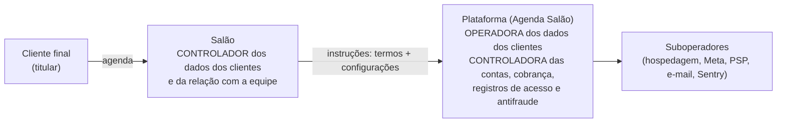

# Papéis e bases legais

> **A validar com jurídico.** Proposta técnica para orientar o produto; não é parecer.

## 1. Quem é quem

O Agenda Salão é **B2B2C**: vende para o salão (B2B), e o salão atende os clientes dele (B2C)
pela plataforma.

| Relação | Controlador | Operador | Por quê |
|---|---|---|---|
| Dados dos **clientes finais** (agenda, contato, histórico, preferências) | **Salão** | **Plataforma** | o salão decide a finalidade (atender o próprio cliente); a plataforma trata conforme as instruções (art. 39) |
| Dados de **contas de donos e da equipe** (login, MFA, sessões) | **Plataforma** | provedores como suboperadores | a plataforma decide como autenticar e proteger as contas |
| Dados de **trabalho da equipe** (agenda, comissão, vínculo) | **Salão** | Plataforma | relação de trabalho ou parceria do salão |
| **Cobrança da assinatura** do SaaS | **Plataforma** | gateway de cobrança | relação contratual com o salão |
| **Registros de acesso** (IP, data e hora) | **Plataforma** | — | obrigação do Marco Civil, art. 15 |
| **Segurança e antifraude** (OTP, rate limit, dispositivos) | **Plataforma** | — | legítimo interesse e segurança |
| **Métricas de produto cross-tenant** | **Plataforma** | — | só se **anonimizadas ou agregadas**. Usar dado de cliente final para finalidade própria (marketplace, ML, "descubra salões") torna a plataforma **controladora** e exige base própria |
| **Pagamento do sinal (Pix)** | **Salão** (e o PSP controla o que lhe cabe) | Plataforma | o dinheiro vai para a conta do salão |

**Responsabilidade do operador:** responde solidariamente se descumprir a lei ou as instruções
lícitas do controlador (art. 42, § 1º, I). Por isso o contrato (DPA) e as configurações do
salão precisam documentar as instruções ([checklist contratual](checklist-contratual.md)).

## 2. Identidade do cliente final: por salão ou global?

| Opção | Consequência |
|---|---|
| **Identidade por tenant** (proposta para o MVP) | O mesmo telefone vira registros independentes em cada salão (`customers` com UNIQUE `(tenant_id, phone_e164)`). A plataforma continua só operadora. É o mais simples juridicamente e é o que o schema da fundação faz |
| Identidade global (um login para vários salões) | A plataforma passa a ser **controladora da identidade** (telefone, nome, credencial), e cada salão continua controlador da relação. Exige base legal própria, aviso de privacidade da plataforma ao cliente final e RIPD |

A arquitetura (RLS por tenant) suporta as duas. Decisão de produto + jurídico antes da
autenticação de cliente final.

## 3. Bases legais por categoria (art. 7º e art. 11)

| Dado | Titular | Controlador | Base legal sugerida |
|---|---|---|---|
| Conta do dono (nome, e-mail, telefone, credencial, cobrança) | dono | Plataforma | art. 7º, V (execução de contrato); art. 7º, II (obrigação fiscal na cobrança) |
| Conta da equipe (login, MFA, logs de autenticação) | equipe | Plataforma | art. 7º, II (Marco Civil, art. 15) e IX (legítimo interesse: segurança da conta) |
| Agenda e trabalho da equipe | equipe | Salão | art. 7º, V ou IX (decisão do salão) |
| Cliente final: nome, telefone, e-mail, histórico, preferências | cliente | Salão | art. 7º, V (procedimentos preliminares de contrato a pedido do titular) |
| Confirmação e lembrete transacional por WhatsApp | cliente | Salão | art. 7º, V. **Também** opt-in exigido pela política da Meta (`customers.whatsapp_opt_in_at`) |
| Marketing (promoções, aniversário, "volte a cortar") | cliente | Salão | **consentimento** (art. 7º, I), granular e revogável, também exigido pela Meta para templates de marketing (`customers.marketing_consent_at`). Alternativa: legítimo interesse (art. 7º, IX + art. 10) com opt-out fácil e LIA documentada |
| **Anamnese e ficha técnica com dado de saúde** (alergias, gestação, medicamentos, condições de pele ou couro cabeludo) | cliente | Salão | **dado sensível**: art. 11, I, consentimento **específico e destacado** para finalidade específica. Salão em regra não é "profissional de saúde", então o art. 11, II, "f" não se aplica. A tese do art. 11, II, "e" (incolumidade física, por exemplo alerta de alergia a química) precisa de validação. Ver [dados sensíveis](dados-sensiveis.md) |
| Fotos de antes e depois | cliente | Salão | registro técnico do serviço: art. 7º, V. **Portfólio e redes sociais: consentimento específico** (+ direito de imagem). Nunca aplicar reconhecimento facial, que tornaria o dado biométrico e sensível |
| Pagamento e Pix (txid, valor, nome do pagador) | cliente | Salão | art. 7º, V e II (fiscal) |
| Registros de acesso (IP, data e hora) | todos | Plataforma | art. 7º, II (Marco Civil, art. 15) |
| Telemetria antifraude (OTP, dispositivo) | todos | Plataforma | art. 7º, IX |
| Dados de **crianças** | criança | Salão | art. 14, § 1º: consentimento específico de um dos pais ou responsável. O agendamento é feito pelo responsável, com o mínimo necessário e sem marketing nem perfilamento. Avaliar o ECA Digital (Lei 15.211/2025) se o serviço for de acesso provável por adolescentes |

## 4. Encarregado

- **Plataforma:** indicar encarregado (art. 41) mesmo se for agente de pequeno porte. Trata
  dados de muitos titulares de terceiros e pode tratar dado de saúde, o que tende a afastar a
  dispensa da Res. CD/ANPD nº 2/2022 (o critério de alto risco não foi verificado no texto).
  Publicar identidade e contato no site (art. 41, § 1º), com ato formal de designação e
  substituto (Res. CD/ANPD nº 18/2024). Pode ser terceirizado.
- **Salões** (ME, EPP, MEI): podem usar canal de comunicação em vez de encarregado, pela Res.
  2/2022. O produto oferece um **canal do titular** pronto por salão, na página pública.

## 5. Registro das operações (art. 37) e RIPD (art. 38)

- Dois registros: a plataforma como **controladora** e como **operadora**. A parte técnica sai
  do [inventário de dados](inventario-de-dados.md). Proposta: classificar cada coluna no
  próprio schema (`COMMENT ON COLUMN ... IS 'pii=contato;base=7V;ret=24m'`), com checagem no
  CI que falha se coluna nova em `app` não tiver classificação.
- **RIPD** obrigatório na prática para a anamnese e fotos e, se adotada, para a identidade
  global do cliente final.

## Referências

- LGPD: https://www.planalto.gov.br/ccivil_03/_ato2015-2018/2018/lei/l13709.htm
- ANPD (resoluções e guias): https://www.gov.br/anpd
