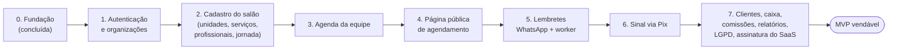

# MVP e roadmap

## 1. Onde estamos

**Iteração 0 (fundação) concluída:** monorepo, motor de disponibilidade, schema com RLS e
garantias no banco, esqueleto seguro do app web, CI e supply chain, kit Claude Code e esta
documentação. Ainda **não** há tela de produto utilizável por um salão.

A meta do MVP, estimada na pesquisa de domínio, é de **10 a 12 semanas com 2 a 3 pessoas**, a
contar do início da iteração 1. É estimativa, não compromisso.

## 2. Sequência de iterações até o MVP

Histórias e critérios em [backlog-inicial.md](backlog-inicial.md). Cada iteração começa com um
threat model quando toca dado pessoal, pagamento, autenticação ou página pública.

## 3. MVP: o mínimo vendável

1. **Onboarding self-service em até 10 minutos:**
   - unidade com fuso, profissionais e serviços a partir de templates por segmento (barbearia,
     salão, unhas) e jornada;
   - link público pronto;
   - checklist para Instagram, Perfil da Empresa no Google e WhatsApp.
2. **Agenda da recepção e do profissional:**
   - visão de dia e de semana por profissional, mobile-first;
   - criar, mover e cancelar;
   - bloqueios, folgas e feriados;
   - status (chegou, em atendimento, concluído);
   - pausas de serviços multi-etapa visíveis ("livre durante a pausa da coloração").
3. **Página pública de agendamento** (PWA, sem app e sem senha):
   - escolher serviço, profissional (ou "qualquer"), dia e horário;
   - informar nome e celular, com OTP por WhatsApp configurável;
   - opt-in transacional registrado;
   - remarcar e cancelar pelo link.
4. **WhatsApp transacional:** confirmação, lembrete de 24 h com botões e cancelamento. Número da
   plataforma, com `wa.me` como fallback.
5. **Clientes:** cadastro, histórico, observações (sem saúde), preferências, flag de "exige
   sinal" e importação por CSV.
6. **Sinal via Pix** (Mercado Pago OAuth), opcional por serviço ou cliente. A política é exibida
   e aceita antes, com devolução automática nos casos previstos.
7. **Caixa simples:** pagamento em dinheiro, Pix, cartão na maquininha ou outro; desconto e
   gorjeta. Sem integração TEF.
8. **Comissões:** percentual por profissional e serviço, snapshot, extrato do período, regime
   de comissão ou cota-parte.
9. **Relatórios:** faturamento, atendimentos, ticket médio, **no-show**, cancelamentos tardios,
   **ocupação**, % de agendamentos online, top serviços e profissionais.
10. **LGPD:**
    - consentimentos;
    - exportação e anonimização do cliente;
    - auditoria;
    - aviso de privacidade e termos;
    - DPA com o salão.
11. **Assinatura do SaaS:** trial, planos por profissional ativo e **cancelamento
    self-service sem multa**.

**Fora do MVP:** anamnese e fotos (exigem criptografia de campo e RIPD), clube de assinatura,
NFS-e, Google Calendar, número próprio de WhatsApp.

## 4. Fases seguintes

### Fase 2 (meses 4 a 6 após o MVP)

- Lista de espera automática (oferta por WhatsApp, quem confirmar primeiro leva) e "slots
  inteligentes" contra fragmentação.
- Clube de assinatura (Asaas ou Efí, cartão e Pix Automático) e pacotes.
- NFS-e via agregador (Emissor Nacional), com campos de IBS/CBS em 2027.
- Google Calendar (saída) e WhatsApp com número próprio (Embedded Signup + Coexistence).
- Avaliações pós-atendimento e NPS.
- Recursos (salas, macas) com UI; combos; estoque.
- Fechamento mensal de comissões (vales, adiantamentos, travamento).
- Ficha técnica e anamnese com criptografia de campo; fotos de antes e depois.

### Fase 3 (meses 7 a 12)

- Split e repasse automático, com contrato de salão-parceiro completo (upload, homologação,
  retenções).
- Reserve with Google (Redirect primeiro).
- Campanhas de marketing com crédito pré-pago e segmentação (clientes sumidos há 45 dias,
  aniversariantes com consentimento).
- Recepcionista por IA no WhatsApp (agenda, remarca e responde preço). Mensagens de serviço
  agora são cobradas, então o custo entra no plano.
- Marketplace e app do cliente (avaliar), multi-unidade avançado, BI.

## 5. Métricas

### Do salão (mostradas a ele; também medem o nosso valor)

| Métrica | Definição |
|---|---|
| **Taxa de no-show** | `no_show / (completed + no_show)` por mês local, sem contar cancelados. Medir o baseline de cada salão antes e depois dos lembretes. Os benchmarks públicos são fracos |
| Cancelamento tardio | cancelados pelo cliente dentro da janela / total |
| **Ocupação** | Σ minutos ocupados (ocupações de agendamentos confirmados e concluídos) / Σ minutos disponíveis (jornada − folgas), por profissional, dia da semana e hora |
| Receita por hora disponível | faturamento concluído / horas disponíveis |
| Ticket médio | faturamento / atendimentos concluídos |
| Retorno | % dos clientes do mês M que voltam em até 45, 60 ou 90 dias |
| % online | `source = 'online'` / total |
| Abandono no sinal | `expired` / `pending` criados |
| Confirmação de presença | clientes que tocaram "Confirmo" / lembretes enviados |
| Custo de WhatsApp por agendamento | Σ custo das mensagens / atendimentos |

### Do SaaS

| Métrica | Definição |
|---|---|
| **Ativação** | salão que em 7 dias cria pelo menos 1 profissional, 3 serviços e a jornada, e recebe o **1º agendamento online** |
| Engajamento | salões com pelo menos X agendamentos por semana; WAU/MAU da equipe |
| Receita | MRR, ARPA, expansão (profissionais adicionados), receita de mensagens |
| Retenção | churn de logo e de receita por coorte, NRR |
| Aquisição | CAC, payback, canal (indicação, Instagram) |
| Qualidade | **incidentes de agenda: meta 0**; falhas de envio de lembrete; tempo até a 1ª resposta do suporte; NPS do salão |

Métricas de produto cross-tenant só com dados **agregados ou anonimizados**
([LGPD](../lgpd/papeis-e-bases-legais.md)).
