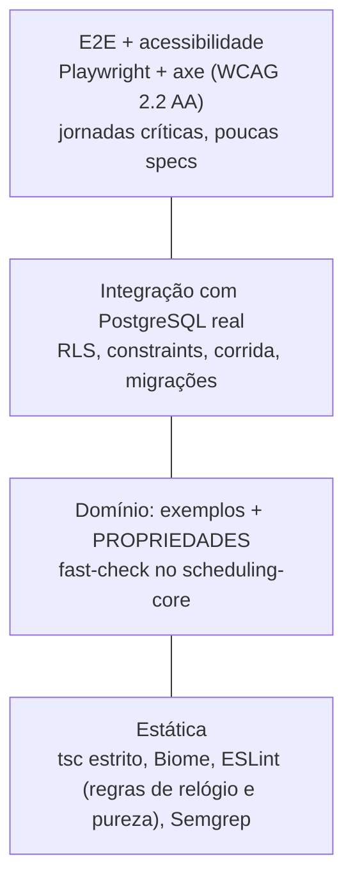

# Estratégia de QA e automação de testes

O risco deste produto se concentra em três lugares:

1. **Regras de tempo:** jornada, pausas, buffers, antecedência, fuso e horário de verão.
2. **Concorrência e consistência:** dupla reserva, cancelamento e remarcação.
3. **Isolamento multi-tenant:** vazamento entre salões, que também é risco de LGPD.

A UI é relativamente simples. Por isso o formato é um **troféu com base de domínio larga**:
muitas propriedades no domínio puro, integração com PostgreSQL real e E2E fino, focado em
jornadas. Regras de trabalho (TDD, testes intocáveis) estão no [CLAUDE.md](../../CLAUDE.md).

## 1. Camadas



| Camada | Ferramenta | O que cobre | Onde roda | Status |
|---|---|---|---|---|
| Estática | `tsc` (strict), Biome, ESLint 10 | tipos, lint, pureza do domínio, relógio, fuso da máquina (`new Date` com data-hora sem offset, `Date.parse`), dicas de exclusão de cobertura, testes desligados (`.only`, `.skip`, `todo` e equivalentes) | `pnpm verify`; pre-commit (Biome nos arquivos staged); pre-push (`turbo run typecheck lint test`); CI (job `static`) | [fundação] |
| Estática | Semgrep (regras próprias em `.semgrep/rules` + pacotes do registry) | SQL cru, PII em log, escopo de tenant, Server Action sem guarda, data no fuso do servidor | só no CI (job `semgrep` do `security.yml`, parte do `security-ok`). Local, à mão: `semgrep scan --metrics=off --config .semgrep/rules .` | [fundação] |
| Estática | knip | código e dependências sem uso | `pnpm verify` (depois do lint); CI (job `static`, dentro do `ci-ok`); manual (`pnpm knip`). Fora dos hooks Git | [fundação] |
| Unit (exemplos) | Vitest 5 | regras como documentação viva | `pnpm test` | [fundação] |
| Propriedades | fast-check 4 + `@fast-check/vitest` | invariantes do motor (P1 a P15), intervalos, dia local, formato de fuso, máquina de estados | `pnpm test` (100 casos); noturno com 2000 casos em três fusos ([`nightly.yml`](../../.github/workflows/nightly.yml)) | [fundação] |
| Model-based | `fc.commands` | agenda como máquina de estados (agendar, cancelar, remarcar) | `pnpm test` | [planejado] |
| Integração e RLS | Vitest + `pg` + PostgreSQL real | migrações, RLS, constraints, `23P01`, triggers, invariantes, corrida | `pnpm test:db` | [fundação] |
| Contrato de API | Zod → OpenAPI 3.1, testes de handler, oasdiff, Schemathesis | API pública `/api/v1` | PR e noturno | [planejado] |
| Componentes | Vitest Browser Mode | seletor de horário, calendário | PR | [planejado] |
| E2E | Playwright 1.64 | jornadas: cliente agenda (mobile), equipe opera o painel, IDOR por URL, cabeçalhos | `pnpm e2e` | [fundação: home, a11y, cabeçalhos e cobertura do Proxy, fixture de console, env em runtime] |
| Acessibilidade | `@axe-core/playwright` + testes de teclado | WCAG 2.2 AA automatizável em cada estado | `pnpm e2e` | [fundação] |
| Visual | `toHaveScreenshot` em container | regressão visual do widget público e do painel | noturno | [planejado] |
| Mutação | Stryker | qualidade dos testes do domínio | noturno | [planejado] (seção 8) |
| Carga | k6 | disponibilidade em pico + disputa de horário | semanal, em staging | [planejado] |
| DAST | OWASP ZAP baseline | cabeçalhos, misconfig, vazamento | PR e 2× por semana | [fundação] (não obrigatório ainda) |

Não teste Server Components `async` em unit: a documentação do Next diz que o Vitest não os
suporta e recomenda E2E. Mantenha os RSC finos e a lógica em funções puras ou serviços.

## 2. Convenções de nome

O sufixo roteia o runner e o tipo de teste:

| Sufixo | Tipo | Runner | Comando |
|---|---|---|---|
| `*.test.ts` | unit / exemplo | Vitest | `pnpm test` |
| `*.prop.test.ts` | propriedade (fast-check), tag `property` | Vitest | `pnpm test` |
| `*.int.test.ts` | integração com banco real | Vitest (projeto `db:integration`) | `pnpm test:db` |
| `*.rls.test.ts` | isolamento multi-tenant | Vitest (projeto `db:integration`) | `pnpm test:db` |
| `*.spec.ts` | **somente Playwright** | Playwright | `pnpm e2e` |

Escrita:

- um `describe` por unidade; nomes como frase ("deve…", "nunca deve…"); AAA visível;
- exemplos primeiro, propriedades depois;
- prefira stubs a mocks; rede só falsa (nunca real);
- todo teste precisa **falhar** se a condição que o faz passar for removida: confira no red;
- no Playwright, locators por papel e nome acessível (`getByRole`, `getByLabel`). `data-testid`
  só como último recurso.

## 3. Gates

| Gate | O que exige | Onde |
|---|---|---|
| Local | `pnpm verify` (formato, lint, knip, tipos, testes, build) antes de cada commit; `pnpm test:db` se mexeu no banco; `pnpm e2e` se mexeu em UI; `pnpm test:hooks` se mexeu em `.claude/hooks` ou em `.claude/settings.json` | skill `verify` |
| Pre-commit / pre-push | Biome nos arquivos staged; gitleaks se instalado; commitlint na mensagem; typecheck, lint e test dos pacotes no push. Opcional: só vale depois de `pnpm hooks:install` | `lefthook.yml` |
| PR (obrigatório) | **`ci-ok`**: `static` (format, lint, knip, typecheck), `test` (`pnpm test`, que inclui `pnpm test:root`, na matriz `TZ=UTC` e `TZ=America/Sao_Paulo`), `test-db` (PostgreSQL 18.6; antes, confere que a imagem do `compose.yaml` é a mesma do serviço, em tag e digest), `build`, `e2e` e `hooks` (`pnpm test:hooks` + `tsc -p .claude/hooks`) | [`ci.yml`](../../.github/workflows/ci.yml) |
| PR (obrigatório) | **`security-ok`**: gitleaks; Semgrep (`semgrep --test` das regras antes da varredura); `osv` (OSV-Scanner com a imagem pinada por digest: no PR, só falha o que o PR acrescenta em relação à base; nos demais eventos, varredura completa; decisão pelo exit code); Trivy (vulnerabilidades); dependency-review (só em PR); zizmor; actionlint e shellcheck (todo `*.sh` versionado, menos as skills de terceiros; shellcheck 0.11.0 da própria imagem pinada do actionlint); `pnpm audit signatures`, `pnpm audit` e SBOM | [`security.yml`](../../.github/workflows/security.yml) |
| PR (obrigatório) | **`pr-title`**: commitlint no título atual do PR, lido pela API REST, de novo a cada edição (evento `edited`). Cobre a mensagem padrão do squash, não a final, que o diálogo de merge ainda deixa editar | [`pr-title.yml`](../../.github/workflows/pr-title.yml) |
| PR (consultivo) | ZAP baseline (em calibração); revisão do Claude | `dast.yml`, `claude-review.yml` |
| Agendado (consultivo) | propriedades do core com `FC_NUM_RUNS=2000` em `TZ=UTC`, `America/Sao_Paulo` e `Pacific/Kiritimati`, todo dia às 05:43 UTC; não é check obrigatório. Só dispara (cron ou manual) depois que o arquivo estiver na branch padrão (seção 5) | [`nightly.yml`](../../.github/workflows/nightly.yml) |

Meta de tempo do PR: **menos de 12 minutos** de relógio.

## 4. Cobertura

Cobertura é piso, não meta. O que mede de verdade o domínio são as propriedades e, no futuro,
o score de mutação.

| Pacote | Limiar | Status |
|---|---|---|
| `@salon/scheduling-core` | **95% linhas, 90% ramos, 95% funções e instruções, por arquivo** | [fundação] (configurado em `vitest.config.ts` e fixado pelo meta-teste `test/test-hygiene.test.ts`, que também recusa dicas de exclusão de cobertura) |
| `@salon/db` (`src/`) | meta: 85% linhas e 75% ramos, via unit + integração | [planejado] como gate |
| `apps/web/src/server` | meta: 80% linhas e 70% ramos | [planejado] |
| Componentes e rotas | cobertos por E2E e Browser Mode, fora do gate | — |

Nunca baixe um limiar para o PR passar (regra do CLAUDE.md).

## 5. Tempo e relógio

- **Domínio:** "agora" só pelo `Clock` injetado (`systemClock` em produção, `fixedClock(...)`
  em teste). O ESLint proíbe `Date.now`, `new Date()` sem argumento, `Date()`, `Temporal.Now`,
  `performance.now`, `Math.random`, getters locais de `Date` e `resolvedOptions` no core. O
  teste `test/lint-rules.test.ts` prova que as regras disparam.
- **Fora do domínio** (web, db, scripts e testes de todos os pacotes): o bloco
  `salon/fuso-da-maquina` do `eslint.base.mjs` proíbe `new Date` com data-hora em texto sem Z
  ou offset (inclusive `t` minúsculo, ano expandido e template como `` `${dia}T10:00` ``) e
  qualquer `Date.parse`. A prova, contra a config real de cada pacote, é `eslint.base.test.mjs`
  (`pnpm test:root`). A regra Semgrep `server-timezone-date` usa a mesma expressão, fora de
  testes.
- **Fusos nas propriedades:** os arbitrários puxam datas das transições reais do tzdata em 14
  fusos (Brasil, Nova York, Santiago, Lisboa, Londres, Lord Howe, Chatham, Kathmandu,
  Kiritimati, Apia, `Etc/UTC`) e, à parte, dos dias em que o relógio voltou para a véspera (St.
  John's, Goose Bay, Moncton, Casey). O Brasil não tem horário de verão desde 2019, mas o motor
  precisa sobreviver à volta dele.
- **Fuso da máquina:** o CI roda os testes em `TZ=UTC` e `TZ=America/Sao_Paulo`, e o noturno
  roda as propriedades do core também em `TZ=Pacific/Kiritimati`. Localmente:
  `TZ=Pacific/Kiritimati pnpm --filter @salon/scheduling-core test`.
- **Banco:** `withTenant` fixa `TimeZone=UTC` e o isolamento READ COMMITTED na transação.
- **E2E:** no navegador, `page.clock`. No servidor, um relógio deslocado controlado por variável
  só com `APP_ENV=e2e`, com trava contra produção e teste unitário da trava [planejado]. Fora dos
  testes visuais, prefira cenários relativos a "agora" (o próximo dia útil com jornada).
- **Reproduzir falha de propriedade:** o fast-check imprime `seed` e `path`.

  ```bash
  # uma propriedade: filtre o arquivo e o teste, sem o script `test`
  FC_SEED=<seed> FC_PATH=<path> pnpm --filter @salon/scheduling-core exec vitest run <arquivo> -t '<nome do teste>'
  # a mesma ordem de arquivos e testes (semente do Vitest)
  pnpm --filter @salon/scheduling-core test --sequence.seed=<semente>
  FC_NUM_RUNS=2000 pnpm --filter @salon/scheduling-core test   # mais casos (~3 min)
  ```

  `FC_SEED` e `FC_PATH` valem para todas as propriedades da execução (as outras falham com
  "Unable to replay"), por isso o filtro. O script `test` com filtro de arquivo não serve: ele
  liga a cobertura por arquivo, e os arquivos não carregados reprovam com 0%. O
  `@fast-check/vitest` acrescenta `(with seed=N)` ao nome do teste, e `-t` casa por trecho.

  **Job noturno** [fundação]: [`nightly.yml`](../../.github/workflows/nightly.yml) roda todo dia
  às 05:43 UTC (e sob demanda, por `workflow_dispatch`) o script `test` do core, com cobertura
  e os mesmos limiares, com `FC_NUM_RUNS=2000` em `TZ=UTC`, `America/Sao_Paulo` e
  `Pacific/Kiritimati` e com `CI=1`: propriedade acima de 120 s conta como falha. Em falha, o
  resumo do run traz a semente do Vitest, as linhas FAIL e o `seed`/`path` do fast-check, com
  os comandos acima. Não é check obrigatório. O cron e o disparo manual só valem com o arquivo
  na branch padrão (documentação do GitHub sobre `schedule` e `workflow_dispatch`;
  [bootstrap](../../.github/rulesets/README.md#0-bootstrap-repositório-que-já-existe-com-branch-padrão-diferente-de-main)):
  até o merge da fundação, o equivalente é rodar os comandos acima localmente. O benchmark de
  `computeAvailableSlots` no noturno é [planejado].

  Todo contraexemplo reduzido vira **teste de exemplo de regressão**.

## 6. Banco real e RLS

- **Harness:** `pnpm test:db` usa `TEST_DATABASE_URL`, que precisa ser o superusuário de um
  cluster **de teste**. Sem ela,
  [`scripts/with-local-postgres.sh`](../../scripts/with-local-postgres.sh) sobe um PostgreSQL
  **16 ou mais novo** efêmero com os binários locais: só em `127.0.0.1`, senha aleatória, UTC,
  removido ao sair. Ordem de busca dos binários: `PG_BIN_DIR`, o `initdb` do `PATH`,
  `/usr/lib/postgresql/<versão>/bin` (a maior) e `pg_config --bindir`. Sem binários, ou com
  versão anterior à 16, o script sai com código 69 e lista as alternativas:
  - binários locais ou `PG_BIN_DIR` (macOS com Homebrew:
    `PG_BIN_DIR="$(brew --prefix postgresql@16)/bin"`);
  - Docker ou Podman: `docker compose up -d --wait postgres-test`, com a `TEST_DATABASE_URL`
    indicada no [`compose.yaml`](../../compose.yaml) (mesma imagem e digest do CI, porta só em
    loopback, dados em memória). O job `test-db` falha se a imagem do `compose.yaml` divergir
    da do serviço do CI, e o Renovate atualiza as duas num PR só (grupo `postgres-test-image`).
    O arquivo passa no `docker compose config`, mas subir o serviço não foi verificado (a
    sessão na nuvem não tem daemon do Docker);
  - qualquer cluster descartável. No Windows, só pelo WSL 2.

  O global setup cria um banco descartável, aplica as migrações **com o runner de produção**,
  dá senhas aleatórias a `app_user` e `app_worker` e apaga tudo no fim. O próprio script tem
  testes sem PostgreSQL (`scripts/with-local-postgres.test.mjs`, em `pnpm test:root`).
- **Versões:** o CI usa PostgreSQL 18.6 (imagem por digest), que é a fonte de verdade. A sessão
  na nuvem do Claude Code tem só o 16.15 e não roda Docker (há o cliente, sem daemon). O schema
  é compatível com os dois (sem `uuidv7()` no banco; UUIDv7 gerado na aplicação), e um teste
  estático garante isso. Duas comparações de `assert_security_invariants()` só foram validadas
  no 16.15: a da política RESTRICTIVE canônica (deparse da expressão) e a da definição dos
  triggers críticos (campos de `pg_trigger`, sem `pg_get_triggerdef`). Se o 18 divergir, o
  `pnpm test:db` do CI falha fechado (não verificado no 18).
- **Os testes conectam como `app_user` e `app_worker`**, nunca como dono ou superusuário (que
  ignorariam a RLS).
- **Coberto hoje** ([README do db](../../packages/db/README.md#testes)):
  - isolamento em todas as tabelas: leitura, UPDATE, DELETE, INSERT com tenant alheio, UPDATE que
    troca `tenant_id`, ausência de contexto, FK cruzada, PK global (id de outro tenant vira
    `IdentifierConflictError` sem tocar a linha dele) e `app_worker` (só altera status);
  - regressão do `''` → `22P02` do GUC na mesma conexão;
  - `tx` que escapa do callback de `withTenant` (builder devolvido, `Promise.all` com ramo que
    falha) é recusado com `TransactionClosedError` e não lê nem grava na transação de outro
    tenant; READ COMMITTED fixo mesmo com outro padrão na sessão; conexão derrubada no meio do
    callback (`pg_terminate_backend` real) faz o `withTenant` rejeitar, sai do pool e não vira
    erro não capturado. A janela entre o callback e o COMMIT, o descarte da conexão quando
    BEGIN, COMMIT ou ROLLBACK falham ou há consulta em voo, e o ouvinte de `error` da conexão
    emprestada têm testes de unidade com um `PoolClient` falso
    (`packages/db/src/tenant.test.ts`, sem banco);
  - `EXCLUDE`: sobreposição, intervalos encostados, cancelado ou no-show liberando, reativação
    colidindo e **corrida real** (exatamente uma vence);
  - ocupação amarrada ao item (profissional, janela com buffers, sem DELETE nem troca de
    horário) e completude no COMMIT (cada fase `work` coberta por ocupação `service`, não só a
    primeira, e nunca por `buffer`; itens dentro da visita; item novo numa visita já
    confirmada, em outra transação);
  - visita (unidade, fuso, horário) e item (profissional, horário, fases, buffers) imutáveis,
    coluna a coluna; instantes de transição, hold e `created_at` gravados pelo banco; hora
    repetida do fim do horário de verão distinguida pelo offset; precisão de milissegundo;
    jornada em minuto cheio; fuso sem dígito (recusa `Etc/GMT+3`, `UTC` e nomes POSIX
    inventados);
  - paridade com o core no banco migrado: todo fuso aceito pelo banco passa no core, uma
    amostra fixa (os 16 fusos do Brasil, `Etc/UTC` e os fusos dos testes do core) passa nos dois
    lados, os fusos recusados do exemplo são recusados também pelo core (o contrário não vale
    para tudo: um link legado como `US/Eastern` passa no core e é recusado pelo CHECK de um
    PostgreSQL sem `tzdata-legacy`, que falha fechado), e o CHECK
    `occupancies_kind_valid` aceita exatamente `OCCUPANCY_KINDS` (a mesma paridade é conferida
    sem banco, no schema e nas migrações, por `packages/db/src/occupancy-kinds-sync.test.ts`);
  - os 81 pares da máquina de estados;
  - auditoria append-only;
  - meta-testes de catálogo, inclusive sabotagens que a função de invariantes precisa detectar
    (política neutralizada, `SECURITY DEFINER` em schema novo, posse, ACL de schema, trigger e
    `EXCLUDE` removidos, trigger crítico recriado com outro evento, sem adiar, com `WHEN` ou
    com outra função, dono com LOGIN);
  - runner: idempotência, lock concorrente, imutabilidade, rollback e falha fechada quando a
    função de invariantes some, é renomeada ou esvaziada.
- **Regra:** tabela nova com `tenant_id` precisa de RLS + `FORCE` + políticas + um caso em
  `*.rls.test.ts`. O meta-teste e a função de invariantes falham se faltar.
- **Isolamento entre testes:** cada arquivo cria os próprios tenants, sem `TRUNCATE`, e cada
  teste usa dia ou horário próprio. Isso permite a ordem aleatória (seção 12) e espelha o
  multi-tenant real. Os arquivos de integração rodam um por vez (`fileParallelism: false`),
  porque há testes de corrida e de catálogo que observam o banco inteiro.
- **Planejado:** rodar os meta-testes de catálogo e de papéis contra **staging e produção** com o
  papel real, porque o risco está na configuração implantada.

## 7. E2E e acessibilidade

- **Configuração** ([`apps/web/playwright.config.ts`](../../apps/web/playwright.config.ts)):
  - projetos `chromium` (desktop) e `mobile` (Galaxy A55, porque o público é majoritariamente
    Android);
  - `webServer` com `next build && next start` em `127.0.0.1:3100` e `APP_ENV=e2e`, o mesmo
    build de produção com a CSP real;
  - `retries: 2` só no CI; trace no primeiro retry; `forbidOnly: true` sempre;
  - o que não se aplica a um projeto sai pela config, nunca por `test.skip` no corpo: os specs
    que não dependem do dispositivo (`security-headers`, `console-guard`, `runtime-env`) ficam
    no `testIgnore` do `mobile`; teste só de desktop leva `{ tag: '@desktop-only' }`, que o
    `grepInvert` do `mobile` exclui; com `E2E_BASE_URL` (ambiente já no ar, sem build local), o
    `runtime-env.spec.ts` sai de todos os projetos. Confira com `playwright test --list`; o
    meta-teste do web fixa esse mapa (seção 12).
- **Fixture automática** ([`e2e/support/console.ts`](../../apps/web/e2e/support/console.ts)):
  qualquer erro de console, aviso de `Permissions-Policy` ou exceção na página reprova o teste.
  Isso pega violação de CSP, falha de hidratação, 404 de recurso e `Permissions-Policy` com
  recurso desconhecido. Só o aviso de `bluetooth` é tolerado (o Chromium do Linux não o
  reconhece), e a exceção do 404 vale só para o próprio documento da página 404, nunca para CSS
  ou JS. O classificador é testado com mensagens reais do Chromium em `console-guard.spec.ts`.
- **Navegador:** rode uma vez `pnpm --filter @salon/web exec playwright install --with-deps
  chromium` (no CI e localmente). O fallback descrito abaixo é para container sem acesso ao
  download.
- **Acessibilidade:** axe com `wcag2a`, `wcag2aa`, `wcag21a`, `wcag21aa` e `wcag22aa`, nos
  temas claro e escuro, **em cada estado do fluxo** (inicial, serviço escolhido, calendário
  aberto, horário selecionado, formulário com erro, confirmação). Não use `exclude()` como
  atalho: ele remove todas as regras do elemento. O axe **não substitui** teclado ponta a ponta,
  foco visível, `aria-live` ao trocar dia ou horário, alvo de toque ≥ 24×24, zoom de 200% e
  auditoria manual com leitor de tela (TalkBack e VoiceOver) por release.
- **Specs planejadas:**
  - cliente agenda pelo celular;
  - dois clientes disputam o mesmo horário (só um confirma; o outro vê alternativas);
  - agendamento só com teclado;
  - painel do dono;
  - IDOR por URL (404);
  - matriz HTTP papel × rota com dois tenants.
- **Navegadores no container da nuvem:** o Playwright 1.64.0 pede uma revisão do Chromium que o
  proxy impede de baixar. A configuração cai na maior revisão disponível em
  `PLAYWRIGHT_BROWSERS_PATH`, com aviso e risco de diferença de versão. **O CI, com o navegador
  certo, é a referência.**

## 8. Mutation testing

- **Onde vale:** só no `@salon/scheduling-core` (motor, políticas) e, depois, nos validadores.
  Em UI e adaptadores de I/O o custo não compensa.
- **Bloqueio conhecido:** o `@stryker-mutator/vitest-runner` 10.0.0 monta nomes de teste com
  espaço, mas o Vitest 5 casa nomes completos unidos por `' > '`. Testes dentro de `describe`
  não rodam, e os mutantes aparecem como "Survived" falsos (issue
  [stryker-js#6210](https://github.com/stryker-mutator/stryker-js/issues/6210)).
- **Até a correção:**
  - `testRunner: "command"` (correto, mais lento) no noturno;
  - meta `break: 75`, subindo para 80;
  - canário: falhar o job se `killed == 0` enquanto houver testes cobrindo.
- Cada mutante sobrevivente vira triagem: falta teste, ou o mutante é equivalente (anotar com
  justificativa).

## 9. Segurança automatizada

| Ferramenta | Quando | Bloqueia? | Status |
|---|---|---|---|
| RLS + meta-testes de catálogo + invariantes | PR | sim | [fundação] |
| Matriz de autorização papel × rota × tenant, com meta-teste "toda rota tem entrada" | PR | sim | [planejado] |
| Fuzz de validadores (fast-check: `safeParse` nunca lança; normalização de telefone) | PR | sim | [planejado] |
| Teste de cabeçalhos e CSP (Playwright) | PR | sim | [fundação] |
| Semgrep com regras próprias | PR | sim | [fundação] |
| ZAP baseline | PR (paths do app) e 2× por semana | ainda não (calibrando `.zap/rules.tsv`) | [fundação] |
| ZAP API scan, Schemathesis | noturno, em staging | não / sim (5xx ou schema) | [planejado] |
| Casos de abuso do agendamento | PR e pentest | sim | [modelo de ameaças](../seguranca/modelo-de-ameacas.md#6-casos-de-abuso-do-agendamento) |

## 10. Carga [planejado]

Ferramenta: k6 (binário Go; o pacote npm `k6` é placeholder). Dois cenários em staging com
dados sintéticos:

1. **Disponibilidade em pico** (`ramping-arrival-rate`): p95 < 300 ms, erros < 1%.
2. **Disputa de horários quentes** (`constant-arrival-rate`): **respostas só 201 ou 409, nunca
   5xx**.

Depois da carga, uma consulta SQL confirma **zero ocupações ativas sobrepostas**. O rate limit
da API pública precisa de exceção para o IP do runner, senão o teste mede o limitador. Nunca
rodar contra produção.

## 11. Dados de teste e LGPD

- **Nunca** use dado real de produção em teste, seed, fixture, print ou prompt de IA. Só dados
  sintéticos (nomes e telefones fictícios; fast-check para entradas).
- O gitleaks tem regras para CPF e CNPJ formatados. Fixtures só com os valores sintéticos da
  allowlist.
- Nenhum envio real de WhatsApp, SMS ou e-mail em teste: adaptadores falsos atrás de portas.
- Seeds determinísticos (seed fixa) para demos e testes visuais. Em integração e E2E, um tenant
  novo por teste.

## 12. Testes instáveis (flaky)

- **Definição:** resultado diferente no mesmo commit.
- **Unit, propriedade e integração:** sem retry (`retry: 0` explícito no core e nos dois
  projetos do db; no web vale o padrão, 0, fixado pelo meta-teste). Instabilidade aqui é bug
  (relógio, ordem, aleatoriedade sem seed, estado compartilhado).
- **Ordem aleatória** [fundação]: `sequence.shuffle` embaralha arquivos e testes no core, no
  web e nos dois projetos do db. Na integração do db, que roda um arquivo por vez, a ordem dos
  arquivos também é sorteada (pela raiz da config). O Vitest imprime a semente (`Running tests
  with seed "..."`), e `--sequence.seed=<n>` reproduz a ordem, por exemplo
  `pnpm --filter @salon/scheduling-core test --sequence.seed=<n>`. Cada meta-teste de higiene
  fixa a opção no seu pacote.
- **E2E:** `retries: 2` no CI. Teste que só passa no retry é marcado como flaky no relatório.
  Specs novas ou alteradas passam por **burn-in** (`--repeat-each=5 --fail-on-flaky-tests` nas
  specs alteradas) [planejado].
- **Quarentena:** tag `quarantine` (Vitest) ou `@quarantine` (Playwright), com issue, dono e
  **prazo de 7 dias**, nunca `.skip`. Roda num job à parte que não bloqueia (o job ainda não
  existe [planejado]). Teto de **5** testes em quarentena; acima disso, para tudo e conserta.
  Prazo vencido: reescrever ou remover com justificativa.
- **Proibido:**
  - `sleep` ou `waitForTimeout` para "estabilizar";
  - aumentar timeout sem diagnóstico;
  - teste focado, pulado, pendente ou "esperado falhando" (`.only`, `.skip`, `.todo`,
    `.skipIf`, `.runIf`, `.fails`, `ctx.skip()`, `test.fixme` e equivalentes).
- **Quem barra isso hoje** [fundação], em três camadas, da sintaxe ao resultado:
  1. **Lint e configuração dos runners** (sintaxe, no editor e no `pnpm lint`):
     - **Biome** (`pnpm lint`, pre-commit e CI): `noFocusedTests` e `noSkippedTests` como
       erro, e o plugin GritQL
       [`biome-plugins/no-disabled-tests.grit`](../../biome-plugins/no-disabled-tests.grit),
       restrito a arquivos de teste, para o que as regras nativas não veem: `todo`, `skipIf`,
       `runIf`, `fails`, modificadores encadeados ou depois de `each`, pulo em runtime
       (`ctx.skip`, `testInfo.skip`/`fixme`/`fail`), colchetes e opções `{ skip, todo, fails,
       only }` escritas na própria chamada. A prova é `biome-plugins/no-disabled-tests.test.mjs`,
       que roda em `pnpm test:root` (incluído em `pnpm test`);
     - **ESLint** (todos os pacotes e a raiz): o bloco `salon/cobertura-honesta` do
       `eslint.base.mjs` (`no-warning-comments`) recusa dicas de exclusão de cobertura
       (`v8 ignore`, `c8 ignore`, `istanbul ignore`, `node:coverage`) em qualquer arquivo. A
       prova, contra a config real de cada pacote, é `eslint.base.test.mjs` (`pnpm test:root`);
     - **runners:** `allowOnly: false` no Vitest do core, do web e dos dois projetos do db
       (`.only` quebra também fora do CI) e `forbidOnly: true` sempre no Playwright.
  2. **Meta-testes de higiene, pelo TEXTO** (`test-hygiene.test.ts`, um por pacote:
     [core](../../packages/scheduling-core/test/test-hygiene.test.ts),
     [db](../../packages/db/test/test-hygiene.test.ts) e
     [web](../../apps/web/src/test-hygiene.test.ts)). Varrem o código linha a linha (`src/` e
     `test/`; no web, `src/` e `e2e/`), inclusive sob `eslint-disable` ou `biome-ignore`, atrás
     de dica de exclusão de cobertura e de teste focado, pulado, pendente ou "esperado
     falhando" por modificador, colchetes, pulo pelo contexto ou chave no objeto de opções (com
     dois pontos, entre aspas ou computada, na chamada, numa variável ou em linha própria; ou
     abreviada no início ou no fim do objeto). O texto não vê opção espalhada (`...opcoes`),
     abreviada no meio do objeto nem pulo computado: isso fica para a camada 3. Cada um também
     fixa a config do Vitest (a lista exata de chaves, para que nenhum filtro como
     `testNamePattern`, `tagsFilter` ou `exclude` entre em silêncio; `allowOnly`, ordem
     aleatória, `retry` e reporters), o script que roda o Vitest (um `--reporter` na linha de
     comando substituiria a lista) e o contrato do reporter compartilhado: o caminho da config
     aponta para o arquivo importado, a classe é um `Reporter` do Vitest instalado (`tsc`) e
     tem os ganchos `onInit`, `onTestRunStart` e `onTestRunEnd`. Por pacote:
     - **core:** chave `skip`, `todo`, `fails` ou `only`. Fixa também os pisos de cobertura, o
       `include`, o script `test` (`vitest run --coverage`) e as tags (só nome, descrição e
       timeout, para nenhuma tag aplicar `skip`, `fails` ou `retry`);
     - **db:** chave `skip`, `todo` ou `only`. A chave `fails` fica de fora do texto de
       propósito, porque é dado legítimo da tabela do `it.each` de `src/tenant.test.ts`; a falha
       esperada reprova pela camada 3. Exige que todo arquivo `*.test`/`*.spec` seja coletado
       por exatamente um projeto (`db:unit` ou `db:integration`) e fixa as chaves da raiz
       (`projects`, `reporters`, `sequence`), cada projeto por inteiro e os scripts `test` e
       `test:db`;
     - **web:** chave `skip`, `todo`, `fails` ou `only`; `fixme`, `fail` e `slow` do
       Playwright, também em runtime (`testInfo.fixme()`, `test.info().skip()`); e a anotação
       com tipo de modificador (`annotation: { type: 'skip' | 'fixme' | 'fail' | 'slow' }`),
       que o Playwright aplica como o próprio modificador. Exceção só pela `ALLOWLIST` do
       arquivo (trecho e motivo; hoje vazia). Fixa o script `test` (`vitest run`) e em que
       projeto do Playwright roda cada spec de `e2e/` (tabelas `SPEC_PROJECTS_LOCAL` e
       `SPEC_PROJECTS_REMOTE`, sem e com `E2E_BASE_URL`), conferidas pelo `testIgnore` da config
       e pela listagem real de `playwright test --list --reporter=json`, que também prova que o
       `mobile` recebe os testes do `chromium` menos os `@desktop-only`. Na raiz da config do
       Playwright não pode haver `testIgnore`, `grep`, `grepInvert` nem `shard`, e cada projeto
       só usa os filtros previstos: spec novo ou exclusão nova reprova a suíte unit do web até a
       tabela mudar no mesmo PR.
  3. **Portão pelo RESULTADO** (reporters; vale para qualquer sintaxe):
     - **Vitest do core, do db e do web:**
       [`test-support/vitest-no-disabled-tests-reporter.ts`](../../test-support/vitest-no-disabled-tests-reporter.ts),
       na raiz, ligado ao lado dos reporters padrão no `vitest.config.ts` de cada pacote (no db,
       na raiz da config, então vale para `pnpm test` e para `pnpm test:db`). Faz a execução
       sair com 1 e lista cada teste que terminou pulado, pendente, pulado em execução ou com
       falha esperada, e as suítes `todo`/`skip` vazias: opção em variável ou espalhada, tag,
       `biome-ignore` e pulo computado (`const pular = ctx.skip; pular()`) não escapam. A prova
       é `packages/scheduling-core/test/no-disabled-tests-reporter.test.ts`, que sobe o Vitest
       em processo filho sobre sondas (pelo atalho `test/support/no-disabled-tests-reporter.ts`
       do core, que reexporta o módulo da raiz; o meta-teste de higiene do core confere que é a
       mesma classe);
     - **suítes `node:test`** da raiz (`pnpm test:root`) e dos hooks (`pnpm test:hooks`):
       [`scripts/no-disabled-tests-reporter.mjs`](../../scripts/no-disabled-tests-reporter.mjs)
       reprova quando algum teste ou suíte termina com `skip` ou `todo`, inclusive um `todo` que
       falha. A prova é `scripts/no-disabled-tests-reporter.test.mjs`, que também fixa as opções
       dos dois scripts no `package.json`. `node --test` direto não passa pelo portão;
     - **lacunas por desenho:** a execução filtrada (`-t`, `arquivo:linha`, `--tags-filter` no
       Vitest; `--test-name-pattern` no `node:test`) só conta os testes selecionados, porque o
       Vitest marca como pulado o que o filtro deixou de fora e um pulo declarado não se
       distingue disso; pendente, falha esperada e pulo em execução continuam reprovando. Um
       `--reporter` na linha de comando do Vitest substitui a lista da config. O portão completo
       é a execução sem filtro, pelos scripts (`pnpm test`, `pnpm test:db`, CI e noturno).
       Localmente, o cache do Turborepo ainda não considera `test-support/` (`turbo.json`):
       depois de mudar só o reporter, rode `pnpm exec turbo run test --force`. O CI não usa
       cache do Turborepo.
  - **Guarda do agente** (hook `guard-files`): pede confirmação quando um Edit ou Write
    acrescenta dica de exclusão de cobertura em `src/`, `test/` ou `e2e/` de `packages/*` ou
    `apps/*` (compara a contagem antes e depois; mover uma dica que já existia, ou escrevê-la
    fora dessas pastas, não pede). Sondado com entradas forjadas em 2026-10-18; se esse `ask`
    de hook pede confirmação na nuvem não foi verificado
    ([fluxo com o Claude, seção 1](../desenvolvimento/fluxo-com-claude.md#1-o-que-carrega-em-cada-ambiente)).
- **Ainda não coberto** [planejado]: o portão pelo resultado nos E2E do Playwright. O
  `playwright test` sai com 0 com teste pulado, inclusive pela anotação `{ type: 'skip' }` ou
  `{ type: 'fixme' }`, e conta como aprovado o teste com `{ type: 'fail' }` que falha
  (verificado no 1.64). Em `e2e/` valem só o texto (higiene do web e plugin do Biome) e o
  `forbidOnly`, então uma opção ou um tipo de anotação guardado em variável escapa. O plugin
  do Biome também ainda não pega a anotação com tipo de modificador; hoje só a higiene do web
  a pega.
- **Pulo condicional legítimo** (por exemplo, navegação por Tab só no desktop): exclua pela
  configuração do projeto. Caso real: em `apps/web/e2e/home.spec.ts`, o teste do link "Pular
  para o conteúdo" leva `{ tag: '@desktop-only' }`, e o `grepInvert` do projeto `mobile` o
  exclui. No próprio arquivo não há saída: a supressão do Biome (`biome-ignore`) não engana o
  meta-teste de higiene do pacote, e no Vitest dos três pacotes e nas suítes `node:test` o
  reporter reprova a execução. A única exceção prevista é a `ALLOWLIST` do meta-teste do web,
  revisada no PR.

## 13. QA com o Claude Code

- Skill `qa` (agente `qa-engineer`): transforma [critérios de aceite](criterios-de-aceite.md) em
  testes, explora a UI pelo MCP do Playwright e converte cada achado em spec que falha.
- Skill `tob-property-based-testing`: escrever e revisar propriedades ("a propriedade afirma algo
  real?").
- Skill `superpowers-test-driven-development`: disciplina red → green → refactor.
- Exploração assistida por charter de 20 a 30 minutos. Cada achado vira issue com passos
  reproduzíveis e uma spec que falha **antes** da correção.

Detalhes em [fluxo com o Claude](../desenvolvimento/fluxo-com-claude.md).
