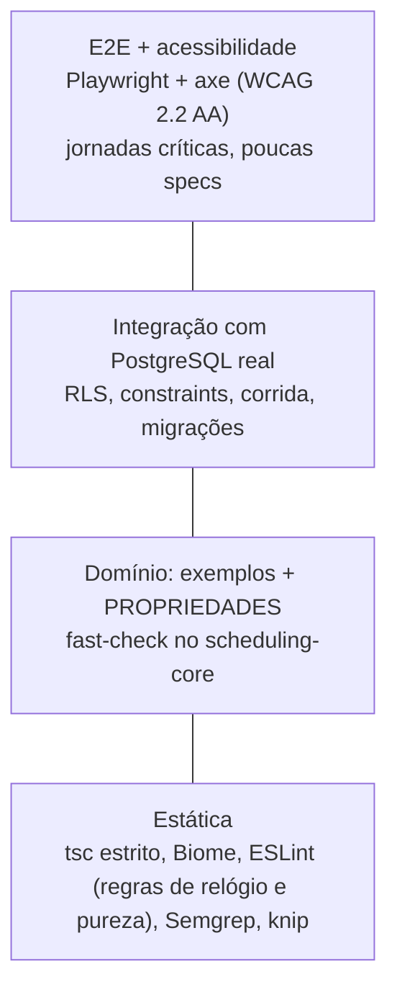

# Estratégia de QA e automação de testes

O risco deste produto se concentra em três lugares:

1. **Regras de tempo:** jornada, pausas, buffers, antecedência, fuso e horário de verão.
2. **Concorrência e consistência:** dupla reserva, cancelamento e remarcação.
3. **Isolamento multi-tenant:** vazamento entre salões, que também é risco de LGPD.

A UI é relativamente simples. Por isso o formato é um **troféu com base de domínio larga**:
muitas propriedades no domínio puro, integração com PostgreSQL real e E2E fino, focado em
jornadas. Regras de trabalho (TDD, testes intocáveis) estão no [CLAUDE.md](../../CLAUDE.md).

## 1. Camadas



| Camada | Ferramenta | O que cobre | Onde roda | Status |
|---|---|---|---|---|
| Estática | `tsc` (strict), Biome, ESLint 10, Semgrep, knip | tipos, lint, pureza do domínio, relógio, SQL cru, PII em log, código morto | `pnpm verify`, pre-commit, CI | [fundação] |
| Unit (exemplos) | Vitest 5 | regras como documentação viva | `pnpm test` | [fundação] |
| Propriedades | fast-check 4 + `@fast-check/vitest` | invariantes do motor (P1 a P15), intervalos, dia local, máquina de estados | `pnpm test` | [fundação] |
| Model-based | `fc.commands` | agenda como máquina de estados (agendar, cancelar, remarcar) | `pnpm test` | [planejado] |
| Integração e RLS | Vitest + `pg` + PostgreSQL real | migrações, RLS, constraints, `23P01`, triggers, invariantes, corrida | `pnpm test:db` | [fundação] |
| Contrato de API | Zod → OpenAPI 3.1, testes de handler, oasdiff, Schemathesis | API pública `/api/v1` | PR e noturno | [planejado] |
| Componentes | Vitest Browser Mode | seletor de horário, calendário | PR | [planejado] |
| E2E | Playwright 1.64 | jornadas: cliente agenda (mobile), equipe opera o painel, IDOR por URL, cabeçalhos | `pnpm e2e` | [fundação: home, a11y, cabeçalhos] |
| Acessibilidade | `@axe-core/playwright` + testes de teclado | WCAG 2.2 AA automatizável em cada estado | `pnpm e2e` | [fundação] |
| Visual | `toHaveScreenshot` em container | regressão visual do widget público e do painel | noturno | [planejado] |
| Mutação | Stryker | qualidade dos testes do domínio | noturno | [planejado] (seção 8) |
| Carga | k6 | disponibilidade em pico + disputa de horário | semanal, em staging | [planejado] |
| DAST | OWASP ZAP baseline | cabeçalhos, misconfig, vazamento | PR e 2× por semana | [fundação] (não obrigatório ainda) |

Não teste Server Components `async` em unit: a documentação do Next diz que o Vitest não os
suporta e recomenda E2E. Mantenha os RSC finos e a lógica em funções puras ou serviços.

## 2. Convenções de nome

O sufixo roteia o runner e o tipo de teste:

| Sufixo | Tipo | Runner | Comando |
|---|---|---|---|
| `*.test.ts` | unit / exemplo | Vitest | `pnpm test` |
| `*.prop.test.ts` | propriedade (fast-check), tag `property` | Vitest | `pnpm test` |
| `*.int.test.ts` | integração com banco real | Vitest (projeto `db:integration`) | `pnpm test:db` |
| `*.rls.test.ts` | isolamento multi-tenant | Vitest (projeto `db:integration`) | `pnpm test:db` |
| `*.spec.ts` | **somente Playwright** | Playwright | `pnpm e2e` |

Escrita:

- um `describe` por unidade; nomes como frase ("deve…", "nunca deve…"); AAA visível;
- exemplos primeiro, propriedades depois;
- prefira stubs a mocks; rede só falsa (nunca real);
- todo teste precisa **falhar** se a condição que o faz passar for removida: confira no red;
- no Playwright, locators por papel e nome acessível (`getByRole`, `getByLabel`). `data-testid`
  só como último recurso.

## 3. Gates

| Gate | O que exige | Onde |
|---|---|---|
| Local | `pnpm verify` (formato, lint, tipos, testes, build) antes de cada commit; `pnpm test:db` se mexeu no banco; `pnpm e2e` se mexeu em UI; `pnpm test:hooks` se mexeu em `.claude/hooks` | skill `verify` |
| Pre-commit / pre-push | Biome nos arquivos staged; gitleaks se instalado; commitlint; typecheck, lint e test no push | `lefthook.yml` (`pnpm hooks:install`) |
| PR (obrigatório) | **`ci-ok`**: `static` (format, lint, typecheck), `test` (matriz `TZ=UTC` e `TZ=America/Sao_Paulo`), `test-db` (PostgreSQL 18.6), `build`, `e2e`, `hooks` | [`ci.yml`](../../.github/workflows/ci.yml) |
| PR (obrigatório) | **`security-ok`**: gitleaks, Semgrep, OSV, Trivy, zizmor, actionlint, `pnpm audit signatures`, `pnpm audit`, SBOM | [`security.yml`](../../.github/workflows/security.yml) |
| PR (consultivo) | ZAP baseline (em calibração); revisão do Claude | `dast.yml`, `claude-review.yml` |

Meta de tempo do PR: **menos de 12 minutos** de relógio.

## 4. Cobertura

Cobertura é piso, não meta. O que mede de verdade o domínio são as propriedades e, no futuro,
o score de mutação.

| Pacote | Limiar | Status |
|---|---|---|
| `@salon/scheduling-core` | **95% linhas, 90% ramos, 95% funções e instruções, por arquivo** | [fundação] (configurado em `vitest.config.ts`) |
| `@salon/db` (`src/`) | meta: 85% linhas e 75% ramos, via unit + integração | [planejado] como gate |
| `apps/web/src/server` | meta: 80% linhas e 70% ramos | [planejado] |
| Componentes e rotas | cobertos por E2E e Browser Mode, fora do gate | — |

Nunca baixe um limiar para o PR passar (regra do CLAUDE.md).

## 5. Tempo e relógio

- **Domínio:** "agora" só pelo `Clock` injetado (`systemClock` em produção, `fixedClock(...)`
  em teste). O ESLint proíbe `Date.now`, `new Date()` sem argumento, `Date()`, `Temporal.Now`,
  `performance.now`, `Math.random`, getters locais de `Date` e `resolvedOptions` no core. O
  teste `test/lint-rules.test.ts` prova que as regras disparam.
- **Fusos nas propriedades:** os arbitrários puxam datas das transições reais do tzdata em 14
  fusos (Brasil, Nova York, Santiago, Lisboa, Londres, Lord Howe, Chatham, Kathmandu,
  Kiritimati, Apia, UTC). O Brasil não tem horário de verão desde 2019, mas o motor precisa
  sobreviver à volta dele.
- **Fuso da máquina:** o CI roda os testes em `TZ=UTC` e `TZ=America/Sao_Paulo`. Localmente:
  `TZ=Pacific/Kiritimati pnpm --filter @salon/scheduling-core test`.
- **Banco:** `withTenant` fixa `TimeZone=UTC` na sessão.
- **E2E:** no navegador, `page.clock`. No servidor, um relógio deslocado controlado por variável
  só com `APP_ENV=e2e`, com trava contra produção e teste unitário da trava [planejado]. Fora dos
  testes visuais, prefira cenários relativos a "agora" (o próximo dia útil com jornada).
- **Reproduzir falha de propriedade:** o fast-check imprime `seed` e `path`.

  ```bash
  FC_SEED=<seed> FC_PATH=<path> pnpm --filter @salon/scheduling-core test
  FC_NUM_RUNS=2000 pnpm --filter @salon/scheduling-core test   # mais casos (noturno)
  ```

  Todo contraexemplo reduzido vira **teste de exemplo de regressão**.

## 6. Banco real e RLS

- **Harness:** `pnpm test:db` usa `TEST_DATABASE_URL`, que precisa ser o superusuário de um
  cluster **de teste**. Sem ela,
  [`scripts/with-local-postgres.sh`](../../scripts/with-local-postgres.sh) sobe um PostgreSQL
  efêmero com os binários locais: só em `127.0.0.1`, senha aleatória, UTC, removido ao sair. O
  global setup cria um banco descartável, aplica as migrações **com o runner de produção**, dá
  senhas aleatórias a `app_user` e `app_worker` e apaga tudo no fim.
- **Versões:** o CI usa PostgreSQL 18.6 (imagem por digest), que é a fonte de verdade. A sessão
  na nuvem do Claude Code tem só o 16.15 e não tem Docker. O schema é compatível com os dois (sem
  `uuidv7()` no banco; UUIDv7 gerado na aplicação), e um teste estático garante isso.
- **Os testes conectam como `app_user` e `app_worker`**, nunca como dono ou superusuário (que
  ignorariam a RLS).
- **Coberto hoje** ([README do db](../../packages/db/README.md#testes)):
  - isolamento em todas as tabelas: leitura, UPDATE, DELETE, INSERT com tenant alheio, UPDATE que
    troca `tenant_id`, ausência de contexto, FK cruzada e `app_worker`;
  - regressão do `''` → `22P02` do GUC na mesma conexão;
  - `EXCLUDE`: sobreposição, intervalos encostados, cancelado ou no-show liberando, reativação
    colidindo e **corrida real** (exatamente uma vence);
  - os 81 pares da máquina de estados;
  - auditoria append-only;
  - meta-testes de catálogo, inclusive sabotagens que a função de invariantes precisa detectar;
  - runner: idempotência, lock concorrente, imutabilidade e rollback.
- **Regra:** tabela nova com `tenant_id` precisa de RLS + `FORCE` + políticas + um caso em
  `*.rls.test.ts`. O meta-teste e a função de invariantes falham se faltar.
- **Isolamento entre testes:** cada teste cria os próprios tenants, sem `TRUNCATE`, o que
  permite paralelismo e espelha o multi-tenant real.
- **Planejado:** rodar os meta-testes de catálogo e de papéis contra **staging e produção** com o
  papel real, porque o risco está na configuração implantada.

## 7. E2E e acessibilidade

- **Configuração** ([`apps/web/playwright.config.ts`](../../apps/web/playwright.config.ts)):
  - projetos `chromium` (desktop) e `mobile` (Galaxy A55, porque o público é majoritariamente
    Android);
  - `webServer` com `next build && next start` em `127.0.0.1:3100` e `APP_ENV=e2e`, o mesmo
    build de produção com a CSP real;
  - `retries: 2` só no CI; trace no primeiro retry.
- **Fixture automática:** qualquer erro de console ou exceção na página reprova o teste. Isso
  pega violação de CSP, falha de hidratação e 404 de recurso.
- **Acessibilidade:** axe com `wcag2a`, `wcag2aa`, `wcag21a`, `wcag21aa` e `wcag22aa`, nos
  temas claro e escuro, **em cada estado do fluxo** (inicial, serviço escolhido, calendário
  aberto, horário selecionado, formulário com erro, confirmação). Não use `exclude()` como
  atalho: ele remove todas as regras do elemento. O axe **não substitui** teclado ponta a ponta,
  foco visível, `aria-live` ao trocar dia ou horário, alvo de toque ≥ 24×24, zoom de 200% e
  auditoria manual com leitor de tela (TalkBack e VoiceOver) por release.
- **Specs planejadas:**
  - cliente agenda pelo celular;
  - dois clientes disputam o mesmo horário (só um confirma; o outro vê alternativas);
  - agendamento só com teclado;
  - painel do dono;
  - IDOR por URL (404);
  - matriz HTTP papel × rota com dois tenants.
- **Navegadores no container da nuvem:** o Playwright 1.64.0 pede uma revisão do Chromium que o
  proxy impede de baixar. A configuração cai na maior revisão disponível em
  `PLAYWRIGHT_BROWSERS_PATH`, com aviso e risco de diferença de versão. **O CI, com o navegador
  certo, é a referência.**

## 8. Mutation testing

- **Onde vale:** só no `@salon/scheduling-core` (motor, políticas) e, depois, nos validadores.
  Em UI e adaptadores de I/O o custo não compensa.
- **Bloqueio conhecido:** o `@stryker-mutator/vitest-runner` 10.0.0 monta nomes de teste com
  espaço, mas o Vitest 5 casa nomes completos unidos por `' > '`. Testes dentro de `describe`
  não rodam, e os mutantes aparecem como "Survived" falsos (issue
  [stryker-js#6210](https://github.com/stryker-mutator/stryker-js/issues/6210)).
- **Até a correção:**
  - `testRunner: "command"` (correto, mais lento) no noturno;
  - meta `break: 75`, subindo para 80;
  - canário: falhar o job se `killed == 0` enquanto houver testes cobrindo.
- Cada mutante sobrevivente vira triagem: falta teste, ou o mutante é equivalente (anotar com
  justificativa).

## 9. Segurança automatizada

| Ferramenta | Quando | Bloqueia? | Status |
|---|---|---|---|
| RLS + meta-testes de catálogo + invariantes | PR | sim | [fundação] |
| Matriz de autorização papel × rota × tenant, com meta-teste "toda rota tem entrada" | PR | sim | [planejado] |
| Fuzz de validadores (fast-check: `safeParse` nunca lança; normalização de telefone) | PR | sim | [planejado] |
| Teste de cabeçalhos e CSP (Playwright) | PR | sim | [fundação] |
| Semgrep com regras próprias | PR | sim | [fundação] |
| ZAP baseline | PR (paths do app) e 2× por semana | ainda não (calibrando `.zap/rules.tsv`) | [fundação] |
| ZAP API scan, Schemathesis | noturno, em staging | não / sim (5xx ou schema) | [planejado] |
| Casos de abuso do agendamento | PR e pentest | sim | [modelo de ameaças](../seguranca/modelo-de-ameacas.md#6-casos-de-abuso-do-agendamento) |

## 10. Carga [planejado]

Ferramenta: k6 (binário Go; o pacote npm `k6` é placeholder). Dois cenários em staging com
dados sintéticos:

1. **Disponibilidade em pico** (`ramping-arrival-rate`): p95 < 300 ms, erros < 1%.
2. **Disputa de horários quentes** (`constant-arrival-rate`): **respostas só 201 ou 409, nunca
   5xx**.

Depois da carga, uma consulta SQL confirma **zero ocupações ativas sobrepostas**. O rate limit
da API pública precisa de exceção para o IP do runner, senão o teste mede o limitador. Nunca
rodar contra produção.

## 11. Dados de teste e LGPD

- **Nunca** use dado real de produção em teste, seed, fixture, print ou prompt de IA. Só dados
  sintéticos (nomes e telefones fictícios; fast-check para entradas).
- O gitleaks tem regras para CPF e CNPJ formatados. Fixtures só com os valores sintéticos da
  allowlist.
- Nenhum envio real de WhatsApp, SMS ou e-mail em teste: adaptadores falsos atrás de portas.
- Seeds determinísticos (seed fixa) para demos e testes visuais. Em integração e E2E, um tenant
  novo por teste.

## 12. Testes instáveis (flaky)

- **Definição:** resultado diferente no mesmo commit.
- **Unit, propriedade e integração:** sem retry. Instabilidade aqui é bug (relógio, ordem,
  aleatoriedade sem seed, estado compartilhado). Rode em ordem aleatória com seed reproduzível
  para expor dependência de ordem.
- **E2E:** `retries: 2` no CI. Teste que só passa no retry é marcado como flaky no relatório.
  Specs novas ou alteradas passam por **burn-in** (`--repeat-each=5 --fail-on-flaky-tests` nas
  specs alteradas) [planejado].
- **Quarentena:** tag `quarantine` (Vitest) ou `@quarantine` (Playwright), com issue, dono e
  **prazo de 7 dias**. Roda num job à parte que não bloqueia. Teto de **5** testes em quarentena;
  acima disso, para tudo e conserta. Prazo vencido: reescrever ou remover com justificativa.
- **Proibido:**
  - `sleep` ou `waitForTimeout` para "estabilizar";
  - aumentar timeout sem diagnóstico;
  - `.only` ou `.skip` em `main` (`forbidOnly` no CI).

## 13. QA com o Claude Code

- Skill `qa` (agente `qa-engineer`): transforma [critérios de aceite](criterios-de-aceite.md) em
  testes, explora a UI pelo MCP do Playwright e converte cada achado em spec que falha.
- Skill `tob-property-based-testing`: escrever e revisar propriedades ("a propriedade afirma algo
  real?").
- Skill `superpowers-test-driven-development`: disciplina red → green → refactor.
- Exploração assistida por charter de 20 a 30 minutos. Cada achado vira issue com passos
  reproduzíveis e uma spec que falha **antes** da correção.

Detalhes em [fluxo com o Claude](../desenvolvimento/fluxo-com-claude.md).
