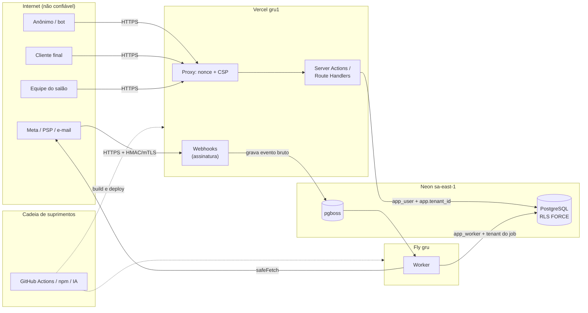

# Modelo de ameaças do sistema

Modelo geral do Agenda Salão, revisado em 18/10/2026. Threat models de features específicas
ficam em [threat-models/](threat-models/README.md). A arquitetura de referência está em
[../arquitetura.md](../arquitetura.md).

- **Método:** STRIDE por componente para segurança e LINDDUN para privacidade. O risco é
  qualitativo: probabilidade × impacto, Alto/Médio/Baixo.
- **Status do controle:** **[fundação]** implementado e testado; **[planejado]** decidido, sem
  código; **[a decidir]** em aberto.
- **Regra:** ameaça sem teste que prove a mitigação continua aberta.

## 1. Atores

| Ator | Sigla | Confiança | Observação |
|---|---|---|---|
| Visitante anônimo | X | nenhuma | acessa a página pública de agendamento |
| Bot | B | nenhuma | automatiza reservas, OTP e scraping |
| Cliente final | C | baixa | autenticado por OTP (WhatsApp ou SMS), sessão de baixo privilégio |
| Profissional | P | média | vê a própria agenda; pode ser parceiro (Lei do Salão-Parceiro) |
| Recepção ou gerente | R | média | opera a agenda e os clientes do salão |
| Dono do salão | D | alta no próprio tenant | configura, exporta e gerencia a equipe |
| Suporte da plataforma | S | alta, com acesso excepcional | só com janela concedida pelo dono e auditada |
| Worker (`app_worker`) | W | sistema | processa jobs de um tenant por vez |
| Provedores (Meta, PSP, e-mail) | — | parcial | enviam webhooks, que são dado não confiável até a assinatura ser verificada |
| Agente de IA (Claude Code, CI) | IA | parcial | escreve código e roda comandos sob hooks e revisão humana |

## 2. Ativos

| Ativo | Por que importa |
|---|---|
| Dados pessoais de clientes (nome, telefone, e-mail, histórico) | LGPD; o salão é o controlador |
| Dado sensível de saúde (anamnese, ficha técnica) e fotos | LGPD art. 11 (fase 2) |
| Agenda e slots | receita do salão; integridade (dupla reserva) |
| Pagamentos (sinal Pix) | dinheiro do salão e do cliente |
| Credenciais: sessões, segredos, tokens de PSP e WhatsApp por salão | permitem agir em nome do salão |
| Isolamento entre tenants | confiança no produto |
| Cadeia de build (CI, dependências, `.claude/`) | comprometimento atinge todos os tenants |

## 3. Diagrama de fluxo de dados

## 4. STRIDE por componente

### 4.1 Página pública de agendamento (anônimo e cliente)

| STRIDE | Ameaça | Controle | Status |
|---|---|---|---|
| S | Reserva em nome de outra pessoa (telefone alheio) | OTP por WhatsApp antes de confirmar (configurável por salão); mensagem de confirmação ao número informado | [planejado] |
| T | Cliente manipula preço, duração, `tenantId`, `staffId` ou `status` no payload | Zod estrito; preço e duração recalculados no servidor a partir do catálogo; tenant resolvido pelo slug no servidor; FKs compostas | FKs [fundação]; o resto [planejado] |
| T | Cliente envia horário com offset ou fuso próprio | o servidor aceita só o horário escolhido entre os ofertados, recalcula o instante no fuso da unidade e revalida na transação | [planejado]; motor [fundação] |
| R | Cliente nega ter aceitado a política de cancelamento ou o sinal | aceite registrado com versão do texto, data e canal; `appointment_events` append-only | eventos [fundação]; aceite [planejado] |
| I | Enumeração de clientes pelo telefone ("já é cliente?") | nunca mostrar PII antes do OTP; resposta neutra; UNIQUE de telefone só por tenant | UNIQUE [fundação]; UI [planejado] |
| I | Link de "gerenciar meu agendamento" adivinhável (UUIDv7 é ordenável) | token aleatório de 32 bytes, guardado como hash, com expiração; trocado por cookie no primeiro acesso; `Referrer-Policy: no-referrer` nessa rota | [planejado] |
| D | Bot ocupa todos os horários de sábado (slot hoarding) | OTP + Turnstile; hold com TTL; limite de reservas pendentes por telefone e por tenant; sinal Pix opcional em horário de pico; rate limit por IP e por slug | [planejado] |
| D | SMS pumping no OTP (custo) | só `+55`; WhatsApp primeiro; Turnstile antes do envio; limites por número, IP, tenant, dia e global; orçamento diário por tenant; falha fechada sem Redis | [planejado] |
| D | Consulta de disponibilidade cara (intervalo longo, grade fina, muitas datas por requisição) | o servidor limita `from`/`to` a `[hoje no fuso da unidade, hoje + max_advance_days]` e a no máximo 31 dias, com Zod estrito, nunca o intervalo do cliente direto; teto de trabalho no core (`MAX_CANDIDATE_STARTS` = 20.160 inícios candidatos, ~200 ms no pior caso medido), acima do qual `SchedulingInputError` no campo `to` vira 400/422 sem stack; rate limit por IP e por slug | teto do core [fundação]; janela de 31 dias e rate limit [planejado] |
| E | Cliente acessa painel ou ação da equipe | sessão de cliente com papel próprio; matriz de autorização testada | [planejado] |

### 4.2 Painel do salão (equipe)

| STRIDE | Ameaça | Controle | Status |
|---|---|---|---|
| S | Credential stuffing ou phishing em conta do dono | MFA obrigatório (TOTP ou passkey); HIBP; rate limit por IP e por conta; passkeys incentivadas; cookies `__Host-` | [planejado] ([ADR-0004](../adr/0004-autenticacao-better-auth.md)) |
| T | Recepção altera preço ou status sem rastro | `appointment_events` grava cada transição com ator; trigger de máquina de estados no banco | [fundação] |
| T | Edição concorrente da agenda (arrastar e soltar) | lock otimista com `version` (trigger incrementa em todo UPDATE) | [fundação] |
| R | Funcionário nega cancelamento ou alteração | auditoria append-only (`UPDATE`, `DELETE` e `TRUNCATE` bloqueados até para o dono) | [fundação] |
| I | Profissional vê contatos ou anamnese de toda a base | DTO por papel (field-level); anamnese só para papéis autorizados, com step-up e auditoria de leitura | [planejado] |
| I | Funcionário exporta a base antes de sair | exportação só para o dono, com step-up, limite, alerta e auditoria; revogar sessões ao remover o membro | [planejado] |
| E | Profissional chama ação de dono | middleware de papel por action (`ownerAction`); matriz papel × ação com meta-teste "toda rota tem entrada" | [planejado] |
| E | Convite de organização aceito por outra pessoa | Better Auth ≥ 1.6.11 + `requireEmailVerificationOnInvitation` | [planejado] |

### 4.3 Servidor Next.js (Server Actions, Route Handlers, Proxy)

| STRIDE | Ameaça | Controle | Status |
|---|---|---|---|
| S | Bypass do Proxy (middleware) | o Proxy não autoriza nada; autorização dentro de cada action e handler; Next ≥ 16.3.8 | [fundação] (Proxy só com CSP) |
| T | XSS armazenado em nome do salão, serviço ou observação | escaping do React; CSP com nonce e `strict-dynamic`; `object-src 'none'`; `base-uri 'none'`; sem `dangerouslySetInnerHTML` (Biome) | [fundação] |
| T | CSRF em Route Handler | Server Actions: checagem nativa de `Origin` × `Host`; Route Handlers: `assertSameOrigin` (Fetch Metadata + `Origin` + `Content-Type: application/json`) | Actions nativo; handler [planejado] |
| T | Clickjacking | `frame-ancestors 'none'` + `X-Frame-Options: DENY` | [fundação] |
| T | HTML servido sem CSP (matcher do Proxy com exclusão por prefixo solto ou por cabeçalho de prefetch que o cliente controla), com o Next aceitando o nonce enviado pelo cliente | matcher `/((?!_next/static/).*)`: tudo, exceto os assets com hash dentro de `/_next/static/`; teste unitário que compila o matcher com as regras do Next e E2E "cobertura do Proxy" (404, `/_next/*`, prefetch) | [fundação] |
| I | Métodos `TRACE`, `TRACK` e `CONNECT` respondem sem cabeçalhos de segurança (500 no adaptador do Proxy do Next 16.4; 400 do parser do Node) | corpo fixo, sem eco da requisição nem stack (E2E "método TRACE"); bloqueio com 405 na borda (CDN ou reverse proxy) | E2E [fundação]; bloqueio na borda [planejado] |
| I | Vazamento por erro (stack, SQL, `DETAIL` do banco) | páginas de erro só com `digest`; `@salon/db` traduz erros sem `DETAIL`; mensagem genérica no `handleServerError` do `next-safe-action` | erros do banco e páginas [fundação]; `handleServerError` [planejado] (entra com o `next-safe-action`, E1.9) |
| I | Cache compartilhado entre tenants | sem `"use cache"` para dado de tenant; `cacheComponents` desligado; `no-store` em páginas autenticadas | [fundação] (desligado); `no-store` [planejado] |
| I | Endpoint de health revela versão ou dependências | `/api/health` responde só `{"status":"ok"}` com `no-store` | [fundação] |
| D | DoS por payload grande ou consulta cara | limite de corpo das actions; teto de trabalho no motor (`MAX_CANDIDATE_STARTS` = 20.160 inícios candidatos, até 366 datas, antecedência e horizonte até 2 anos); jobs assíncronos para exportação | motor [fundação]; o resto [planejado] |
| E | Server Action órfã ainda chamável | toda action exportada ou inline com guarda (regra Semgrep `server-action-auth`); knip contra código sem uso; inventário de actions no CI | Semgrep no CI (job `semgrep` do `security.yml`, dentro do `security-ok`) e knip no `pnpm verify` e no CI (job `static` do `ci.yml`, dentro do `ci-ok`) [fundação]; inventário de actions [planejado] |

### 4.4 PostgreSQL

| STRIDE | Ameaça | Controle | Status |
|---|---|---|---|
| S | Aplicação conecta com papel privilegiado (dono, superusuário, BYPASSRLS) | `app_user` e `app_worker` `NOSUPERUSER NOBYPASSRLS NOINHERIT`, sem CREATEROLE, CREATEDB nem REPLICATION; `app_migrator` `NOLOGIN NOINHERIT` e membro de nenhum papel (o bootstrap corrige um reaproveitado com LOGIN e o runner recusa o deploy se ele voltar a ter LOGIN); invariantes no deploy recusam papel perigoso; papéis criados por SQL, não pelo console | [fundação] |
| T | Dupla reserva por corrida | `EXCLUDE USING gist (tenant_id =, staff_id =, during &&) WHERE (active)`; `active` derivada do status por trigger (sem agendamento visível, `false`); o `FOR SHARE` dessa derivação depende de READ COMMITTED, que `withTenant` fixa | [fundação] (corrida real testada) |
| T | Aplicação esconde ou encolhe a ocupação para liberar o horário (DELETE, troca de horário ou de profissional, 1 minuto num serviço de 1 h) | a aplicação só faz INSERT e UPDATE de `active` em `occupancies`; FK composta com o item inclui `staff_id`; trigger `occupancies_guard_within_item` (trecho dentro da janela do item mais os buffers congelados); constraint triggers adiadas exigem no COMMIT que as ocupações `service` cubram toda fase `work` do item e que os itens caibam na visita; visita e item imutáveis (remarcar = novo agendamento) | [fundação] |
| T | Aplicação forja instantes de transição, `created_at` ou estende o hold | trigger `appointments_guard_status` grava os instantes com o `now()` da transação e ignora os enviados; `hold_expires_at` só muda enquanto o agendamento segue `pending`; `app_worker` só tem UPDATE de `appointments.status` (GRANT de coluna) | [fundação] |
| T | Transição de status inválida (por exemplo, cancelado → confirmado) | trigger espelho da máquina de estados do core; teste de paridade; 81 pares testados no banco | [fundação] |
| T | Referência a cliente ou profissional de outro tenant | FKs compostas `(tenant_id, id)` | [fundação] |
| T | Regressão de segurança por migração ou por mudança manual no banco (drift) | `assert_security_invariants()` ao fim de toda execução do runner, com o hash do corpo conferido (`INVARIANTS_FUNCTION_SHA256`): falha se a função sumir, for renomeada ou esvaziada. Ela também compara a definição de cada trigger crítico, lida de `pg_trigger` (constraint trigger ou não, momento, eventos com as colunas do `UPDATE OF`, adiamento até o COMMIT, nível, presença de `WHEN`, número de argumentos e função), com a esperada: recriar o trigger com outra definição reprova o deploy. A comparação só foi validada no PostgreSQL 16.15; se o 18.6 do CI divergir, o `pnpm test:db` falha fechado (não verificado no 18). Pega erro honesto e drift, não migração maliciosa (quem migra é dono de tudo): para isso valem a revisão e os meta-testes do `pnpm test:db` | [fundação] |
| R | Alteração da auditoria | `appointment_events` escrita só por trigger `SECURITY DEFINER`; triggers bloqueiam `UPDATE`, `DELETE` e `TRUNCATE` | [fundação] |
| I | Leitura cross-tenant (IDOR/BOLA) | RLS `ENABLE` + `FORCE`, política RESTRICTIVE com `NULLIF(...)::uuid`; 0 linhas sem contexto | [fundação] |
| I | Consulta atrasada (`tx` usado depois do callback: fire-and-forget, `after()`, builder devolvido, `Promise.all` com ramo que falha) roda na transação de OUTRA requisição, com o tenant dela, sem a RLS perceber | `withTenant` embrulha a conexão: depois do callback só passam COMMIT e ROLLBACK, o resto é recusado com `TransactionClosedError` sem tocar no banco; conexão com transação sem desfecho limpo, com consulta ainda em voo ou que emitiu erro é destruída | [fundação] (unidade com cliente falso e integração) |
| I | Canal encoberto por UNIQUE global | toda UNIQUE de negócio (telefone, slug da unidade, `idempotency_key`) começa por `tenant_id`. Exceção: a PK `id` é global e devolve 23505 mesmo com a RLS escondendo a linha. Não vaza nada porque o id nasce no servidor e nunca muda; o 23505 vira `IdentifierConflictError`, respondido como 404/409 genérico | [fundação]; "nunca aceitar `id` nem `tenant_id` do cliente" é regra do DAL [planejado] |
| I | View que roda como dono | invariante exige `security_invoker` e recusa materialized view e foreign table legíveis pela aplicação | [fundação] |
| I | Troca de tenant por SQL injection (`set_config`) | SQL parametrizado (Drizzle); `sql.raw` só com constantes (regras Semgrep `sql-raw-interpolation` e `sql-string-taint`); DAL como primeira camada | [fundação] |
| D | Queda da conexão emprestada no meio do callback (failover, `pg_terminate_backend`): o `pg-pool` tira o ouvinte de `error` no empréstimo, e o evento sem ouvinte derrubava o processo Node | enquanto a conexão está emprestada, `withTenant` liga um ouvinte de `error` e o remove antes de devolvê-la; a conexão que emitiu erro é destruída e o COMMIT ou a consulta seguinte falha (fail-closed) | [fundação] (unidade e integração com `pg_terminate_backend` real) |
| D | Migração que trava tabela em produção | runner com `lock_timeout`, transação única e `pg_advisory_xact_lock`; revisão de migração | [fundação] |
| E | Função `SECURITY DEFINER` chamável pela aplicação | invariante recusa função executável por PUBLIC ou pela aplicação fora da lista `executable_definers` (hoje vazia) e exige `search_path` fixo terminado em `pg_temp` | [fundação] |

### 4.5 Worker e jobs

| STRIDE | Ameaça | Controle | Status |
|---|---|---|---|
| T | Job processado no tenant errado | payload só com IDs + `tenantId`; `withTenant` por job; job sem tenant é rejeitado | papel [fundação]; worker [planejado] |
| R | Mensagem enviada duas vezes (custo, irritação) | `singletonKey` e `dedupe_key` únicas | [planejado] |
| I | PII no payload da fila ou no log do worker | payload mínimo; redaction no pino | [planejado] |
| D | Backlog da fila derruba o banco transacional | retenção de jobs concluídos; alerta de backlog e de DLQ | [planejado] |
| E | Worker com mais privilégio que o necessário | `app_worker` só tem SELECT e UPDATE das colunas `appointments.status` e `occupancies.active` (GRANT de coluna; `active` é recalculada por trigger a partir do status); sem INSERT, DELETE nem UPDATE de tabela inteira, e a função de invariantes recusa o deploy se isso mudar. Job novo que precise escrever outra coluna ganha GRANT de coluna explícito numa migração nova e ajuste em `assert_security_invariants()` | [fundação] |

### 4.6 Webhooks de entrada (Pix, WhatsApp)

| STRIDE | Ameaça | Controle | Status |
|---|---|---|---|
| S | Webhook forjado marca o sinal como pago | assinatura sobre o corpo cru com comparação em tempo constante (Mercado Pago: `x-signature` HMAC-SHA256; Meta: `X-Hub-Signature-256`); **reconsulta o pagamento na API do PSP** com o token do salão antes de mudar o estado | [planejado] |
| T | Replay de evento | deduplicação por `(provider, provider_event_id)`; janela de tempo quando o provedor envia `ts` | [planejado] |
| I | Payload sensível em log | log sem corpo; evento bruto acessível só ao worker | [planejado] |
| D | Flood de webhooks | resposta 2xx rápida e processamento em job; rate limit | [planejado] |

### 4.7 Integrações de saída

| STRIDE | Ameaça | Controle | Status |
|---|---|---|---|
| I | Token de WhatsApp ou PSP de um salão vaza | só no servidor e no worker; cifrado por tenant; escopo mínimo; rotação; secret scanning com regras para `APP_USR-` e `EAA…` | regras de scanning [fundação]; o resto [planejado] |
| I | SSRF para metadados da nuvem por URL configurável (ICS, webhook do salão, avatar) | `safeFetch`: só https, porta 443, sem credenciais na URL, sem redirect, resolução DNS validada (só IP público), timeout; proxy de egress no worker | [planejado] |
| T | Template de WhatsApp com conteúdo injetado | variáveis validadas e sem HTML; template utility sem conteúdo promocional | [planejado] |

### 4.8 CI/CD e cadeia de suprimentos

| STRIDE | Ameaça | Controle | Status |
|---|---|---|---|
| T | Dependência maliciosa (worm, conta sequestrada) | quarentena de 3 dias; `trustPolicy: no-downgrade`; scripts bloqueados (`strictDepBuilds`); `blockExoticSubdeps`; `pnpm audit signatures` | [fundação] |
| T | Action com tag movida | pin por SHA completo; zizmor; política de pinning nas configurações | [fundação] (pins); configuração [planejado] |
| T | Cache envenenado em job privilegiado | `cache-mode: none` em job com segredo; sem `pull_request_target` | [fundação] |
| I | Segredo commitado | gitleaks no pre-commit (se instalado) e no CI; push protection | CI [fundação] |
| E | PR de fork executa código com segredo | gatilho `pull_request`; forks excluídos dos jobs com segredo; aprovação para contribuidor externo | [fundação] |
| I | Quem tem escrita no repositório lê o segredo da revisão do Claude (`ANTHROPIC_API_KEY`) com um workflow alterado no próprio PR, que roda antes de qualquer revisão | lista curta de colaboradores com escrita; chave dedicada ao CI num workspace do Console com limite de gasto (prefira a chave de API ao token OAuth de uma pessoa); o CODEOWNERS hoje não bloqueia merge e não mitiga isso ([.github/rulesets/README.md](../../.github/rulesets/README.md#4-variáveis-e-segredos-settings--secrets-and-variables--actions)) | risco aceito e documentado; `environment` com revisores obrigatórios para o segredo [proposta] (pede aprovação manual a cada run) |
| R | Commit forjado | commits assinados exigidos pelo ruleset | [planejado] (configuração do GitHub) |
| T | pnpm ou binário de scanner adulterado | pnpm pelo Corepack, que confere o hash sha512 do `packageManager` no CI (`.github/actions/setup`) e na máquina; gitleaks e OSV-Scanner extraídos de imagens pinadas por digest | [fundação] |
| I | Scanner que falha aberto (API de advisories fora do ar tratada como "sem achado") | OSV-Scanner decidido pelo exit code em `.github/scripts/osv-gate.sh` (só 0 ou 1 contam como varredura concluída; o resto falha, inclusive no cron), com testes próprios | [fundação] |

### 4.9 Agente de IA (Claude Code)

| STRIDE | Ameaça | Controle | Status |
|---|---|---|---|
| T | Agente apaga dados ou faz push forçado | hook `guard-bash` (fail-closed, matcher `Bash\|Monitor`: analisa o comando do Bash e o script de shell do Monitor; verificado numa sessão real em 2026-10-18): nega `rm -r` perigoso, `push --force` (inclusive abreviado, por prefixo único), push para `main` (inclusive depois de trocar de branch na mesma linha e por refspec com curinga), `--no-verify` e hooks Git desligados (`LEFTHOOK=0`, `LEFTHOOK_BIN`, `LEFTHOOK_CONFIG`), também atrás de wrappers (`env -S`, `setsid`, `strace`, `taskset`); pede confirmação para SQL destrutivo | [fundação] |
| I | Agente lê `.env`, chaves ou o ambiente | hooks `guard-bash` (Bash e Monitor) e `guard-files` (ferramentas de arquivo) negam leitura de segredo, e as regras nativas `Read(...)` de `permissions.deny` tiram os segredos das buscas em diretório; `.env` real não existe na nuvem. Não verificado: se as regras nativas `Bash(...)` valem também para o Monitor (conta-se só com o hook) | [fundação] |
| T | Agente enfraquece teste ou lint para "passar" | regras no CLAUDE.md; revisão humana; skill `verify` antes de cada commit; teste desligado barrado pelo Biome, pelo meta-teste de higiene de cada pacote e, no Vitest do core, do db e do web e nas suítes `node:test`, pelo resultado da execução; dica de exclusão de cobertura barrada pelo ESLint de todos os pacotes, e o `guard-files` pede confirmação ao acrescentá-la ([QA, seção 12](../qa/estrategia.md#12-testes-instáveis-flaky)) | [fundação]; portão pelo resultado nos E2E do Playwright [planejado] |
| T | Prompt injection por conteúdo do repositório ou de PR (inclusive para exfiltrar segredo do CI) | conteúdo é dado, não instrução; revisão consultiva; no `claude-review.yml`, só `gh pr diff` e o comentário inline (que mascara segredos antes de publicar), com `gh pr comment`, `gh api` e `gh issue` negados e o ambiente dos subprocessos limpo (`CLAUDE_CODE_SUBPROCESS_ENV_SCRUB`) | [fundação] (não verificado num run real) |
| T | Persistência maliciosa em `.claude/` | o hook `guard-bash` (fail-closed, Bash e Monitor) nega escrita por shell em `.claude/settings*.json` e `.claude/hooks/` (inclusive por `cd` + caminho relativo, interpretadores e `sed -i`) e na configuração do agente no escopo do usuário (`~/.claude/settings.json`); pelas ferramentas Edit/Write, a escrita no escopo do usuário e em `.claude/settings*.json` e `.claude/hooks/` pede confirmação pelo `guard-files` (as regras nativas `permissions.ask` **não pedem na nuvem**: lá a edição de arquivo roda sem perguntar em qualquer modo, e um Edit em `.claude/settings.json` foi aplicado sem bloqueio em 2026-10-18, antes desta mudança). O `guard-files` pede confirmação também para `.mcp.json` e `.claude/mcp/`; material de terceiros só vendorizado por SHA; revisão do diff por quem faz o merge. O CODEOWNERS só identifica o dono: com uma pessoa no projeto, o ruleset não exige aprovação (`required_approving_review_count: 0`, `require_code_owner_review: false`). Lacunas conhecidas do `guard-bash` nessa via: comando Ex do vim dentro de `-c`/`+cmd`, `patch` sem alvo citado e cópia para `.claude/` com o nome vindo da origem ([.claude/README.md](../../.claude/README.md#hooks)) | hooks e vendorização [fundação]; confirmação do `guard-files` para editar settings e hooks [fundação] (se o ask de hook é aprovado automaticamente na nuvem: não verificado); correção das lacunas do vim e do `patch` [planejado]; revisão obrigatória de code owner [planejado] (quando entrar a segunda pessoa) |

## 5. LINDDUN (privacidade), resumo

| Categoria | Ameaça no produto | Controle | Status |
|---|---|---|---|
| **L**inking | cruzar o mesmo telefone entre salões | identidade de cliente por tenant no MVP; UNIQUE só por tenant; métricas cross-tenant só agregadas | [fundação] (UNIQUE) |
| **I**dentifying | identificar o cliente em analytics ou logs | IDs opacos; `HMAC(segredo, telefone)` quando for preciso correlacionar; sem trackers de terceiros | [planejado] |
| **N**on-repudiation | registro excessivo de quem fez o quê (cliente) | auditoria com o mínimo: ator e transição, sem conteúdo | [fundação] |
| **D**etecting | inferir comportamento (frequência, horários) por terceiros | sem analytics de terceiros no app e na página pública; fontes e imagens só da própria origem | [fundação] (CSP `'self'`) |
| **D**ata disclosure | vazamento de anamnese, fotos ou telefone | RLS; criptografia de campo para sensível; redaction; Sentry sem PII | RLS [fundação]; o resto [planejado] |
| **U**nawareness | cliente não sabe do tratamento | aviso de privacidade do salão na página pública; texto da política versionado; opt-in de WhatsApp registrado | colunas [fundação]; UI [planejado] |
| **N**on-compliance | retenção indefinida, direito do titular sem atender | jobs de retenção; exportação e anonimização; DPA com o salão | CHECK de anonimização [fundação]; o resto [planejado] |

Detalhes em [../lgpd/README.md](../lgpd/README.md).

## 6. Casos de abuso do agendamento

Cada caso vira teste (integração, E2E ou carga) e entra na suíte de pentest
(skill `pentest-tenant`).

| # | Abuso | Resultado esperado | Onde testar | Status |
|---|---|---|---|---|
| A1 | 200 reservas simultâneas do mesmo horário e profissional | exatamente 1 sucesso; as demais recebem 409 com alternativas, nunca 5xx | integração (corrida real) + carga k6 | banco [fundação]; HTTP [planejado] |
| A2 | Reservas encostadas (10:00–10:30 e 10:30–11:00) | ambas aceitas (`[)`) | integração | [fundação] |
| A3 | Trocar `professionalId` ou `customerId` por um de outro tenant | FK composta falha ou 404; nada gravado | integração + E2E | banco [fundação] |
| A4 | Mesma `Idempotency-Key` com corpo diferente | 422; mesmo corpo devolve a resposta original | integração | UNIQUE [fundação]; HTTP [planejado] |
| A5 | Reativar agendamento expirado cujo horário já foi tomado (Pix tardio) | `23P01`, devolução automática do Pix e alternativas ao cliente | integração | revive [fundação]; devolução [planejado] |
| A6 | Cancelado → confirmado direto pela API | transição recusada (trigger e core) | unit + integração | [fundação] |
| A7 | Telefone novo a cada requisição a partir de um IP | bloqueio por IP e Turnstile | E2E + carga | [planejado] |
| A8 | Callback de pagamento repetido, sem assinatura ou com valor diferente | idempotente; 401; ignorado (vale a reconsulta ao PSP) | integração | [planejado] |
| A9 | Link de gerenciamento expirado ou de outro cliente | 404 genérico | E2E | [planejado] |
| A10 | Horário fora da jornada, antes da antecedência mínima ou além do horizonte | não ofertado; recusado na revalidação | propriedades P1 e P4 + integração | motor [fundação] |
| A11 | Cliente com relógio ou fuso do aparelho diferente | horários sempre no fuso da unidade, com offset visível quando o rótulo repetir | propriedades + E2E | motor [fundação] |
| A12 | Cancelamento "no prazo" forjado por relógio do cliente | prazo calculado no servidor com o `Clock` | unit | [planejado] |
| A13 | Hold infinito (pending sem expirar) | job expira holds vencidos a cada minuto; `CHECK` exige `hold_expires_at` em `pending` | integração | CHECK [fundação]; job [planejado] |
| A14 | Encaixe (overbook) feito por quem não pode | encaixe explícito, por papel autorizado e auditado | integração | [a decidir] |
| A15 | Scraping da base pelo autocomplete de clientes | limite de resultados e de taxa; só equipe autenticada | E2E | [planejado] |

## 7. Riscos aceitos e questões em aberto

| Item | Situação | Dono |
|---|---|---|
| `set_config` chamável por qualquer sessão (troca de tenant via SQLi) | aceito com SQL parametrizado + Semgrep + DAL. Assinatura HMAC do contexto (nível 3) fica para avaliação | mantenedor |
| `DrizzleQueryError` (erro não traduzido pelo `@salon/db` e `cause` dos traduzidos) traz os parâmetros da consulta na mensagem, que podem ser dado pessoal | em aberto: hoje só a regra documentada "nunca registrar o erro cru nem o `cause`" ([README do db](../../packages/db/README.md#uso)). Tratar como achado de LGPD quando o logger existir ([ADR-0010](../adr/0010-observabilidade.md)) | threat model da observabilidade |
| `time_off` x ocupação não é garantido no banco | decisão provisória de domínio ([modelo](../dominio/modelo.md#2-invariantes)): uma folga criada sobre agendamentos existentes não os cancela. A reserva revalida folgas na transação, e o painel deve alertar a recepção sobre agendamentos dentro de uma folga nova [planejado] | produto |
| MFA do cliente final (ASVS 6.3.3) | desvio aceito ([asvs-l2.md](asvs-l2.md#desvios-aceitos)) | mantenedor |
| Expiração de holds de todos os tenants (job sem tenant) | a decidir: loop por tenant ou função `SECURITY DEFINER` dedicada | threat model do worker |
| Resolução pública `slug → tenant` | função dedicada que devolve só o necessário | threat model da página pública |
| Encaixe (overbook) | o schema da fundação não tem bypass do `EXCLUDE`. Decidir se entra e como é auditado | produto + segurança |
| Edição de `.claude/settings*.json` e `.claude/hooks/` pelo agente na nuvem | a decidir: na nuvem, edição de arquivo roda sem perguntar, e o `guard-files` não decide nada para esses caminhos; hoje só a leitura do diff no PR segura essa via ([fluxo com o Claude](../desenvolvimento/fluxo-com-claude.md#1-o-que-carrega-em-cada-ambiente)). Opção: `ask` no `guard-files`, depois de conferir se um `ask` de hook pede confirmação na nuvem (não verificado) | mantenedor |
