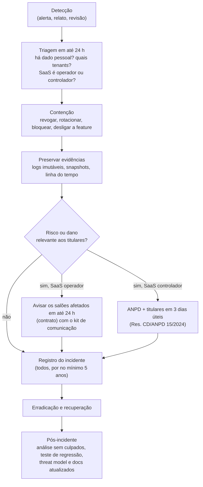

# Resposta a incidentes

Runbook para incidentes de segurança e de dados pessoais. Os prazos e obrigações legais abaixo
vêm da LGPD e de resoluções da ANPD lidas em **fontes secundárias**, porque o site oficial
estava inacessível na pesquisa. **Tudo o que é obrigação legal está a validar com jurídico**
antes de virar contrato ou política pública.

Relatos externos chegam pelo canal do [SECURITY.md](../../SECURITY.md).

## 1. Severidade

| Nível | Critério | Exemplos | Resposta |
|---|---|---|---|
| **SEV1** | Dado pessoal exposto entre tenants ou a terceiros, ou comprometimento de credencial de produção, ou exploração ativa | salão vê clientes de outro; vazamento de dump; segredo de sessão vazado; dependência maliciosa em produção | imediata, 24×7; avaliação LGPD no mesmo dia |
| **SEV2** | Vulnerabilidade explorável sem evidência de exploração, ou fraude financeira pontual | IDOR encontrado em revisão; webhook forjado aceito; conta da equipe tomada | início em até 4 h |
| **SEV3** | Falha de integridade ou disponibilidade sem dado pessoal exposto | dupla reserva; lembretes não enviados; abuso de custo de mensagens | dentro do dia útil |
| **SEV4** | Risco baixo ou achado informativo | cabeçalho ausente em página estática | backlog priorizado |

Na dúvida, classifique para cima. Rebaixar depois é barato.

## 2. Papéis

Com uma pessoa só no projeto, ela acumula os papéis e o jurídico externo é acionado em SEV1.

| Papel | Responsabilidade |
|---|---|
| Coordenador do incidente | decide, prioriza, mantém a linha do tempo e encerra |
| Responsável técnico | contenção, investigação, correção e preservação de evidências |
| Comunicação | salões afetados, titulares e status page |
| Encarregado (DPO) do SaaS | avaliação de risco aos titulares e comunicação com a ANPD |
| Jurídico | enquadramento legal, contratos com salões e fornecedores |

## 3. Fluxo

## 4. Obrigações da LGPD (a validar com jurídico)

O papel da plataforma muda o dever. Ver [papéis e bases legais](../lgpd/papeis-e-bases-legais.md).

| Situação | Quem comunica a ANPD e os titulares | Prazo | Base |
|---|---|---|---|
| Dados de clientes finais dos salões (a plataforma é **operadora**) | o **salão** (controlador) | a plataforma avisa o salão em **até 24 h** do conhecimento (proposta de cláusula contratual), para que ele cumpra o prazo legal | LGPD arts. 39 e 48; contrato |
| Dados de contas de donos e equipe, logs de acesso, cobrança do SaaS (a plataforma é **controladora**) | a **plataforma** | **3 dias úteis** do conhecimento, se houver risco ou dano relevante. Complementação em até **20 dias úteis** | LGPD art. 48; Res. CD/ANPD nº 15/2024 |
| Agente de pequeno porte | — | prazos **em dobro** pela Res. CD/ANPD nº 2/2022, **exceto** em tratamento de alto risco. A plataforma tende a não se enquadrar (volume de titulares de terceiros e possível dado de saúde) | Res. CD/ANPD nº 2/2022 |
| Todo incidente, comunicado ou não | a plataforma (e o salão, como controlador) | registro guardado por **no mínimo 5 anos** | Res. CD/ANPD nº 15/2024 |

**Critérios de risco ou dano relevante** (segundo fontes secundárias sobre a Res. 15/2024):
dados sensíveis (saúde: anamnese), dados de crianças, adolescentes ou idosos, dados
financeiros, dados de autenticação, dados protegidos por sigilo e tratamento em larga escala.
Também é preciso avaliar o potencial de dano material ou moral aos titulares.

**Conteúdo mínimo da comunicação** (LGPD art. 48, § 1º):

1. a natureza dos dados pessoais afetados;
2. as informações sobre os titulares envolvidos;
3. as medidas técnicas e de segurança usadas para proteger os dados, observados os segredos
   comercial e industrial;
4. os riscos relacionados ao incidente;
5. os motivos da demora, se a comunicação não foi imediata;
6. as medidas adotadas ou que serão adotadas para reverter ou mitigar os efeitos do prejuízo.

Canal com a ANPD: formulário de comunicação de incidente no site oficial
(https://www.gov.br/anpd). Confira o procedimento vigente na hora, porque a autarquia foi
transformada em agência reguladora pela Lei 15.352/2026 (fonte secundária).

## 5. Playbooks

### P1. Vazamento entre tenants (SEV1)

- **Sinais:** relato de salão; `TenantIsolationError` fora do padrão; teste ou auditoria
  mostrando IDOR; `authz.denied` em pico.
- **Contenção:**
  1. desligar a rota ou feature (feature flag ou deploy de reversão);
  2. revogar sessões afetadas;
  3. conferir que os papéis de produção não têm BYPASSRLS
     (`app_private.assert_security_invariants()` com o papel real).
- **Investigação:**
  - identificar a camada que falhou (sessão, DAL, `withTenant`, RLS, cache);
  - levantar os tenants e titulares expostos e o período;
  - reproduzir com um teste que falha (skill `pentest-tenant`).
- **Recuperação:** correção com teste de regressão e meta-teste. Se for cache, invalidar tudo.
- **Comunicação:** salões afetados em até 24 h, com o kit (seção 7).

### P2. Segredo ou credencial vazada (SEV1)

- **Exemplos:**
  - segredo de sessão do Better Auth;
  - senha de `app_user`, `app_worker` ou do admin do banco;
  - token de WhatsApp ou PSP de um salão;
  - chave da API Anthropic do CI;
  - token do Renovate ou do GitHub.
- **Contenção:**
  - **rotacionar primeiro, investigar depois**. O Better Auth aceita segredos versionados
    (`BETTER_AUTH_SECRETS`), o que permite trocar o segredo sem derrubar o serviço. Revogue
    também as sessões ativas dos usuários afetados;
  - remover o segredo do histórico se foi commitado (o gitleaks aponta o commit) e tratá-lo como
    comprometido mesmo assim.
- **Investigação:** logs de acesso do provedor no período e uso anômalo (envios de WhatsApp,
  cobranças, consultas ao banco).

### P3. Dependência, action ou imagem comprometida (SEV1/SEV2)

- **Sinais:** advisory de malware (OSV, GitHub), alerta do Renovate, comportamento anômalo no
  CI.
- **Contenção:**
  - fixar a versão anterior no catálogo;
  - verificar se a versão maliciosa entrou no lockfile (`pnpm why <pacote>`) e se algum
    deploy a incluiu;
  - rotacionar segredos acessíveis aos jobs que a executaram;
  - conferir que nada foi escrito em `.claude/`, `.github/` ou `.vscode/` (persistência
    relatada em worms).
- **Prevenção:** a quarentena de 3 dias e o bloqueio de scripts de instalação
  ([supply-chain.md](supply-chain.md)) cobriram os incidentes conhecidos de 2025–2026. Revise
  se o caso escapou e por quê.

### P4. Conta da equipe tomada (SEV2)

- **Contenção:** revogar todas as sessões do usuário, forçar a troca de senha e o
  recadastramento do MFA, e conferir convites e membros criados no período.
- **Investigação:** exportações feitas, alterações de dados bancários ou Pix e de
  configurações, a partir de `appointment_events` e da auditoria de acesso.

### P5. Webhook forjado ou fraude de pagamento (SEV2)

- **Contenção:** suspender a confirmação automática por webhook (passa a exigir reconsulta
  manual ao PSP) e rotacionar o segredo de assinatura.
- **Correção:** o webhook só muda estado depois de consultar o pagamento na API do PSP com o
  token do salão e de conferir valor, `txid` e tenant.

### P6. Abuso de custo (SMS ou WhatsApp pumping) (SEV3)

- **Sinais:** queda da razão entre OTPs verificados e enviados; pico de envios por prefixo ou
  por tenant; alerta de orçamento.
- **Contenção:** reduzir os limites, exigir Turnstile em todo envio, bloquear prefixos e
  pausar o OTP por SMS (manter o WhatsApp).

### P7. Integridade da agenda ou indisponibilidade (SEV3)

- **Exemplos:** dupla reserva (não deveria ocorrer por causa do `EXCLUDE`, então investigar
  encaixes e manutenção manual), lembretes não enviados, backlog da fila.
- **Ações:**
  - consulta de sobreposições ativas por profissional;
  - reprocessar a DLQ;
  - avisar os salões afetados com a lista de agendamentos para conferência.

### P8. Incidente em subprocessador (variável)

- Vercel, Neon, Fly, Upstash, Meta, PSP e provedor de e-mail. Obter o relatório do fornecedor,
  avaliar quais dados nossos estavam no escopo e seguir a seção 4.

## 6. Preservação de evidências

- Exportar logs relevantes antes de expirarem (Vercel, Neon, provedores). Não apagar nada que
  possa ser evidência.
- Snapshot ou branch do banco no estado do incidente (branching da Neon), com acesso restrito.
- Linha do tempo em UTC: quem soube, quando e o que foi feito.
- Nunca copiar dado pessoal para canais informais (chat, e-mail pessoal, prompt de IA).

## 7. Kit de comunicação ao salão (controlador)

Modelo a adaptar, sem dado pessoal no corpo da mensagem:

> **Assunto:** Incidente de segurança no Agenda Salão envolvendo dados do seu salão
>
> Identificamos em [data e hora, com fuso] um incidente que pode ter afetado [tipo de dado] de
> [número aproximado] clientes do seu salão. [O que aconteceu, em linguagem simples.]
> [O que já fizemos.] [O que recomendamos ao salão e aos clientes.]
> Como controlador desses dados, o salão avalia a comunicação à ANPD e aos titulares. Em anexo
> seguem as informações do art. 48, § 1º, da LGPD e um modelo de mensagem aos clientes.
> Contato do nosso encarregado: [canal].

## 8. Registro de incidentes

Todo incidente, comunicado ou não, vai para o registro (guardado por no mínimo 5 anos), com:

| Campo | Conteúdo |
|---|---|
| ID e severidade | `INC-AAAA-NNN`, SEV1 a SEV4 |
| Datas (UTC) | ocorrência (estimada), conhecimento, contenção, encerramento |
| Natureza | o que aconteceu e qual controle falhou |
| Dados e titulares | categorias de dado, número aproximado de titulares, tenants |
| Avaliação de risco | relevante ou não, com justificativa |
| Comunicações | a quem, quando e por qual canal (salões, ANPD, titulares) |
| Medidas | contenção, correção e prevenção (links para PRs e testes) |

O registro **não** fica neste repositório, porque contém dado sensível do incidente. Guarde-o
em armazenamento controlado, com acesso restrito e auditado.

## 9. Pós-incidente

- Análise sem culpados em até 5 dias úteis após a recuperação.
- Todo incidente gera pelo menos um **teste de regressão** e a atualização do
  [modelo de ameaças](modelo-de-ameacas.md).
- Revisar alertas: o incidente foi detectado por nós ou por terceiros?
- Exercício simulado (tabletop) semestral com um dos playbooks acima.

## Referências

- LGPD, arts. 37, 39, 46, 48 e 52: https://www.planalto.gov.br/ccivil_03/_ato2015-2018/2018/lei/l13709.htm
- ANPD (resoluções e formulário de incidente): https://www.gov.br/anpd
- OWASP Top 10:2025, A09 Security Logging and Alerting Failures: https://owasp.org/Top10/2025/
