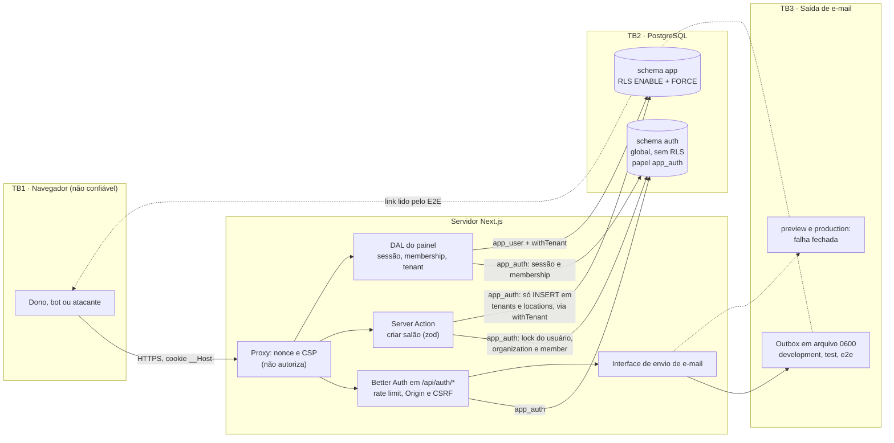

# Threat model: login, cadastro e onboarding do salão

- **Versão:** 1, de 2026-10-20. Feito **antes** da implementação. Atualize a coluna Status no
  PR que implementar cada mitigação.
- **Escopo:** E1.1 (conta do dono), E1.3 (criar salão), parte de E1.9 e E1.10 e o fuso da
  unidade (E2.1). Decisões em [ADR-0004](../../adr/0004-autenticacao-better-auth.md) e
  [ADR-0002](../../adr/0002-isolamento-multi-tenant-rls.md). Há um desvio decidido com o dono
  do produto: o `app_user` **não** recebe acesso ao schema `auth`, embora o ADR previsse SELECT
  em `member`/`organization`.
- **Método:** STRIDE por componente, LINDDUN para os dados pessoais, risco = probabilidade ×
  impacto (A/M/B), avaliado para o estado em que a feature **vai a produção**.
- **Status:**
  - **[fundação]**: já existe no código e tem teste;
  - **[iteração]**: obrigatório nesta iteração, ainda a implementar. A ameaça continua aberta
    até o teste existir;
  - **[pendente]**: fora do escopo desta iteração, registrado como risco residual;
  - **[a decidir]**: depende de decisão (ver Perguntas em aberto).
- **Quem escreve o teste:** QA (`qa-engineer`) ou PT (`tenant-isolation-pentester`).

## 0. Status depois da implementação (2026-10-30)

As colunas de status das tabelas abaixo ficaram como no modelo original (antes do código).
Este resumo registra o que entrou nesta iteração, com o teste que fecha cada ameaça.

**Implementado e testado:**

| Ameaças | Mitigação | Teste |
|---|---|---|
| LC-01, LC-13 | rate limit no banco por `x-real-ip` (login 5/min, cadastro 5/h) | E2E `auth-api`: 6ª tentativa → 429, outro IP livre |
| LC-02 | `x-real-ip` único; em preview/production, sem IP válido → 400 | unit `route-handler` e `http-policy` |
| LC-03, LC-15 | validação estrita no hook `before` (antes da busca do e-mail); `disableSignUp` sem provedor | unit `config.test`; E2E `auth-api` (mesma resposta para e-mail novo e existente, mesmo 400 para entrada inválida) |
| LC-04 | hash fictício no cadastro e no login (conferido no código 1.7.10) | E2E: mesma mensagem para senha errada e e-mail inexistente |
| LC-05 | `/send-verification-email` fora da lista fechada (o reenvio é pelo login) | unit e E2E: 404 |
| LC-06 | **sem** `autoSignInAfterVerification` | unit `config.test`; E2E: sem cookie de sessão depois da confirmação |
| LC-07 | `baseURL`/`trustedOrigins` fixos em `APP_URL` | E2E: `X-Forwarded-Host` forjado não muda o link |
| LC-08 | `callbackURL` fixo (`/cadastro/confirmado`) no hook; origem conferida pelo Better Auth | unit; E2E: URLs externas recusadas e nada enviado |
| LC-09 | checagem de origem do Better Auth ativa; action com a checagem nativa do Next | E2E: POST com `Origin` alheio → 403 |
| LC-10, LC-34 | cookie `__Host-` Secure/HttpOnly/Lax/Path=/ sem Domain; sem `cookieCache`; logout apaga a sessão e manda `Clear-Site-Data`; `/app` com `no-store` | E2E `auth-flow`: todo `Set-Cookie`, cookie antigo recusado depois do logout |
| LC-11 | lista fechada de 4 rotas em `/api/auth`, plugin `organization` desligado | unit `route-handler`/`http-policy`; E2E: 9 rotas → 404 |
| LC-12, LC-25 | logger do Better Auth sem PII; falha em `/api/auth` vira 500 com log só de nome e SQLSTATE; `SlugUnavailableError` | unit `logger`, `route-handler`, `errors`, `create-salon` |
| LC-14 | outbox 0600 (`wx`), pasta 0700, nome aleatório, recusa de link simbólico, só dev/test/e2e | unit `mailer`, `env` |
| LC-16, LC-28 | nome sem controle, bidi nem largura zero (NFC); e-mail escapado | unit `account`, `salon`, `verification-email`; E2E: nome com marcação aparece como texto |
| LC-17 | `expiresIn` de 1 h; `Referrer-Policy: no-referrer` em `/api/auth/*` | unit `next-config`, `config`; E2E `auth-api` |
| LC-18 | sem login automático: link reaberto não cria sessão | E2E `auth-flow` |
| LC-19, LC-20, LC-23, LC-26 | action relê a sessão; zod estrito; `FOR UPDATE` + um salão por conta | unit `create-salon`; test:db `provision-tenant` (corrida real) |
| LC-21, LC-27, LC-35–LC-37, LC-39 | FK `auth.organizations.id → app.tenants.id`; papéis e invariantes estendidas ([ADR-0012](../../adr/0012-papel-app-auth-e-provisionamento.md)) | test:db `catalog` (sabotagens) e `provision-tenant` |
| LC-24 | slug com o padrão do CHECK, mínimo de 3, lista de reservados e meta-teste das rotas de topo | unit `slug` |
| LC-30–LC-32 | DAL: sessão → vínculo (`app_auth`) → `withTenant(app_user)`; nega em erro | unit `tenant-context`; E2E `auth-isolation` |

**Pendente (risco aceito na seção 9, até antes de qualquer cadastro em produção):** MFA
(E1.2), HIBP, Turnstile, reset de senha (E1.6), provedor de e-mail, logger com redaction (T2),
teto absoluto e inatividade por papel (LC-33; hoje a sessão vale 12 h fixas), troca dos GRANTs
de INSERT do `app_auth` por função `SECURITY DEFINER` (LC-22) e verificação de que a Vercel
sobrescreve `x-real-ip`. Respostas às perguntas da seção 10: LC-06 decidido (sem login
automático); plugin `organization` desligado; FK adotada; o Chromium aceita `__Host-` em
`http://127.0.0.1` (E2E verde).

## 1. Contexto

### Ativos

| Ativo | Onde fica | Classificação |
|---|---|---|
| Nome e e-mail do dono | `auth.user` | dado pessoal (a plataforma é controladora) |
| Hash de senha (scrypt) | `auth.account` | credencial |
| Token de sessão, IP e user-agent | `auth.session` e cookie `__Host-…` | credencial e dado pessoal |
| IP por rota | `auth.rate_limit` | dado pessoal |
| Token de verificação de e-mail | URL do e-mail (no outbox em dev/test/e2e) | credencial temporária; o JWT do Better Auth traz o e-mail no payload (a confirmar no 1.7.10) |
| Vínculo usuário → salão (papel `owner`) | `auth.member` e `auth.organization` | **raiz da autorização**: define o `tenantId` da sessão |
| Salão (nome e slug público) e unidade (nome e fuso) | `app.tenants` e `app.locations` | dado do tenant; num MEI, o nome do salão costuma ser o nome da pessoa |
| Segredos | `BETTER_AUTH_SECRET`, credenciais de `app_auth` e `app_user` | segredo |

### Atores

Visitante anônimo e bot (cadastro, login), dono (sessão própria), atacante com conta
verificada (tenant B), Better Auth (biblioteca de terceiros dentro do servidor), sistema de
arquivos local (outbox) e mantenedor/CI. Clientes finais, equipe, worker e integrações (PSP e
WhatsApp) não participam desta iteração.

### Fluxos

| # | Fluxo | Caminho |
|---|---|---|
| F1 | Cadastro | navegador → `POST /api/auth/sign-up/email` (rate limit; `hooks.before` valida os campos) → `auth.user`/`auth.account` → envio do e-mail de verificação. A resposta é igual para e-mail novo e já cadastrado |
| F2 | Verificação | link do e-mail → `GET /api/auth/verify-email?token=…&callbackURL=…` → `emailVerified = true` → `autoSignInAfterVerification` cria a sessão → redirect para o `callbackURL` |
| F3 | Login | `POST /api/auth/sign-in/email` → sessão nova com cookie `__Host-`. Se o e-mail não estiver verificado: 403 e reenvio (`sendOnSignIn`) |
| F4 | Onboarding | Server Action (zod estrito) → sessão relida no servidor → exige e-mail verificado → numa transação única: `withTenant(authDb, newId())`, `SELECT … FOR UPDATE` em `auth.user`, checagem de membership e INSERT em `app.tenants`, `app.locations`, `auth.organization` e `auth.member` (`owner`) |
| F5 | Painel | página → DAL: sessão → `auth.member` (conexão `app_auth`) → `withTenant(app_user, tenantId, readOnly)` → salão e unidade |
| F6 | Logout | `POST /api/auth/sign-out` → a linha da sessão é apagada e o cookie expira |

## 2. Diagrama

Fronteiras de confiança:

- **TB1:** tudo o que vem do navegador é não confiável, inclusive `Host`, `X-Forwarded-*`,
  `x-real-ip` (até ser verificado na plataforma) e `callbackURL`.
- **TB2:** dois papéis com credenciais diferentes. O `app_auth` vê todo o schema `auth`, sem
  RLS, e só insere em `app`. O `app_user` vê o schema `app` filtrado pela RLS e nada de `auth`.
- **TB3:** disco local (outbox) e, no futuro, o provedor de e-mail.
- **TB4 (lógica):** o schema `auth` é global, e só a linha de `auth.member` liga a sessão a um
  tenant.

## 3. Ameaças STRIDE

### 3.1 Better Auth (`/api/auth/*`) e navegador

| ID | STRIDE | Cenário | Risco | Mitigação | Teste que prova (quem) | Status |
|---|---|---|---|---|---|---|
| LC-01 | S | Credential stuffing ou força bruta em `/sign-in/email` numa conta sem MFA | A | Rate limit do Better Auth com storage `database` e regra dura para `/sign-in/email` (proposta: 5 por 60 s por IP, a calibrar); senha de 12 a 128 caracteres; scrypt | Integração: a 6ª tentativa do mesmo `x-real-ip` dentro da janela recebe 429 com `Retry-After`, outro IP não é afetado e o contador vale entre duas instâncias do handler (QA) | rate limit [iteração]; MFA (E1.2), HIBP, Turnstile, limite por conta e rate limit externo (T4) [pendente] |
| LC-02 | S, D | Rate limit desligado sem aviso: requisição sem `x-real-ip` (o Better Auth pula o limite sem IP, a confirmar no 1.7.10) ou com `x-real-ip` forjado, se a plataforma não sobrescrever o cabeçalho (fail-open, A10) | A | `advanced.ipAddress.ipAddressHeaders: ["x-real-ip"]`, sem `x-forwarded-for`; em preview e production, `hooks.before` recusa `/api/auth/*` sem um IP único e válido; `rateLimit.enabled` explícito por `APP_ENV`, sem depender do `NODE_ENV` | Unit do hook: production sem cabeçalho → recusa; valor com vírgula ou inválido → recusa. Staging: `x-real-ip` forjado não aparece em `auth.session.ip_address` (QA) | hook [iteração]; sobrescrita na Vercel não verificada [a decidir] |
| LC-03 | I | **Enumeração por resposta** no cadastro: status ou corpo diferem entre e-mail novo e já cadastrado. Três origens: validação do nome em `databaseHooks`, que só roda no caminho do e-mail novo; falha do envio em preview/production (o e-mail novo tenta enviar e dá erro, o existente não); e o corpo da resposta fictícia | A | Validar todos os campos em `hooks.before` de `/sign-up/email`, **antes** da consulta de existência (o `databaseHooks` fica como segunda camada); em preview/production sem provedor, `emailAndPassword.disableSignUp: true`; a UI mostra sempre a mesma mensagem | Integração com banco real: matriz {novo, existente verificado, existente não verificado} × {válido, nome inválido, senha de 11, senha de 129} → mesmo status, mesmas chaves no corpo e mesma mensagem; com `APP_ENV=preview`, o cadastro não grava linha (PT) | [iteração] |
| LC-04 | I | **Enumeração por tempo**: o e-mail novo faz scrypt, INSERT e envio, e o existente pode responder sem hash; login de e-mail inexistente sem hash fictício | M | Conferir no código 1.7.10 o hash fictício nos dois endpoints e completar por hook se faltar; o envio de e-mail não pode atrasar a resposta (no futuro provedor, fila ou envio depois da resposta) | Unit determinístico: espião no hasher chamado exatamente uma vez em cada caminho (novo, existente, inexistente no login); medição de tempo só como teste exploratório, fora do gate (PT) | [iteração] |
| LC-05 | I, D | `/send-verification-email` revela se o e-mail existe ou não está verificado; e serve para bombardear a caixa da vítima | M | Conferir a resposta no 1.7.10 e igualar por hook se diferir; regra dura no rate limit (proposta: 3 por hora por IP) | Integração: novo, verificado e não verificado → mesma resposta; a 4ª chamada na hora → 429 (PT) | [iteração]; limite por destinatário [pendente] |
| LC-06 | S, E | **Pre-account hijacking**: o atacante cadastra o e-mail da vítima com a senha dele. A vítima recebe a verificação (que o atacante pode reenviar com `sendOnSignIn`), clica, e o `autoSignInAfterVerification` a coloca numa conta cuja senha o atacante conhece. O salão e, depois, os clientes que ela cadastrar ficam acessíveis a ele | A | Antes de produção, uma destas opções: (1) desligar `autoSignInAfterVerification`, para que quem verifica precise entrar com a senha; (2) auto sign-in só no navegador que fez o cadastro (cookie de vínculo `__Host-`, HttpOnly, conferido num hook `after` de `/verify-email`) e, nos outros, só verificar. Nas duas: texto "se não foi você, ignore" e purga de contas não verificadas. Reset de senha (E1.6) com `revokeSessionsOnPasswordReset` | E2E: cadastro no contexto A, link aberto no contexto B (sem cookie) → B fica sem sessão e o e-mail aparece verificado; com a opção 2, no contexto A há sessão (PT) | [a decidir] (bloqueia produção) |
| LC-07 | T, S | Envenenamento do link de verificação pelo cabeçalho `Host`/`X-Forwarded-Host`: com `baseURL` inferido da requisição, o link aponta para o domínio do atacante e entrega o token a ele | A | `baseURL: env.APP_URL` fixo; `trustedOrigins: [env.APP_URL]`, sem `localhost` em production | Integração/E2E: cadastro com `Host` e `X-Forwarded-Host` iguais a `evil.example` → o link gravado no outbox começa com `APP_URL` (PT) | [iteração] |
| LC-08 | T | **Open redirect** pelo `callbackURL` (sign-up, send-verification-email e verify-email por GET): `//evil.example`, `/\evil.example`, `https:evil.example`, `javascript:`, versões codificadas, `APP_URL.evil.example` | M | Checagem de origem do Better Auth contra `trustedOrigins` e um `hooks.before` com allowlist de **caminhos fixos** (`/app/onboarding`, `/app`); o cliente nunca repassa `callbackURL` vindo da query | Integração: cada payload em cada endpoint → recusa, sem 3xx para fora da origem; o link do outbox só traz `callbackURL` da allowlist (PT) | [iteração] |
| LC-09 | T | **CSRF e login CSRF**: um site de terceiros faz POST em `/sign-in/email` com as credenciais do atacante; a vítima passa a usar a conta dele e cadastra o salão ali. Também logout forçado | M | Nunca `disableCSRFCheck` nem `disableOriginCheck`; `SameSite=Lax`; `Origin` × `trustedOrigins` também sem cookie (a confirmar no 1.7.10); a Server Action usa a checagem nativa do Next, sem `serverActions.allowedOrigins` | Integração: `Origin: https://evil.example` e `Sec-Fetch-Site: cross-site`, com e sem cookie, JSON e form, em sign-in, sign-up, sign-out e send-verification-email → 403; Server Action com `Origin` alheio → recusada, nada gravado (PT) | Server Action nativo [fundação]; configuração e teste [iteração] |
| LC-10 | S | **Fixação ou reuso de sessão**: cookie plantado por subdomínio ou rede, token que continua valendo depois do logout, sessão revogada que um cache mantém viva | M | `useSecureCookies: false` + `cookiePrefix: "__Host-…"` + `defaultCookieAttributes.secure: true`; `HttpOnly`, `SameSite=Lax`, `Path=/`, sem `Domain`; `cookieCache` desligado; token novo a cada login; o logout apaga a sessão no banco | E2E: confere **todos** os `Set-Cookie` de cadastro, verificação, login e logout; cookie definido antes do login ≠ cookie depois; cookie antigo depois do logout → o painel nega e a linha de `auth.session` sumiu. Integração: sessão apagada no banco é negada na requisição seguinte (QA) | [iteração] |
| LC-11 | E, I | **Superfície fora do escopo exposta**: endpoints do Better Auth e de plugins (`organization/*`, `update-user`, `change-email`, `delete-user`, `change-password`, `request-password-reset`, `list-sessions`). Exemplos de abuso: criar organização sem `app.tenants`, apontar `set-active` para uma organização alheia, trocar o e-mail | A | Plugin `organization` desligado nesta iteração (as tabelas existem pelo schema Drizzle) ou `allowUserToCreateOrganization: false`; `disabledPaths` para tudo o que não estiver na allowlist (sign-up/email, sign-in/email, sign-out, verify-email, send-verification-email, get-session) | Unit de inventário: os endpoints de `auth.api` comparados com a allowlist (endpoint novo reprova). Integração: `organization/create`, `organization/set-active`, `update-user`, `change-email` e `delete-user` → 404 (PT) | [iteração] |
| LC-12 | I | **PII em log e erro**: o logger padrão do Better Auth e o log de erro do Next imprimem a mensagem do `DrizzleQueryError`, que traz os parâmetros (e-mail, nome, slug, IP); resposta de erro com detalhe | A | `logger` do Better Auth com função própria que registra só código e rota, sem mensagem crua, até o T2; `onAPIError` sem stack; a Server Action traduz os erros do banco antes de lançar; `telemetry.enabled: false` explícito | Unit: o logger recebe um erro com e-mail no parâmetro e não o emite. Integração: falha forçada (slug repetido, banco fora) → resposta, stdout e stderr sem e-mail, nome ou slug (QA) | [iteração]; logger com redaction (T2) [pendente] |
| LC-13 | D | Flood de cadastro e login: CPU do scrypt, linhas em `auth.user` e `auth.rate_limit` e escrita no banco a cada requisição | M | Rate limit (LC-01); senha com no máximo 128 caracteres | Integração: 50 cadastros do mesmo IP → no máximo o limite configurado de linhas criadas (QA) | [iteração]; Turnstile, T4 e purga de não verificados e de `rate_limit` [pendente] |

### 3.2 E-mail e outbox

| ID | STRIDE | Cenário | Risco | Mitigação | Teste que prova (quem) | Status |
|---|---|---|---|---|---|---|
| LC-14 | I | **Vazamento do outbox**: arquivo com link válido e e-mail fica numa pasta versionada, servida (`public/`), legível por outro usuário, enviada como artefato do CI, com o destinatário no nome do arquivo ou escrita através de symlink | B (M se ligado fora de dev) | A env recusa `MAIL_OUTBOX_DIR` fora de development/test/e2e (proposta: recusar também com `APP_URL` não local); pasta fora de `apps/web/public` e coberta pelo `.gitignore`; diretório 0700 e arquivo 0600 aberto com `wx` (exclusivo, sem sobrescrever); nome aleatório; E2E só com endereços `@example.test`; pasta fora dos artefatos do CI | Unit da env: preview ou production com `MAIL_OUTBOX_DIR` → o boot falha. Unit do sender: modo 0600, nome sem o destinatário, recusa arquivo existente ou symlink. Meta-teste: `git check-ignore` na pasta e caminho fora de `public/` (QA) | [iteração] |
| LC-15 | D, I | Preview ou production sem provedor: o envio precisa falhar fechado sem abrir enumeração (LC-03) nem deixar conta utilizável | M | O sender lança em preview e production; conta não verificada não entra; `disableSignUp` nesses ambientes | Integração com `APP_ENV=production`: o sender lança; nenhuma sessão é criada; cadastro sem linha nova (QA) | [iteração] |
| LC-16 | T | Injeção no e-mail: nome com CRLF, HTML ou caracteres bidi no assunto ou no corpo (ASVS 1.3.11) | B | O zod do nome recusa caracteres de controle, bidi override e zero-width e normaliza para NFC; o template escapa HTML; o nome não vai em cabeçalho | Unit do template e do schema do nome (QA) | [iteração] |
| LC-17 | I | O token de verificação vai na URL e o JWT expõe o e-mail no payload (a confirmar): logs da plataforma, histórico e `Referer` | M | `emailVerification.expiresIn` de até 1 h; `Referrer-Policy: no-referrer` na rota de verificação; redaction de `token` em log (T2) | Unit da configuração de `expiresIn`; E2E: resposta de `verify-email` com `Referrer-Policy: no-referrer` (QA) | `expiresIn` e cabeçalho [iteração]; redaction [pendente] |
| LC-18 | S | Link de verificação reaproveitado cria outra sessão: o JWT não é de uso único | M | Confirmar que o 1.7.10 não cria sessão para usuário já verificado; se criar, hook que recusa | E2E: o mesmo link aberto em dois contextos limpos → só o primeiro ganha sessão (PT) | [iteração] |

### 3.3 Onboarding (Server Action)

| ID | STRIDE | Cenário | Risco | Mitigação | Teste que prova (quem) | Status |
|---|---|---|---|---|---|---|
| LC-19 | E | Onboarding sem sessão, com cookie inválido, com sessão revogada ou com e-mail não verificado | A | A action relê a sessão no servidor (`auth.api.getSession` com os headers, sem `cookieCache`) e o `emailVerified` do banco; nada vem do cliente | Integração: sem cookie, cookie inválido, sessão apagada e usuário com `emailVerified = false` inserido direto → recusa, nada gravado nas 4 tabelas (PT) | [iteração] |
| LC-20 | T | Mass assignment: payload com `id`, `tenantId`, `organizationId`, `status`, `role` ou `ownerId` | M | Zod `.strict()` só com nome do salão, slug, nome da unidade e fuso (`z.enum` das 16 zonas); ids de `newId()` no servidor | Unit do schema; integração: chave extra → erro de validação sem gravar (QA) | [iteração] |
| LC-21 | E | **Tenant takeover via member/organization**: virar `owner` de um tenant existente passando um id conhecido, pelos endpoints do plugin ou pelo `activeOrganizationId` | A | `tenantId = newId()` gerado dentro da action; INSERT em `app.tenants` primeiro (a PK global faz um id existente falhar com 23505 e abortar tudo); `auth.member` só nasce nessa transação; o DAL ignora `activeOrganizationId` sem membership; LC-11. Proposta: FK `auth.organization.id → app.tenants.id` | test:db: o fluxo com o id de um tenant existente falha com 23505 e não grava nada em `auth.member`/`auth.organization`; com a FK aprovada, `auth.organization` sem `app.tenants` → 23503 (PT) | [iteração]; FK [a decidir] |
| LC-22 | T | O `app_auth` consegue inserir unidade em tenant **existente**: a RESTRICTIVE passa com o contexto, a PERMISSIVE de INSERT é `true` e a FK existe. Exige bug ou SQL injection no caminho de autenticação | M | Ordem fixa na transação (`tenants` antes de `locations`, mesmo id novo); revisão. Alternativa: uma função `SECURITY DEFINER` dedicada (`executable_definers`) no lugar dos GRANTs de INSERT | test:db documenta o comportamento atual (para a decisão ficar visível); integração da action prova que o caminho real falha antes, com 23505 em `tenants` (PT) | [a decidir] |
| LC-23 | T, D | **Corrida de dois onboardings** simultâneos da mesma conta → dois salões | M | `SELECT … FOR UPDATE` em `auth.user` e checagem de membership num comando **separado, depois** do lock (em READ COMMITTED ela enxerga o commit da primeira); erro de negócio "você já tem um salão" (409) | test:db com duas conexões reais e barreira: exatamente 1 tenant, 1 organization e 1 member; a segunda recebe o erro definido, nunca 5xx; a repetição em 40P01 do `withTenant` não duplica (PT) | [iteração] |
| LC-24 | S | **Slug squatting**: slug que colide com rota (`api`, `app`, `_next`, `entrar`), que imita a plataforma (`suporte`, `admin`, `oficial`, nome do produto) ou que usa marca de terceiro | M | Slug derivado do nome (NFD, sem acento, minúsculas, `[a-z0-9-]`, 1 a 63 caracteres, sem hífen nas pontas, igual ao CHECK `tenants_slug_format`), lista de reservados, um salão por conta, e-mail verificado | Unit: cada reservado e variações (maiúscula, acento, hífen) recusados; nome que normaliza para vazio (emoji, `!!!`) com tratamento definido; paridade da regex do zod com o CHECK; meta-teste: todo segmento de topo de `src/app` está na lista (QA) | [iteração]; processo de disputa de marca [pendente] |
| LC-25 | I | Conflito de slug: o 23505 em `tenants_slug_key` não é traduzido pelo `@salon/db` (hoje só `<tabela>_pkey`) e sobe como `DrizzleQueryError` com os parâmetros | M | Erro traduzido novo para `tenants_slug_key` → "endereço indisponível", sem detalhe (o slug é público: não é oráculo sensível) | Unit do tradutor; integração: slug repetido → mensagem fixa, sem nome nem slug no erro (QA) | UNIQUE [fundação]; tradução [iteração] |
| LC-26 | D | **Criação em massa de salões** com contas verificadas por e-mail descartável (squatting em massa, custo) | M | Um salão por conta, e-mail verificado e rate limit de cadastro | Integração: a segunda criação na mesma conta é recusada (QA) | [iteração]; Turnstile, limite por IP e dia e domínios descartáveis [pendente] |
| LC-27 | T | Fuso fora da lista (`America/Buenos_Aires`, `UTC`, `Etc/GMT+3`) ou offset fixo | B | `z.enum` das 16 zonas IANA do Brasil (padrão `America/Sao_Paulo`); CHECK `locations_timezone_valid` com EXECUTE para o `app_auth` | Unit do enum; test:db: INSERT como `app_auth` com esses valores → 23514 (QA) | CHECK [fundação]; enum e GRANT [iteração] |
| LC-28 | T | XSS armazenado no nome do salão ou do usuário | B | Escaping do React e CSP com nonce; o zod recusa caracteres de controle e bidi | E2E: nome `` aparece como texto e o console fica sem violação de CSP (QA) | escaping e CSP [fundação]; zod [iteração] |
| LC-29 | R | Sem trilha de quem criou o salão nem de login que falhou | M | Trilha mínima em `auth.member.created_at` e `auth.session` (IP, user-agent, instante) | — | eventos `auth.*` (ASVS 16.3.x, T2) [pendente] |

### 3.4 DAL e painel

| ID | STRIDE | Cenário | Risco | Mitigação | Teste que prova (quem) | Status |
|---|---|---|---|---|---|---|
| LC-30 | I, E | **Cross-tenant**: a sessão de B lê o salão de A por `tenantId` em query ou body, cookie extra, `activeOrganizationId` adulterado ou cache compartilhado | A | DAL: sessão → `auth.member` (`user_id` da sessão) pelo `app_auth` → `withTenant(app_user, tenantId, { readOnly: true })`; `tenantId` nunca vem da requisição; `server-only`; sem `"use cache"`; `Cache-Control: no-store` em `/app/**`; RLS FORCE | E2E/integração com dois tenants: B não vê nome, slug nem unidade de A em nenhuma rota do painel, inclusive com `?tenantId=A`, cookie extra e `activeOrganizationId = A` gravado no banco; a resposta sai `no-store` (PT) | RLS [fundação]; DAL e `no-store` [iteração] |
| LC-31 | E | **Fail-open do DAL**: erro na consulta de sessão ou membership cai num padrão permissivo (primeiro tenant, tenant vazio) | A | Sem membership → onboarding; erro → resposta genérica ou login, nunca dado | Unit do DAL com consulta que lança e com membership ausente → nega (QA) | [iteração] |
| LC-32 | E | Página ou action confiando no redirect do Proxy | M | Autorização no DAL de cada página e action; o Proxy no máximo redireciona quem não tem cookie | E2E: cookie com o nome certo e valor inválido → o DAL nega (PT) | [iteração] |
| LC-33 | S | Sessão sem teto absoluto: a expiração do Better Auth desliza com o `updateAge` | M | `session.expiresIn` de 12 h com `updateAge` curto (inatividade) e teto absoluto de 7 dias pelo `createdAt`, checado no DAL (ADR-0004) | Unit do DAL com `Clock` fixo: sessão de 7 dias e 1 min → nega (QA) | [pendente] (E1.9; barato, recomendo nesta iteração) |
| LC-34 | I | Depois do logout, o painel continua no cache do navegador ou no bfcache | B | `no-store` nas páginas autenticadas; `Clear-Site-Data: "cache", "storage"` na resposta do sign-out (hook `after`) | E2E: depois do logout, "voltar" não mostra o painel; o sign-out traz `Clear-Site-Data` (QA) | [iteração] |

### 3.5 PostgreSQL (papéis e schema `auth`)

| ID | STRIDE | Cenário | Risco | Mitigação | Teste que prova (quem) | Status |
|---|---|---|---|---|---|---|
| LC-35 | E, I | O `app_user` acessa o schema `auth` (hash de senha e sessões de todos) por SQL injection no caminho de tenant | A | `app_user` e `app_worker` sem USAGE em `auth`; checagem nova na função de invariantes | test:db: como `app_user`, SELECT em `auth.user`, `auth.session` e `auth.member` → 42501; sabotagem `GRANT USAGE ON SCHEMA auth TO app_user` → o runner falha (PT) | [iteração] |
| LC-36 | E | O `app_auth` ganha mais do que o decidido: SELECT, UPDATE ou DELETE em `app.*`, INSERT em outra tabela de `app`, CREATE, BYPASSRLS, membro de outro papel ou política FOR ALL | A | `app_auth` em `runtime_roles` e `app_roles`; checagens novas: em `app`, só INSERT em `tenants` e `locations`; a política PERMISSIVE do `app_auth` só FOR INSERT; schema `auth` do `app_migrator`, sem PUBLIC; migração nova com `CREATE OR REPLACE` e hash novo no runner | test:db: como `app_auth`, SELECT, UPDATE e DELETE em `app.tenants`/`app.locations` e INSERT em `app.customers` → 42501; INSERT sem RETURNING funciona; sabotagens (`GRANT SELECT ON app.tenants TO app_auth`, política FOR ALL, `ALTER ROLE app_auth BYPASSRLS`, `GRANT app_user TO app_auth`, schema `auth` com dono errado) → o runner falha (PT) | [iteração] |
| LC-37 | E | `app_auth` criado pelo console (no Neon, entra em grupo com BYPASSRLS) ou com senha versionada | A | Criado por SQL numa migração privilegiada (session-user), idempotente, que corrige atributos perigosos; senha fora do repositório | test:db: atributos LOGIN, NOSUPERUSER, NOBYPASSRLS, NOINHERIT, NOCREATEDB, NOCREATEROLE e NOREPLICATION; um `app_auth` reaproveitado com BYPASSRLS é corrigido ou recusado (PT) | [iteração] |
| LC-38 | I | Com SQL injection no caminho de autenticação, o `app_auth` lê todo o schema `auth`, que não tem RLS (hashes e tokens de todos) | M | Drizzle parametrizado; regras Semgrep `sql-raw-interpolation` e `sql-string-taint`; o `app_auth` não lê nada de `app` | Semgrep no CI cobre os módulos de autenticação (QA) | [fundação] (regras); risco aceito (seção 7) |
| LC-39 | T | DDL fora do runner: CLI do Better Auth (`migrate`/`generate`) aplicado no banco | B | Tabelas pelo schema Drizzle e pelo runner; o `app_auth` não tem CREATE (invariante h) | test:db: `CREATE TABLE auth.x` como `app_auth` → 42501 (PT) | [iteração] |
| LC-40 | S, I | Configuração: `BETTER_AUTH_SECRET` fraco, ausente ou igual ao do exemplo; URL do `app_auth` apontando para o dono ou para um superusuário; segredo com prefixo `NEXT_PUBLIC_` | A | Env com zod: segredo de pelo menos 32 bytes, obrigatório em preview/production; URL do `app_auth` obrigatória (nome a definir, ex.: `DATABASE_URL_AUTH`). Proposta: checagem no boot de `current_user = 'app_auth'` sem `rolsuper`/`rolbypassrls` | Unit da env; integração: boot com URL de superusuário falha (QA) | infraestrutura da env [fundação]; regras [iteração] |
| LC-41 | T | Dependência: advisory novo no `better-auth` | M | Versão exata 1.7.10, `@better-auth/*` na mesma versão, quarentena, patch crítico em até 7 dias ([ADR-0007](../../adr/0007-politica-de-supply-chain.md)) | `pnpm audit` e OSV no CI (QA) | [fundação] |

## 4. LINDDUN

| Categoria | Dado | Ameaça | Controle | Status |
|---|---|---|---|---|
| Linking | IP e user-agent em `auth.session`; IP em `auth.rate_limit` | ligar contas diferentes ao mesmo dispositivo ou à mesma pessoa | acesso só pelo `app_auth`; nunca exibir a outro tenant; retenção definida | acesso [iteração]; retenção [pendente] (LGPD) |
| Identifying | e-mail; nome do salão e slug, que num MEI costumam ser o nome da pessoa | o slug público identifica a pessoa | aviso no onboarding de que nome e endereço são públicos; nada de CPF ou telefone nesta iteração | aviso [iteração]; minimização [iteração] |
| Non-repudiation | sessões (IP, user-agent, instante) | registro além do necessário | só o que o Better Auth grava; sem log de corpo de requisição | [iteração] |
| Detecting | existência de conta (revela a profissão ou o negócio da pessoa) | enumeração por resposta, por tempo e pelo reenvio | LC-03, LC-04, LC-05 | [iteração] |
| Data disclosure | hash de senha, tokens de sessão, link de verificação, e-mail em log | vazamento por log, outbox, URL ou SQL injection | LC-12, LC-14, LC-17, LC-35, LC-38; scrypt | [iteração] e [pendente] (T2) |
| Unawareness | todos | o dono não sabe como a plataforma trata os dados dele | link para a política de privacidade e os termos no cadastro, com a versão aceita registrada | [a decidir] (lgpd-privacy-reviewer) |
| Non-compliance | contas não verificadas, sessões e `rate_limit` | retenção indefinida; conflito com a guarda de 6 meses do Marco Civil (art. 15) se as sessões forem apagadas no logout | purga de não verificados; política de retenção de sessões e IP | [pendente] (lgpd-privacy-reviewer e jurídico) |

## 5. Casos de abuso

| # | Abuso | Resultado esperado | Ameaças | Onde testar |
|---|---|---|---|---|
| AB1 | Enumeração por resposta: cadastrar e-mails conhecidos e comparar status, corpo e mensagem, também com nome inválido e em preview | respostas idênticas; em preview, nenhum cadastro | LC-03, LC-15 | integração |
| AB2 | Enumeração por tempo: comparar cadastro e login de e-mail existente e inexistente | o hasher roda uma vez em todos os caminhos e o envio não atrasa a resposta | LC-04 | unit (espião) |
| AB3 | Credential stuffing a partir de um IP e de IPs rotativos via `x-real-ip` forjado | 429 a partir do limite; o cabeçalho forjado não muda o IP gravado em staging | LC-01, LC-02 | integração e staging |
| AB4 | Fixação de sessão: plantar cookie antes do login; reusar o cookie depois do logout | token novo no login; o antigo é negado | LC-10 | E2E |
| AB5 | CSRF e login CSRF a partir de `evil.example` | 403, nada gravado e nenhuma sessão criada | LC-09 | integração |
| AB6 | Open redirect no `callbackURL` da verificação (lista da LC-08) | recusa; o link do e-mail só traz caminhos da allowlist | LC-08 | integração |
| AB7 | Envenenar o link de verificação com `Host: evil.example` | link com `APP_URL` | LC-07 | integração ou E2E |
| AB8 | Pre-account hijacking (LC-06) | a vítima que só clicou no link não ganha sessão numa conta cuja senha não definiu | LC-06 | E2E com dois contextos |
| AB9 | Tenant takeover: id de tenant existente na action, `organization/*`, `set-active` e `activeOrganizationId` adulterado | 404 ou recusa; nenhum `auth.member` em tenant alheio | LC-11, LC-21, LC-30 | test:db e integração |
| AB10 | Slug squatting: `api`, `_next`, `admin`, `suporte`, `Suporte`, `suporté`, `-app-` | recusados com a mesma mensagem genérica | LC-24 | unit |
| AB11 | Criação em massa: 20 contas verificadas criando salões; 2 salões na mesma conta | 1 por conta; o resto limitado pelo cadastro | LC-26 | integração |
| AB12 | Dois onboardings simultâneos da mesma conta | exatamente 1 salão; o outro recebe 409 | LC-23 | test:db (corrida real) |
| AB13 | Vazamento do outbox: `MAIL_OUTBOX_DIR` em production, pasta versionada ou servida, symlink no lugar do arquivo | o boot falha; a pasta fica ignorada e não é servida; a escrita recusa o symlink | LC-14 | unit e meta-teste |
| AB14 | Abrir o mesmo link de verificação duas vezes | só a primeira abertura cria sessão | LC-18 | E2E |

## 6. Testes que DEVEM existir

Uma ameaça só fecha quando o teste correspondente existe e passa.

**Banco (`pnpm test:db`, PT)**

1. Papéis: atributos do `app_auth` (LC-37); `app_user` e `app_worker` sem nenhum acesso ao
   schema `auth` (LC-35); `app_auth` sem SELECT, UPDATE e DELETE em `app.*`, sem INSERT fora de
   `tenants` e `locations` e sem CREATE (LC-36, LC-39).
2. Invariantes: cada sabotagem da LC-35 e da LC-36 faz o runner falhar; o hash novo da função
   de invariantes é conferido.
3. Negativo cross-tenant: com o contexto de B, o `app_auth` não insere unidade com
   `tenant_id = A` (42501 pela RESTRICTIVE); o caso "contexto = A existente" fica documentado
   (LC-22).
4. Corrida real de dois onboardings (LC-23); id de tenant existente aborta a transação inteira
   (LC-21); fusos recusados pelo CHECK com o papel `app_auth` (LC-27).

**Integração do servidor (handler do Better Auth e Server Action com banco real)**

5. Matriz de enumeração do cadastro e do reenvio (LC-03, LC-05; PT); espião do hasher
   (LC-04; PT).
6. Rate limit por rota e por IP; sem IP em production → recusa (LC-01, LC-02; QA).
7. CSRF e Origin em todos os endpoints mutáveis e na action (LC-09; PT); payloads de open
   redirect (LC-08; PT); `Host` forjado (LC-07; PT).
8. Inventário de endpoints contra a allowlist e 404 nos desligados (LC-11; PT).
9. Onboarding: sem sessão, sessão revogada, e-mail não verificado, chaves extras, slug repetido
   com mensagem fixa e segunda criação na mesma conta (LC-19, LC-20, LC-25, LC-26; QA e PT).
10. Sem PII em resposta, stdout e stderr nas falhas forçadas (LC-12; QA).
11. Sender: falha fechada em production e outbox 0600, nome aleatório e recusa de symlink
    (LC-14, LC-15; QA).

**Unit (QA)**

12. Env: `MAIL_OUTBOX_DIR` recusada fora de development/test/e2e; segredo e URL do `app_auth`
    obrigatórios em preview/production (LC-14, LC-40).
13. Slug: derivação, reservados, paridade com o CHECK e meta-teste das rotas de topo (LC-24).
14. Schemas zod (nome sem controle e bidi; fuso enum) e template de e-mail (LC-16, LC-20,
    LC-27).
15. DAL: nega em erro e sem membership; teto absoluto quando entrar (LC-31, LC-33).

**E2E (Playwright, QA salvo indicação)**

16. Fluxo completo: cadastro → link do outbox → verificação → onboarding → painel → logout.
17. Todos os `Set-Cookie` de cada passo: `__Host-`, `Secure`, `HttpOnly`, `Path=/`, sem
    `Domain`, `SameSite=Lax` (LC-10).
18. Cookie antigo depois do logout; `Clear-Site-Data`; voltar não mostra o painel (LC-10,
    LC-34).
19. Dois tenants: B não vê A em nenhuma rota do painel, com os parâmetros adulterados
    (LC-30; PT).
20. Pre-account hijacking com dois contextos (LC-06; PT); link usado duas vezes (LC-18; PT);
    `Referrer-Policy` na verificação (LC-17); XSS no nome (LC-28).

Spec novo entra na tabela `SPEC_PROJECTS_LOCAL` de `apps/web/src/test-hygiene.test.ts`.

## 7. Requisitos ASVS 5.0 nível 2 aplicáveis

| Capítulo | IDs | Nesta iteração |
|---|---|---|
| V1 | 1.2.4, 1.3.11 | Drizzle parametrizado [fundação]; nome sem controle no e-mail (LC-16) |
| V2 | 2.2.1/2.2.2, 2.3.3, 2.4.1 | zod estrito na action e no hook; onboarding atômico; anti-automação **parcial** (rate limit sem Turnstile) |
| V3 | 3.3.1–3.3.4, 3.5.1–3.5.3, 3.7.2 | cookies `__Host-` (LC-10); CSRF (LC-09); allowlist de redirect (LC-08) |
| V4 | 4.1.3 | `x-real-ip` único e fail-closed (LC-02); sobrescrita na plataforma não verificada |
| V6 | 6.1.1, 6.1.3/6.3.4, 6.2.1/6.2.9, 6.2.5/6.2.7 | rate limit; um único caminho (e-mail e senha), com os outros endpoints desligados (LC-11); 12 a 128 caracteres; sem regra de composição, colar permitido e `autocomplete` correto |
| V6 (fora) | 6.2.4/6.2.12, 6.2.11, 6.3.3, 6.4.3 | HIBP, palavras do contexto, MFA e reset de senha: **não atendidos** nesta iteração (seção 8) |
| V7 | 7.2.1–7.2.4, 7.4.1 | sessão opaca no banco, token novo no login, logout invalida no servidor; 7.1.1/7.3.x (teto absoluto) pendente (LC-33) |
| V8 | 8.2.1, 8.2.2, 8.3.1, 8.4.1 | DAL com membership e `withTenant`; negativos cross-tenant (LC-30) |
| V11 | 11.4.2, 11.5.1 | scrypt (padrão do Better Auth); tokens do Better Auth, nunca UUIDv7 como segredo |
| V13 | 13.2.2, 13.3.1 | `app_auth` com o mínimo e invariantes; segredos na env validada |
| V14 | 14.2.1, 14.3.1–14.3.3 | token na URL de verificação (desvio, LC-17); `no-store` e `Clear-Site-Data` |
| V15 | 15.3.1/15.3.3, 15.3.4 | mass assignment (LC-20); IP confiável (LC-02) |
| V16 | 16.5.1, 16.5.3; 16.2.5 e 16.3.x | erros genéricos e fail-closed nesta iteração; logs de autenticação com redaction pendentes (T2) |

Ao implementar, atualize os status em [../asvs-l2.md](../asvs-l2.md) no mesmo PR.

## 8. Suposições

- O 1.7.10 se comporta como descrito nos pontos marcados "a confirmar": hash fictício, resposta
  do reenvio, checagem de Origin sem cookie, limite pulado sem IP, verificação repetida sem
  sessão nova, token de verificação em JWT e atomicidade do contador do rate limit. Cada ponto
  tem teste na seção 6; um teste que falhar vira hook nosso, nunca afrouxamento do teste.
- Em preview e production não há provedor de e-mail: ninguém conclui o cadastro ali, e o
  `disableSignUp` fecha a enumeração. Logo, **não há dado de cliente final** nesta iteração.
- Um dono por salão e um salão por conta. Sem convites.
- Deploy na Vercel (`gru1`) com `x-real-ip` sobrescrito pela borda: **não verificado**.
- O E2E roda em `http://127.0.0.1:3100`. Que o Chromium aceite `Secure` e `__Host-` nessa
  origem também não foi verificado (ver perguntas).

## 9. Riscos aceitos

| Risco | Condição do aceite | Dono |
|---|---|---|
| Sem MFA (E1.2), HIBP, palavras do contexto nem Turnstile; rate limit só por IP e no banco (T4) | **Só enquanto** não houver cadastro em production nem dado de cliente final. Portão: E1.2 entregue antes de qualquer feature com dado de cliente ir a production | dono do produto e mantenedor |
| Sem reset de senha (E1.6): quem esquece a senha ou é vítima da LC-06 só recupera o acesso pelo suporte | mesma condição acima | dono do produto |
| Sem logger com redaction nem eventos `auth.*` (T2) | logger do Better Auth sem mensagem crua (LC-12) entregue nesta iteração | mantenedor |
| Token de verificação (com o e-mail) na URL | `expiresIn` de até 1 h e `no-referrer`; redaction no T2 | mantenedor |
| Leitura global do schema `auth` pelo `app_auth` (inerente: o login acontece antes do tenant) | SQL parametrizado, Semgrep e `app_auth` sem leitura de `app` | mantenedor |
| Slug squatting de marca de terceiro | política de disputa a definir antes do lançamento público | dono do produto |
| Contador do rate limit possivelmente não atômico sob concorrência | margem pequena acima do limite; T4 resolve | mantenedor |

## 10. Perguntas em aberto

1. **LC-06 (bloqueia produção):** desligar `autoSignInAfterVerification` ou fazer o auto
   sign-in só no navegador que fez o cadastro? Dono do produto e segurança.
2. Plugin `organization` desligado nesta iteração ou ligado com `disabledPaths`? A recomendação
   é desligar (LC-11).
3. FK `auth.organization.id → app.tenants.id` e função `SECURITY DEFINER` no lugar dos GRANTs
   de INSERT do `app_auth` (LC-21, LC-22): adotar agora? Passa pela skill `review-migration`.
4. A Vercel sobrescreve `x-real-ip` (LC-02)? Verificar em staging antes de production.
5. O Chromium aceita `Secure` e `__Host-` em `http://127.0.0.1`? Se não, o E2E usa
   `http://localhost`.
6. Valores finais do rate limit por rota e da janela.
7. Para o **lgpd-privacy-reviewer**: base legal da conta do dono (execução de contrato,
   art. 7º, V, "a validar com jurídico"); prazo de purga de contas não verificadas; retenção de
   `auth.session` e `auth.rate_limit` frente à guarda de 6 meses do Marco Civil (art. 15),
   **a validar com jurídico**; aviso de privacidade e versão aceita dos termos no cadastro;
   aviso de que nome e slug do salão são públicos; e-mail legível no token da URL; endereços
   reais de desenvolvedores no outbox local.
