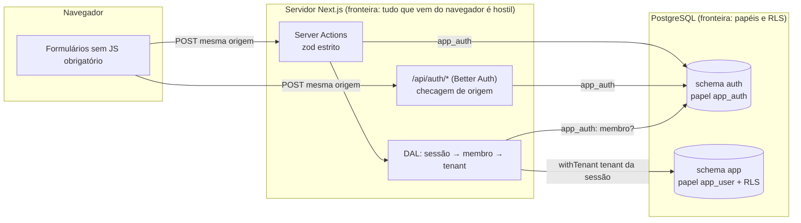

# Threat model: conta do dono, login e criação do salão (1ª entrega do E1)

- **Data:** 2026-10-30
- **Escopo:** histórias E1.1 (parcial), E1.3, E1.9 (parcial) e E1.10 do
  [backlog](../../produto/backlog-inicial.md#e1-autenticação-e-organizações), com o
  [ADR-0004](../../adr/0004-autenticacao-better-auth.md).
- **Fora desta entrega:** segundo fator (E1.2), verificação de e-mail, HIBP, Turnstile, rate
  limit em banco, convites (E1.4), remoção de membro (E1.5), recuperação de senha (E1.6) e
  sessões ativas (E1.7). Por isso a entrega tem uma **trava de produção** (A1).

## 1. Contexto

**Atores:** visitante anônimo; dono com conta e sem salão; dono com salão (`owner` da
organização); dono de OUTRO salão (atacante interno); atacante externo com lista de senhas
vazadas.

**Ativos:**

- credenciais: hash da senha (scrypt, `auth.account.password`), token de sessão;
- dados pessoais do dono: nome e e-mail (`auth.user`);
- dados do salão: nome, slug público e unidade com fuso (`app.tenants`, `app.locations`);
- o vínculo dono ↔ salão (`auth.member`), que decide o `tenant_id` de toda consulta.

**Fluxos:**

1. Cadastro: formulário (Server Action) → `auth.api.signUpEmail` → `auth.user` +
   `auth.account` → sessão (cookie `__Host-`).
2. Login: formulário → `auth.api.signInEmail` → sessão nova. Saída: `auth.api.signOut`.
3. Criação do salão: sessão válida e sem salão → Server Action com zod estrito →
   organização do Better Auth (`auth.organization` + `auth.member` com papel `owner`) →
   `app.tenants` com o MESMO id + primeira `app.locations`, por `withTenant(id)` → sessão
   aponta para a organização ativa.
4. Painel: DAL lê a sessão, confere no banco que o usuário é membro da organização ativa e
   só então abre `withTenant(organizationId)`.

## 2. Diagrama

## 3. Ameaças

| ID | STRIDE/LINDDUN | Cenário | Risco | Mitigação | Teste que prova | Status |
|---|---|---|---|---|---|---|
| A1 | E (todas) | Esta entrega ir para produção sem MFA, verificação de e-mail, HIBP e limite em banco, inclusive por esquecer `APP_ENV` no deploy | A | Trava de produção: `assertAuthAllowed` libera só `APP_ENV` da lista fechada (`development`, `test`, `e2e`, `preview`) e, sem `APP_ENV`, só fora de `NODE_ENV=production` | unidade (`config.test.ts`: produção, sem APP_ENV em build de produção, valor desconhecido) | implementado |
| A2 | S | Força bruta / credential stuffing no login | A | O limitador do Better Auth só roda no roteador HTTP e as actions chamam a API direto: limite próprio em memória (por IP 30/15 min, por e-mail e IP 10/15 min, teto por e-mail 50/15 min, recusada conta, memória cheia falha fechado), senha 12–128; limite em banco, Turnstile e HIBP na 2ª entrega | unidade (`rate-limit.test.ts`); E2E: 11ª tentativa no mesmo e-mail, mesmo com a senha certa, pede para esperar | parcial (por processo; IP só confiável atrás de proxy que sobrescreve o cabeçalho) |
| A3 | S | Sequestro ou fixação de sessão | A | cookie `__Host-salao.*`, `HttpOnly`, `Secure`, `SameSite=Lax`, sem `Domain`; `cookieCache` desligado; sessão nova a cada login | E2E confere todo `Set-Cookie`; unidade da config | implementado |
| A4 | T | CSRF no login, cadastro, saída ou criação do salão | A | Sem rota `/api/auth` (Better Auth só por Server Actions); checagem nativa de `Origin` das Server Actions; `trustedOrigins` = `APP_URL`; nunca `disableCSRFCheck`/`disableOriginCheck` | unidade: config sem `disable*`; E2E de POST com `Origin` estranho **não feito** (proteção nativa do Next) | implementado (sem E2E dedicado) |
| A5 | E / I | Dono do salão A abre o painel do salão B (troca de organização ativa, id na URL, cookie de outra pessoa) | A | `tenant_id` só da sessão; o DAL confere `auth.member` a cada requisição (`getActiveMember`) antes do `withTenant`; nenhuma rota recebe tenant por parâmetro; RLS como 2ª camada | integração: resumo do salão B não traz A; E2E: dois donos, cada um só vê o seu | implementado |
| A6 | E | Usuário sem salão acessa o painel; reenvio da action de criação (o id está no bundle) recria salão ou acrescenta unidade; membro não-dono retoma a criação | M | painel exige membro; a action redireciona quem já tem salão completo, só o `owner` retoma, e o banco só aceita a PRIMEIRA unidade na criação (`TenantOnboardingConflictError`); um salão por conta (`organizationLimit: 1`; o Better Auth só conta antes de gravar, então o banco garante com único em `member("userId")`, e o envio simultâneo que perde retoma o salão do vencedor) | integração (reenvio com outra unidade recusado; usuário em segunda organização recusado); pentest: corrida com envios simultâneos deixava dois salões (corrigido) | implementado (organização órfã do envio perdedor fica com o endereço até a limpeza, pendência) |
| A7 | T | Criação do salão pela metade (organização criada, tenant não) | M | criação idempotente: a action retoma a partir da organização existente; `app.tenants` com o mesmo id | integração: repetir com os mesmos dados devolve os mesmos ids | implementado |
| A8 | I | Enumeração de e-mail pelo cadastro ("já existe") ou pelo login | M | mensagem fixa nos dois; o login faz hash mesmo sem usuário; a diferença de comportamento no cadastro some com a verificação de e-mail (2ª entrega); A1 bloqueia produção | unidade (`messages.test.ts`); E2E: mesma mensagem para e-mail inexistente e senha errada | parcial (cadastro) |
| A9 | I | Slug do salão revela dado pessoal (telefone, CPF) ou colide com rota do sistema | M | slug validado (`^[a-z0-9-]`, 3–63), sem 8+ dígitos seguidos, lista de reservados (rotas do app e arquivos do Next) | unidade (`validation.test.ts`) | implementado |
| A10 | T | Entrada malformada nas actions (campos extras, tipos, tamanhos) | M | zod `.strict()` sobre só os campos esperados do FormData; limites iguais aos CHECKs; fuso só da lista dos 16 do Brasil | unidade | implementado |
| A11 | I | Erro do banco ou do Better Auth vaza stack, SQL ou e-mail | M | actions devolvem mensagens fixas; nada de `error.message` para o cliente; senha nunca reexibida; sem log com PII | unidade (`messages.test.ts`, `form-state.test.ts`) | implementado |
| A12 | E | Papel `app_auth` vira caminho para dado de tenant, ou `app_user` lê credenciais | A | `app_auth` só no schema `auth` (inclusive USAGE de schema) e com `search_path=auth` no papel; `app_user`/`app_worker` sem nada em `auth`; invariantes de deploy cobrem atributos, posse, privilégios e USAGE | integração: catálogo, 42501 de ponta a ponta, 10 sabotagens recusadas pelas invariantes | implementado |
| A13 | D | Cadastro em massa (custo do scrypt, lixo no banco) | M | limite próprio por IP (30 por hora); Turnstile e limite em banco na 2ª entrega | unidade (`rate-limit.test.ts`) | parcial |
| L1 | LINDDUN: Identifiability / Non-compliance | Nome e e-mail do dono em log ou URL | M | nada de PII em log, URL ou mensagem de erro; formulários por POST; sessão sem IP | revisão AppSec (sem log com PII; o aviso de e-mail existente do Better Auth é `info`, abaixo do nível padrão) | implementado |
| L2 | LINDDUN: Data disclosure | Senha ou hash exposto | A | hash scrypt do Better Auth, coluna só acessível ao `app_auth`; senha nunca logada nem devolvida | integração (privilégios e 42501) | implementado |

## 4. ASVS 5.0 L2

- **V6 Autenticação:** 6.2.1 (mínimo 12 caracteres) e 6.2.9 (até 128) nesta entrega; 6.2.12
  (HIBP), 6.3.1 (anti-automação) e 6.3.3 (MFA) na 2ª, com A1 bloqueando produção até lá.
- **V7 Sessão:** 7.2.4 (sessão nova no login) e 7.4.1 (saída invalida a sessão no servidor)
  nesta entrega.
- **V3:** 3.3.1–3.3.4 (atributos e prefixo `__Host-`) nesta entrega; 3.5.1–3.5.3 (CSRF).
- **V8 Autorização:** 8.2.2 e 8.3.1 (autorização no servidor, por organização) nesta entrega.

## 5. Suposições, riscos aceitos e perguntas

- **Suposição:** só o dono cria conta nesta entrega; a equipe entra por convite (E1.4).
- **Risco aceito (dono: mantenedor):** sem MFA, sem verificação de e-mail e sem HIBP até a
  2ª entrega. Só vale porque A1 impede produção; em `preview` não há dados reais.
- **Risco aceito (dono: mantenedor):** `auth.session.token` em texto puro (formato do Better
  Auth): quem lê o banco como `app_auth` sequestra sessões. Mitigado pelo isolamento do papel;
  expurgo das vencidas é pendência.
- **Risco aceito até a 2ª entrega:** o limite de tentativas é por processo e o limite por IP
  depende de um proxy que sobrescreva `x-real-ip`/`x-forwarded-for`; sem ele, só o limite por
  e-mail vale.
- **Não verificado:** a checagem de `Origin` das Server Actions atrás do proxy da hospedagem
  (`X-Forwarded-Host`); conflito do schema `auth` com a Data API do Neon (`pg_session_jwt`).
- **Revisões feitas:** AppSec (3 achados, corrigidos com teste), revisão automática do
  limite de tentativas (3 pontos: 2 corrigidos, IP forjável documentado), pentest de
  isolamento (nenhum vazamento entre salões; 1 achado baixo, corrigido), migrações (aprovado com
  ressalvas, tratadas), LGPD (pendências no [inventário](../../lgpd/inventario-de-dados.md#schema-auth-better-auth-1ª-entrega-do-adr-0004)).
- **Decisão:** o `app_user` não recebe `SELECT` em `auth.member`/`auth.organization`
  (diferente do ADR-0004). O DAL resolve o membro pela conexão `app_auth`, o que dá ao
  `app_user` menos privilégio.
- **Pergunta (produto):** um dono pode ter mais de um salão? Nesta entrega, não.
