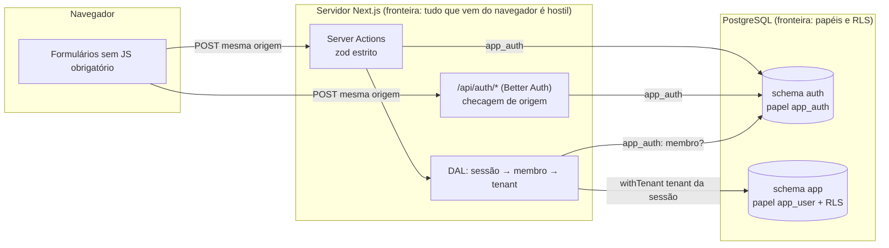

# Threat model: conta do dono, login e criação do salão (1ª entrega do E1)

- **Data:** 2026-10-30
- **Escopo:** histórias E1.1 (parcial), E1.3, E1.9 (parcial) e E1.10 do
  [backlog](../../produto/backlog-inicial.md#e1-autenticação-e-organizações), com o
  [ADR-0004](../../adr/0004-autenticacao-better-auth.md).
- **Fora desta entrega:** segundo fator (E1.2), verificação de e-mail, HIBP, Turnstile, rate
  limit em banco, convites (E1.4), remoção de membro (E1.5), recuperação de senha (E1.6) e
  sessões ativas (E1.7). Por isso a entrega tem uma **trava de produção** (A1).

## 1. Contexto

**Atores:** visitante anônimo; dono com conta e sem salão; dono com salão (`owner` da
organização); dono de OUTRO salão (atacante interno); atacante externo com lista de senhas
vazadas.

**Ativos:**

- credenciais: hash da senha (scrypt, `auth.account.password`), token de sessão;
- dados pessoais do dono: nome e e-mail (`auth.user`);
- dados do salão: nome, slug público e unidade com fuso (`app.tenants`, `app.locations`);
- o vínculo dono ↔ salão (`auth.member`), que decide o `tenant_id` de toda consulta.

**Fluxos:**

1. Cadastro: formulário (Server Action) → `auth.api.signUpEmail` → `auth.user` +
   `auth.account` → sessão (cookie `__Host-`).
2. Login: formulário → `auth.api.signInEmail` → sessão nova. Saída: `auth.api.signOut`.
3. Criação do salão: sessão válida e sem salão → Server Action com zod estrito →
   organização do Better Auth (`auth.organization` + `auth.member` com papel `owner`) →
   `app.tenants` com o MESMO id + primeira `app.locations`, por `withTenant(id)` → sessão
   aponta para a organização ativa.
4. Painel: DAL lê a sessão, confere no banco que o usuário é membro da organização ativa e
   só então abre `withTenant(organizationId)`.

## 2. Diagrama

## 3. Ameaças

| ID | STRIDE/LINDDUN | Cenário | Risco | Mitigação | Teste que prova | Status |
|---|---|---|---|---|---|---|
| A1 | E (todas) | Esta entrega ir para produção sem MFA, verificação de e-mail, HIBP e rate limit em banco | A | Trava de produção: o módulo de autenticação recusa `APP_ENV=production` até a 2ª entrega | unidade: config de auth lança com `APP_ENV=production` | a implementar |
| A2 | S | Força bruta / credential stuffing no login | A | rate limit do Better Auth (memória, ligado com `NODE_ENV=production`) agora; banco + Turnstile + HIBP na 2ª entrega; senha 12–128 | unidade (política de senha); A1 bloqueia produção | parcial |
| A3 | S | Sequestro ou fixação de sessão | A | cookie `__Host-`, `HttpOnly`, `Secure`, `SameSite=Lax`, sem `Domain`; `cookieCache` desligado; sessão nova a cada login | E2E confere todo `Set-Cookie` | a implementar |
| A4 | T | CSRF no login, cadastro, saída ou criação do salão | A | Server Actions: checagem nativa de `Origin` do Next; `/api/auth/*`: checagem de origem do Better Auth (`trustedOrigins` = `APP_URL`), nunca `disableCSRFCheck`/`disableOriginCheck` | unidade: config sem `disable*`; E2E: POST com `Origin` estranho recusado | a implementar |
| A5 | E / I | Dono do salão A abre o painel do salão B (troca de organização ativa, id na URL, cookie de outra pessoa) | A | `tenant_id` só da sessão; o DAL confere `auth.member` (usuário × organização) a cada requisição antes do `withTenant`; nenhuma rota recebe tenant por parâmetro; RLS como 2ª camada | integração: `requireTenant` recusa organização da qual o usuário não é membro; E2E: dono B não vê o salão A | a implementar |
| A6 | E | Usuário sem salão acessa o painel; usuário com salão cria um 2º salão por replay da action | M | painel exige membro; criação recusa quem já é membro (1 salão por conta nesta entrega) | E2E + integração | a implementar |
| A7 | T | Criação do salão pela metade (organização criada, tenant não) | M | criação idempotente: a action retoma a partir da organização existente; `app.tenants` com o mesmo id (`ON CONFLICT DO NOTHING`) | integração: 2ª chamada completa o que faltou | a implementar |
| A8 | I | Enumeração de e-mail pelo cadastro ("já existe") ou pelo login | M | mensagem genérica nos dois; a diferença de comportamento some com a verificação de e-mail (2ª entrega); A1 bloqueia produção | unidade: mapeamento de erros genérico | parcial |
| A9 | I | Slug do salão revela dado pessoal (telefone, CPF) ou colide com rota do sistema | M | slug validado (`^[a-z0-9-]`), sem sequência longa de dígitos, lista de slugs reservados | unidade | a implementar |
| A10 | T | Entrada malformada nas actions (campos extras, tipos, tamanhos) | M | zod `.strict()`, limites de tamanho iguais aos CHECKs do banco; fuso só da lista dos 16 do Brasil validada pelo core | unidade | a implementar |
| A11 | I | Erro do banco ou do Better Auth vaza stack, SQL ou e-mail | M | actions devolvem mensagens fixas; nada de `error.message` para o cliente; nada de PII em log | unidade + E2E (corpo da resposta) | a implementar |
| A12 | E | Papel `app_auth` vira caminho para dado de tenant, ou `app_user` lê credenciais | A | `app_auth` só tem privilégio no schema `auth`; `app_user`/`app_worker` não têm nenhum em `auth`; invariantes do deploy cobrem `app_auth` (atributos, posse e privilégios) | integração (catálogo e invariantes) | a implementar |
| A13 | D | Cadastro em massa (custo do scrypt, lixo no banco) | M | rate limit do Better Auth; Turnstile na 2ª entrega | A1 | parcial |
| L1 | LINDDUN: Identifiability / Non-compliance | Nome e e-mail do dono em log ou URL | M | nada de PII em log, URL ou mensagem de erro; formulários por POST | revisão `lgpd-check` | a implementar |
| L2 | LINDDUN: Data disclosure | Senha ou hash exposto | A | hash scrypt do Better Auth, coluna só acessível ao `app_auth`; senha nunca logada nem devolvida | integração (privilégios) | a implementar |

## 4. ASVS 5.0 L2

- **V6 Autenticação:** 6.2.1 (mínimo 12 caracteres) e 6.2.9 (até 128) nesta entrega; 6.2.12
  (HIBP), 6.3.1 (anti-automação) e 6.3.3 (MFA) na 2ª, com A1 bloqueando produção até lá.
- **V7 Sessão:** 7.2.4 (sessão nova no login) e 7.4.1 (saída invalida a sessão no servidor)
  nesta entrega.
- **V3:** 3.3.1–3.3.4 (atributos e prefixo `__Host-`) nesta entrega; 3.5.1–3.5.3 (CSRF).
- **V8 Autorização:** 8.2.2 e 8.3.1 (autorização no servidor, por organização) nesta entrega.

## 5. Suposições, riscos aceitos e perguntas

- **Suposição:** só o dono cria conta nesta entrega; a equipe entra por convite (E1.4).
- **Risco aceito (dono: mantenedor):** sem MFA, sem verificação de e-mail e sem HIBP até a
  2ª entrega. Só vale porque A1 impede produção; em `preview` não há dados reais.
- **Decisão:** o `app_user` não recebe `SELECT` em `auth.member`/`auth.organization`
  (diferente do ADR-0004). O DAL resolve o membro pela conexão `app_auth`, o que dá ao
  `app_user` menos privilégio.
- **Pergunta (produto):** um dono pode ter mais de um salão? Nesta entrega, não.
